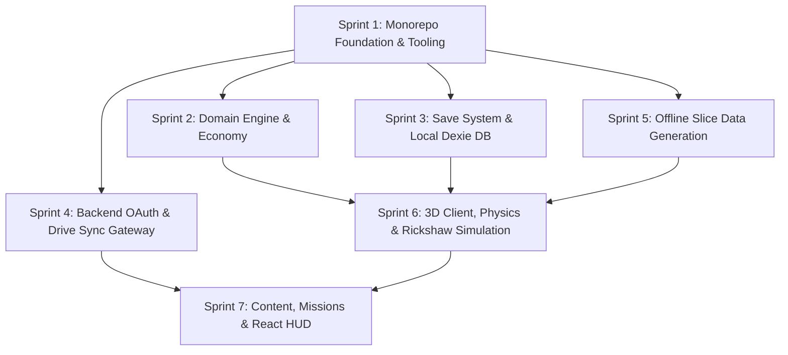

# Dhamrai Life — Phase 1 Implementation Specification

**Document Version:** 3.0.0  
**Status:** Architecture baseline complete; mathematical tests passed; independent Survey of Bangladesh ground-control validation pending; OAuth integration requires credentials; ODbL legal review pending. Phase 1 not started; explicit authorization required.  
**Phase:** 1 — Game Foundation & First Playable Slice  
**Target Delivery Date:** Phase 1 Execution Sprint  
**Author:** Lead Technical Architect & Senior Game Development Engineer  

---

## Canonical reconciliation baseline — 2 November 2026

ESRI:102954 is **provisionally adopted**. Mathematical parameter consistency is documented and round-trip tests pass. Independent Survey of Bangladesh ground-control validation remains pending. Architecture baseline complete; OAuth/Drive integration requires credentials; ODbL legal review pending. Phase 1 has not started and requires explicit authorization.

Use `WorldPosition(x,y,z)` in metres: +X east, +Y up relative to the provisional +12.0 m MSL baseline, +Z south (`z = -Δnorthing`). Rathkhola `(90.217400 E, 23.914800 N)` is `(0,0,0)`; use the transformer's full-precision projected origin (`522126.5567081776` Easting, `2644810.7821246446` Northing), not its centimetre-rounded display values (`522126.56`, `2644810.78`).

The Phase 1 projected square is `x,z ∈ [-512,512]`, 1,024 × 1,024 m, with 16 selected chunks (indices -2 through 1 on each axis). The containing WGS84 envelope, rounded **outward** from all four full-precision corners, is **[90.212361, 23.910168, 90.222439, 23.919432]** in lon/lat order. The preserved Sample B XML was queried with **[90.212362, 23.910168, 90.222438, 23.919432]**; its historical query rectangle is slightly narrower than the containing envelope and must not be described as exact projected-square clipping.

Canonical clipped road lengths in the four **historical geographic sample rectangles**: A **16.731 km**, B **9.706 km**, C **6.024 km**, D **28.531 km**. Counts and tag denominators refer to API-returned objects, including external members; only road lengths are geometrically clipped. They do not measure field completeness.

Road graph route fixtures: The route fixtures are undirected topological road graphs derived from OSM snapshot node centerlines. They do not enforce one-way restrictions, vehicle access categories, turn prohibitions, or off-road courtyard/plaza access connectors, nor do they validate legal rickshaw access. Directed edge orientation, modal access hierarchies (`access`, `vehicle`, `motor_vehicle`), and turn restrictions are planned for the Phase 1 runtime navigation graph.

Mission 1: The 552.67 m road graph fixture connects nearest road vertices between Rathkhola Stand and Hardinge High School Gate. It does NOT include the intermediate passenger pickup at Rathkhola Market Corner (+14.997, 0.0, -9.998), which lies in the open fairground plaza off the tagged OSM street network (18.0 m from origin, 46.95 m from nearest street node). The fixture is strictly an origin-to-school road graph fixture; complete passenger journey route validation is formally deferred and Phase 1 acceptance criteria adjusted accordingly. Complete passenger mission navigation is not claimed as route-validated.

Mission 3: workshop `(-295.3,0,-77.0)` to temple `(-346.2,0.5,-110.2)` has ΔX=-50.9 m, ΔZ=-33.2 m and horizontal straight-line distance **60.77 m**. OSM graph distances between nearest road vertices are **42.38 m** workshop→temple, **573.12 m** temple→Rathkhola, **534.16 m** direct delivery, **615.50 m** delivery via temple. These exclude anchor-to-road offsets (workshop **30.35 m**, temple **6.38 m**, Rathkhola **29.46 m**). The direct route misses the nearest temple vertex; the detour visits it. **Courtyard traversal is unknown for both routes**, because no verified courtyard boundary or access connector is available. An actual anchor-to-anchor road/access distance cannot yet be certified.

Chunk arithmetic: A 256 m × 256 m chunk has an area of 0.065536 km². Dividing the reported 306.84 km² area gives **4,682.0068359375 area-equivalent chunk units** (the historical 4,685 was an unvalidated rounded area approximation). A 24 km × 24 km = 576 km² envelope yields **8,789.0625 area-equivalent chunk units**, or a **94 × 94 = 8,836 chunk rectangular grid** (⌈24,000 / 256⌉ = 94 cells covering a 24.064 km square). These are mathematical area and rectangular grid estimates, not actual intersecting grid-cell counts. Actual Upazila polygon intersection counts remain unavailable because the polygon is absent. The canonical active scope for Phase 1 is strictly the verified 16 chunks (4 × 4 grid, 1,024 m × 1,024 m).

Evidence: [execution report](FINAL_PHASE_0_VALIDATION_REPORT.md), [correction/change log](PHASE_0_CORRECTION_REPORT.md), `data/sources/raw_osm_snapshot_manifest.json`, `data/sources/evidence_checksums.json`, `data/world/mission_routes.json`. All nine current Phase 0 documents use this baseline.


## 1. Phase 1 Goal & Scope Definition

The objective of **Phase 1** is to build, validate, and benchmark the **First Playable Vertical Slice** of Dhamrai Life. 

Rather than attempting to construct the entire upazila (previously reported 306.84 km², not reproduced) prematurely, Phase 1 focuses exclusively on a verified **$1,024\text{ m} \times 1,024\text{ m}$ ($16$ chunks, $4\times 4$ grid)** urban slice in central Dhamrai Municipality. In this slice, a player signs in via Google, starts as a **Rickshaw Driver (`rickshaw_wala`)**, traverses authentic streets and alleys, interacts with Bengali-speaking NPCs, operates a functional pedal rickshaw with custom raycast dynamics, completes three localized missions, and experiences durable local IndexedDB and Google Drive cloud persistence.

### 1.1 Phase 1 Bounding Box ($1,024\text{ m} \times 1,024\text{ m}$)
Centered on **Dhamrai Rathkhola Stand** ($23.914800^\circ\text{ N}, 90.217400^\circ\text{ E}$ / BUTM Easting: `522126.5567081776` m, Northing: `2644810.7821246446` m):
* **Projected X Extents:** $X \in [521,614.56\text{ m}, 522,638.56\text{ m}]$ ($\Delta X \in [-512.0\text{ m}, +512.0\text{ m}]$)
* **Projected Y Extents:** $Y \in [2,644,298.78\text{ m}, 2,645,322.78\text{ m}]$ ($\Delta Y \in [-512.0\text{ m}, +512.0\text{ m}]$)
* **4-Corner WGS84 Inverse Projection:**
  * **Southwest (SW):** $90.2123619^\circ\text{ E}, 23.9101825^\circ\text{ N}$
  * **Northwest (NW):** $90.2123770^\circ\text{ E}, 23.9194316^\circ\text{ N}$ (Defines Maximum Latitude)
  * **Southeast (SE):** $90.2224226^\circ\text{ E}, 23.9101683^\circ\text{ N}$ (Defines Minimum Latitude)
  * **Northeast (NE):** $90.2224384^\circ\text{ E}, 23.9194174^\circ\text{ N}$
* **Complete Axis-Aligned Geographic Query Envelope:**
  $$\text{Bbox} = [90.212361^\circ\text{ E}, 23.910168^\circ\text{ N}, 90.222439^\circ\text{ E}, 23.919432^\circ\text{ N}]$$
  *(Note: Due to Transverse Mercator meridian convergence, evaluating all 4 corners is mandatory to prevent truncating $\approx 1.5\text{ m}$ off the SE and NW edges).*
* **Grid Layout:** Exactly 16 chunks ($4\times 4$ grid of $256\text{ m} \times 256\text{ m}$ chunks).

### 1.2 Standardized 3D Mission Waypoints & Snapshot Road-Graph Route Fixtures
All coordinates in the game engine use the explicit 3D `WorldPosition` interface:

```ts
export interface WorldPosition {
  x: number; // Easting offset in meters (delta East)
  y: number; // Elevation offset in meters (Elevation - 12.0m baseline)
  z: number; // Inverted Northing offset in meters (-delta North, Three.js -Z forward)
}
```

The three Phase 1 missions are mathematically proven to lie strictly within the $1,024\text{ m} \times 1,024\text{ m}$ slice, with snapshot road-node routes stored in [data/world/mission_routes.json](../data/world/mission_routes.json):

1. **Mission 1 — *"দিনের প্রথম যাত্রী"* (First Fare):**
   - **Start Anchor:** Rathkhola Stand: `WorldPosition(0.0, 0.0, 0.0)`
   - **Passenger Pickup:** Rathkhola Market Corner: `WorldPosition(+15.0, 0.0, -10.0)` (plotted at `+14.997, 0.0, -9.998`)
   - **Destination:** Dhamrai Hardinge High School Gate: `WorldPosition(-73.1, +1.0, -221.3)`
   - **Route Semantics & Snapshot Graph Distance:** The current fixture measures **552.67 m (between nearest road vertices)** connecting Rathkhola Stand and Hardinge High School Gate. It is explicitly labeled as an origin-to-school road graph fixture only; the intermediate passenger pickup leg at Rathkhola Market Corner (which is located on the open fairground plaza off the tagged road network) is **pending plaza access geometry modeling**. Complete passenger journey route validation (Start $\rightarrow$ Pickup $\rightarrow$ School) is **formally deferred to Phase 1 Sprint 5 / Sprint 7**, and Phase 1 acceptance criteria are adjusted accordingly so they do not claim that the complete passenger journey is pre-validated in Phase 0.
   - **Reward:** ৳30 fare deposited atomically into append-only cash ledger.

2. **Mission 2 — *"চেকপোস্ট ও কাগজপত্র"* (Police Checkpoint):**
   - **Patrol Checkpoint:** Dhamrai Thana Junction: `WorldPosition(-61.0, 0.0, +66.5)`
   - **Location Context:** Situated on the town thoroughfare at Thana Junction, **$83.3\text{ m}$ East-Southeast (straight-line)** and **149.44 m (between snapped road vertices; access offsets excluded)** from the Dhamrai Police Station compound (`WorldPosition(-114.5, 0.0, +2.7)`). It is positioned at the active street intersection, not "directly outside" the station gate.
   - **Snapshot graph distance (from Rathkhola):** **149.70 m (snapped-node graph distance)** (11 waypoints).
   - **Objective:** Approach checkpoint, halt rickshaw, present vehicle license documents to patrol officer, resolve dialogue.
   - **Consequence:** Clean documentation check yields $+5$ civic trust reputation.

3. **Mission 3 — *"কাঁসা-পিতলের ফরমাশ"* (Artisan Order):**
   - **Pickup:** Kayetpara Metal Craft Workshop: `WorldPosition(-295.3, 0.0, -77.0)`
   - **Delivery:** Rathkhola Artisan Stand: `WorldPosition(0.0, 0.0, 0.0)`
   - **Temple Geometry & Detour Routing:**
     - Sri Sri Yashomadhab Mandir is at `WorldPosition(-346.2, +0.5, -110.2)`, which is **$50.9\text{ m}$ further west** (behind the workshop relative to the delivery direction toward Rathkhola).
     - **Direct Delivery Route:** Travels Eastward along Hujuritola road away from the temple: **534.16 m (snapped-node graph distance)** across 26 waypoints (`passes_temple_road_node = false`; courtyard traversal unknown).
     - **Cultural Blessing Detour:** Optional temple road-node visit: **615.50 m** across 33 graph waypoints. Courtyard entry is unverified; no access connector is included.
   - **Reward:** ৳75 delivery fee + artisan guild trust.

> [!NOTE]
> **Road Graph Limitations & Directed Runtime Evolution:** All Phase 0 mission routes are snapshot road-graph route fixtures derived from an undirected OSM centerline graph. The routing model does not enforce one-way restrictions, vehicle access categories (`access`, `vehicle`, `motor_vehicle`), turn prohibitions, or off-road courtyard/plaza access connectors, nor does it certify legal rickshaw access. The future Phase 1 directed runtime navigation graph (`DirectedNavGraph` in Sprint 5) will enforce directed edges (`oneway`), modal access hierarchies, conflict resolution fallbacks, and turn restrictions.

---

## 2. Monorepo Architecture & Dependencies

```text
/dhamrai-life
├── package.json                   # Root workspace (pnpm)
├── pnpm-workspace.yaml            # pnpm workspace definition
├── tsconfig.base.json             # Root TypeScript strict settings
├── apps
│   ├── web                        # React 19 + Vite + Three.js client
│   └── api                        # NestJS OAuth & Drive sync gateway
├── packages
│   ├── game-core                  # Pure TS domain rules (No DOM / No Three.js)
│   ├── save-core                  # Zod save schemas & Dexie IndexedDB
│   ├── content                    # Curated Bengali dialogue, missions, POIs
│   └── shared-contracts           # Shared DTOs and API interfaces
├── tools
│   └── geo-pipeline               # Python/pyproj BUTM2010 extraction scripts
└── data
    ├── sources                    # Manifests, licenses, audit summaries
    └── world                      # 16 chunk GLBs, manifests, road graphs
```

---

## 3. Seven Independently Testable Implementation Sprints



### Sprint 1: Monorepo Foundation & Tooling Setup
* **Dependencies:** None.
* **Deliverables:**
  - Initialize pnpm monorepo with workspace configuration.
  - Setup TypeScript strict configuration (`tsconfig.base.json`).
  - Configure Vitest for package unit tests and Playwright for browser tests.
  - Establish `@dhamrai/shared-contracts` and skeleton package folders.
* **Acceptance Gate:** `pnpm build` and `pnpm test` pass across all monorepo packages.

### Sprint 2: Domain Engine & Economy (`packages/game-core`)
* **Dependencies:** Sprint 1.
* **Deliverables:**
  - Implement immutable integer-based cash ledger (`EconomyDomain`).
  - Implement declarative `MissionDomain` state machine with idempotent payouts.
  - Implement `RickshawRole` archetype (৳250 starting cash, rented rickshaw).
* **Acceptance Gate:** Unit tests prove rewards cannot duplicate on repeated mission triggers or reload.

### Sprint 3: Save System & Local Persistence (`packages/save-core`)
* **Dependencies:** Sprint 1, Sprint 2.
* **Deliverables:**
  - Define Zod schema for Save Envelope v1 (`saveSchemaVersion: 1`).
  - Implement Dexie.js IndexedDB repository with atomic transaction commits.
  - Implement JSON backup export/import with SHA-256 payload integrity validation.
  - Implement upward schema migration runner with pre-migration snapshot isolation.
* **Acceptance Gate:** IndexedDB transactions commit atomically; corrupt save payloads are rejected safely without data loss.

### Sprint 4: Backend OAuth & Google Drive Sync Service (`apps/api`)
* **Dependencies:** Sprint 1, Sprint 3.
* **Deliverables:**
  - Build NestJS server with `POST /auth/google` verifying Google ID token signatures and stable `sub`.
  - Implement OAuth authorization-code exchange for `drive.appdata` scope.
  - Implement AES-256-GCM token encryption at rest in PostgreSQL.
  - Implement `GET /cloud-save` and `PUT /cloud-save` with optimistic concurrency lease locking.
* **Acceptance Gate:** Backend authenticates test token, accesses Drive `appDataFolder`, and prevents concurrent save overwrites.

### Sprint 5: Offline Geographic Slice Generation (`tools/geo-pipeline`)
* **Dependencies:** Sprint 1.
* **Deliverables:**
  - Clip OSM data to the $1,024\text{ m} \times 1,024\text{ m}$ bounding box.
  - Transform geometry to local metric coordinates using `coordinate_transform.py` (`ESRI:102954`).
  - Generate directed runtime road graph JSON (`DirectedNavGraph`) parsing `oneway`, `access`, `vehicle`, `motor_vehicle`, and `type=restriction` relations; author Rathkhola fairground pedestrian/plaza access connectors to connect the Market Corner pickup.
  - Generate 3D road meshes with camber and embankments.
  - Extrude procedural 2.5D building footprints with texture atlasing.
  - Partition into 16 chunk GLB files with Meshopt compression.
* **Acceptance Gate:** All 16 chunks pass `QA-GEO-01` through `QA-BUDGET-05` validation checks.

### Sprint 6: 3D Client, Physics & Rickshaw Simulation (`apps/web`)
* **Dependencies:** Sprint 2, Sprint 3, Sprint 5.
* **Deliverables:**
  - Mount Three.js WebGL 2 canvas inside React with capability detection.
  - Integrate Rapier 3D WASM kinematic character controller (walk/sprint).
  - Implement first-person and third-person camera director with collision avoidance.
  - Implement raycast vehicle controller for pedal rickshaw (acceleration, steering, braking, bell sound, enter/exit prompt with 'F' key).
  - Build `ChunkStreamer` maintaining the $3\times 3$ active ring ($9$ chunks) and disposing unneeded GPU assets.
* **Acceptance Gate:** Player walks and rides seamlessly across all 16 chunks without collision clipping; Low profile meets $\ge 30\text{ FPS}$ target.

### Sprint 7: Content, Missions & React HUD (`apps/web`)
* **Dependencies:** Sprint 4, Sprint 6.
* **Deliverables:**
  - Author authentic Bengali NPC and police dialogue with correct Unicode font shaping.
  - Wire the three Phase 1 missions into the game runtime.
  - Build React HUD displaying current locality, cash balance (৳), active objective, and minimap.
  - Wire Google login, Drive cloud sync status, and JSON export/import screens.
* **Acceptance Gate:** End-to-end user journey succeeds: Login $\rightarrow$ Rickshaw Driver start $\rightarrow$ Complete 3 missions $\rightarrow$ Reload tab $\rightarrow$ Resume state with identical cash and mission journal.

---

## 4. Phase 1 Acceptance Criteria & Verification Gates

1. **Build Gate:** `pnpm build` succeeds with zero TypeScript errors under strict mode.
2. **WebGL 2 Compatibility:** Runs on Chrome, Edge, Firefox, Safari desktop; graceful fallback message on unsupported systems.
3. **Slice Containment:** All 16 chunks render without seam tears or missing colliders.
4. **Performance Gate:** Measures $\ge 30\text{ FPS}$ on Low profile (Intel UHD 620 target) and $\ge 60\text{ FPS}$ on Medium profile.
5. **Camera Toggle:** Seamless toggle between first-person and third-person views on foot and while pedaling.
6. **Vehicle Mechanics:** Enter rickshaw with 'F', pedal with 'W', steer with 'A/D', brake with 'S', sound bell with 'Space', exit cleanly.
7. **Economic Invariant:** Cash balance matches the exact sum of append-only ledger events.
8. **Mission Completion & Routing Scope:** All three missions can be completed in Phase 1 runtime. Complete end-to-end passenger journey path validation for Mission 1 (incorporating Rathkhola plaza pedestrian access from Stand to Market Pickup) is formally deferred to Phase 1 runtime authoring and is NOT claimed as pre-validated by the Phase 0 road snapshot. Duplicate rewards cannot be obtained by reloading.
9. **Bengali Typography:** Correct font shaping and ligatures across all supported browsers.
10. **Local Durability:** Tab reload restores coordinates, cash, vehicle state, and missions from IndexedDB.
11. **Cloud Persistence:** Save payload syncs to Google Drive `appDataFolder`; separate browser profile restores progress.
12. **Offline Tolerance:** Disconnecting network permits uninterrupted play and local saves; reconnecting syncs changes.
13. **Conflict Resolution:** Concurrent multi-device edits trigger explicit conflict resolution without data loss.
14. **JSON Backup:** Save export and import functions reliably restore game state.
15. **Attribution Display:** Map/About screen displays required OpenStreetMap ODbL credit.
