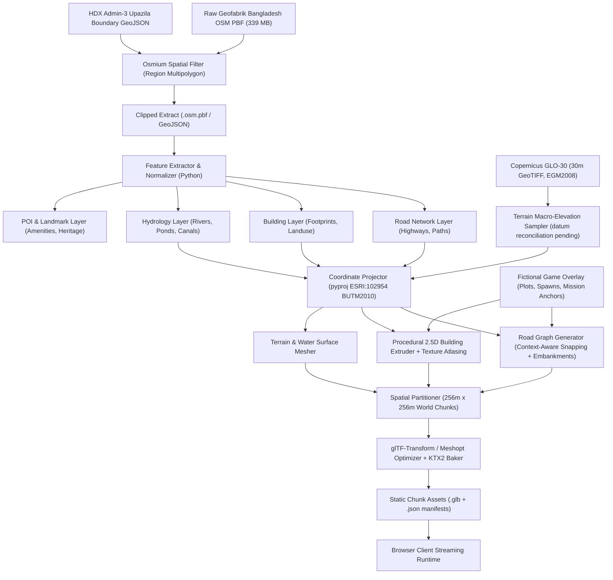

# Dhamrai Life — World Data Extraction & Processing Pipeline Design

**Document Version:** 3.0.0  
**Status:** Architecture baseline complete; mathematical tests passed; independent Survey of Bangladesh ground-control validation pending; OAuth integration requires credentials; ODbL legal review pending. Phase 1 not started; explicit authorization required.  
**Author:** Lead Technical Architect & Senior Game Development Engineer  

---

## Canonical reconciliation baseline — 2 November 2026

ESRI:102954 is **provisionally adopted**. Mathematical parameter consistency is documented and round-trip tests pass. Independent Survey of Bangladesh ground-control validation remains pending. Architecture baseline complete; OAuth/Drive integration requires credentials; ODbL legal review pending. Phase 1 has not started and requires explicit authorization.

Use `WorldPosition(x,y,z)` in metres: +X east, +Y up relative to the provisional +12.0 m MSL baseline, +Z south (`z = -Δnorthing`). Rathkhola `(90.217400 E, 23.914800 N)` is `(0,0,0)`; use the transformer's full-precision projected origin (`522126.5567081776` Easting, `2644810.7821246446` Northing), not its centimetre-rounded display values (`522126.56`, `2644810.78`).

The Phase 1 projected square is `x,z ∈ [-512,512]`, 1,024 × 1,024 m, with 16 selected chunks (indices -2 through 1 on each axis). The containing WGS84 envelope, rounded **outward** from all four full-precision corners, is **[90.212361, 23.910168, 90.222439, 23.919432]** in lon/lat order. The preserved Sample B XML was queried with **[90.212362, 23.910168, 90.222438, 23.919432]**; its historical query rectangle is slightly narrower than the containing envelope and must not be described as exact projected-square clipping.

Canonical clipped road lengths in the four **historical geographic sample rectangles**: A **16.731 km**, B **9.706 km**, C **6.024 km**, D **28.531 km**. Counts and tag denominators refer to API-returned objects, including external members; only road lengths are geometrically clipped. They do not measure field completeness.

Road graph route fixtures: The route fixtures are undirected topological road graphs derived from OSM snapshot node centerlines. They do not enforce one-way restrictions, vehicle access categories, turn prohibitions, or off-road courtyard/plaza access connectors, nor do they validate legal rickshaw access. Directed edge orientation, modal access hierarchies (`access`, `vehicle`, `motor_vehicle`), and turn restrictions are planned for the Phase 1 runtime navigation graph.

Mission 1: The 552.67 m road graph fixture connects nearest road vertices between Rathkhola Stand and Hardinge High School Gate. It does NOT include the intermediate passenger pickup at Rathkhola Market Corner (+14.997, 0.0, -9.998), which lies in the open fairground plaza off the tagged OSM street network (18.0 m from origin, 46.95 m from nearest street node). The fixture is strictly an origin-to-school road graph fixture; complete passenger journey route validation is formally deferred and Phase 1 acceptance criteria adjusted accordingly. Complete passenger mission navigation is not claimed as route-validated.

Mission 3: workshop `(-295.3,0,-77.0)` to temple `(-346.2,0.5,-110.2)` has ΔX=-50.9 m, ΔZ=-33.2 m and horizontal straight-line distance **60.77 m**. OSM graph distances between nearest road vertices are **42.38 m** workshop→temple, **573.12 m** temple→Rathkhola, **534.16 m** direct delivery, **615.50 m** delivery via temple. These exclude anchor-to-road offsets (workshop **30.35 m**, temple **6.38 m**, Rathkhola **29.46 m**). The direct route misses the nearest temple vertex; the detour visits it. **Courtyard traversal is unknown for both routes**, because no verified courtyard boundary or access connector is available. An actual anchor-to-anchor road/access distance cannot yet be certified.

Chunk arithmetic: A 256 m × 256 m chunk has an area of 0.065536 km². Dividing the reported 306.84 km² area gives **4,682.0068359375 area-equivalent chunk units** (the historical 4,685 was an unvalidated rounded area approximation). A 24 km × 24 km = 576 km² envelope yields **8,789.0625 area-equivalent chunk units**, or a **94 × 94 = 8,836 chunk rectangular grid** (⌈24,000 / 256⌉ = 94 cells covering a 24.064 km square). These are mathematical area and rectangular grid estimates, not actual intersecting grid-cell counts. Actual Upazila polygon intersection counts remain unavailable because the polygon is absent. The canonical active scope for Phase 1 is strictly the verified 16 chunks (4 × 4 grid, 1,024 m × 1,024 m).

Evidence: [execution report](FINAL_PHASE_0_VALIDATION_REPORT.md), [correction/change log](PHASE_0_CORRECTION_REPORT.md), `data/sources/raw_osm_snapshot_manifest.json`, `data/sources/evidence_checksums.json`, `data/world/mission_routes.json`. All nine current Phase 0 documents use this baseline.


## 1. Overview & Architecture Goals

The World Data Pipeline is an **offline, reproducible data build system** written in Python and Node.js. It transforms raw geospatial datasets (OSM PBF extracts, boundary shapefiles, elevation rasters) into lightweight, versioned, browser-streamable 3D world chunks, road navigation graphs, and collision geometry.

### Core Non-Negotiable Rules
1. **Zero Runtime OSM Calls:** The browser client never contacts public Overpass or Nominatim APIs at runtime. All data is preprocessed into immutable static assets.
2. **Strict Coordinate Determinism:** Transformations from geodetic WGS84 to local metric game coordinates use the provisionally adopted BUTM 2010 projection (`ESRI:102954`) implemented via `pyproj`.
3. **Reproducibility & Provenance:** Every exported chunk, road edge, and building mesh must reference its source dataset version and pipeline commit.
4. **Legal Separation:** Fictional game overlays (plots, quest anchors, character identities) are stored strictly in separate JSON data layers, supporting the studio's intended licensing treatment; counsel must review ODbL Produced Work/Derivative Database classification before release.

---

## 2. End-to-End Pipeline Architecture



---

## 3. Coordinate System & Axis Conventions

### 3.1 Provisionally Adopted CRS: `ESRI:102954` (`BUTM2010`)
* **Projection Method:** Transverse Mercator (`EPSG:9807`)
* **Ellipsoid / Datum:** WGS 84 (`EPSG:4326`)
* **Latitude of Origin:** $0^\circ 00' 00''\text{ N}$ | **Central Meridian:** $90^\circ 00' 00''\text{ E}$
* **Scale Factor:** $0.9996$ | **False Easting:** $500,000.0\text{ m}$ | **False Northing:** $0.0\text{ m}$
* **Software Identifier:** Cataloged under authority `ESRI:102954` (an ESRI registry code, NOT an EPSG code). Provisionally adopted matching the Survey of Bangladesh's declared BUTM 2010 parameters.

### 3.2 Standard Three.js Coordinate Space
The local game world anchors $(0, 0, 0)$ at **Dhamrai Rathkhola Stand** ($23.914800^\circ\text{ N}, 90.217400^\circ\text{ E}$, provisional $+12.0\text{ m}$ MSL):
* Authoritative Projected Easting ($X_{\text{origin}}$): **`522126.5567081776`** meters (display rounded: $522,126.56\text{ m}$)
* Authoritative Projected Northing ($Y_{\text{origin}}$): **`2644810.7821246446`** meters (display rounded: $2,644,810.78\text{ m}$)

$$\begin{aligned}
X_{\text{game}} &= \text{Easting} - 522126.5567081776\text{ m} \quad &&(+X = \text{East}, -X = \text{West}) \\
Y_{\text{game}} &= \text{Elevation} - 12.0\text{ m} \quad &&(+Y = \text{Up}, -Y = \text{Down}) \\
Z_{\text{game}} &= -(\text{Northing} - 2644810.7821246446\text{ m}) \quad &&(+Z = \text{South}, -Z = \text{North})
\end{aligned}$$

---

## 4. Road Graph & Context-Aware Snapping

### 4.1 Context-Aware Topological Snapping Rule
The previous draft used an unconditional $0.75\text{ m}$ proximity snapping rule. To prevent erroneously welding close parallel service roads, dual-carriageway centerlines, or grade-separated bridges, the snapping algorithm enforces strict contextual constraints:

```python
def should_snap_nodes(node_a, node_b, way_a, way_b, max_distance=0.5):
    # 1. Proximity check (reduced from 0.75m to 0.5m)
    dist = calculate_distance(node_a, node_b)
    if dist > max_distance:
        return False
        
    # 2. Vertical grade separation guard
    if way_a.tags.get("layer", "0") != way_b.tags.get("layer", "0"):
        return False  # Never weld bridge/flyover nodes to ground roads
        
    # 3. Opposing one-way dual carriageway guard
    if way_a.tags.get("oneway") == "yes" and way_b.tags.get("oneway") == "yes":
        if is_parallel_opposing_vector(way_a, way_b):
            return False  # Never collapse divided highway lanes into a single line
            
    # 4. Highway class compatibility
    # Do not weld residential footpath nodes directly into high-speed trunk centerlines
    if is_incompatible_class(way_a.tags.get("highway"), way_b.tags.get("highway")):
        return False
        
    return True
```

### 4.2 Road Cross-Section & Embankment Generation
Because 30m DEM elevation data cannot resolve micro-scale road embankments, cross-sections are generated using **procedural engineering approximations**:
* **Road Camber:** $1.5\%$ crown slope toward shoulders for drainage.
* **Road Embankment Berms:** $35^\circ$ sloping grass/dirt berms descending $-1.0\text{ m}$ to $-1.5\text{ m}$ to meet adjacent lowlands.
* **Procedural Width Assumptions:**
  * National Highway (N5 - Corridor scope): $12.0\text{ m}$ (4 lanes)
  * Regional Highways (R503): $6.5\text{ m}$ (2 lanes)
  * Town Residential Streets: $4.0\text{ m}$ (shared space)
  * Rural Unpaved Tracks: $3.0\text{ m}$ (single lane with passing bays)

### 4.3 Graph Semantics: Phase 0 Snapshot Fixtures vs. Phase 1 Directed Runtime Navigation Graph

A strict architectural distinction is maintained between Phase 0 static snapshot fixtures and the future Phase 1 runtime navigation graph:

#### 1. Phase 0 Snapshot Fixtures (Undirected Planar Graph)
- **Nature:** Extracted offline from raw snapshot `sample_b_phase1_slice.xml` highway way centerlines.
- **Topology:** Simple undirected graph with edges weighted strictly by 2D Euclidean distance on the projected horizontal plane.
- **Scope & Limitations:** Evaluates graph connectivity and topological distance bounds between nearest road vertices. Strictly **ignores** `oneway`, `access`, `motor_vehicle`, `vehicle`, turn prohibitions, and off-road plaza/courtyard links.
- **Non-Claim:** Does **not** validate or imply legal rickshaw access or certified real-world vehicular drivability. Complete passenger journey route validation for Mission 1 is formally deferred pending plaza access authoring.

#### 2. Phase 1 Directed Runtime Navigation Graph (`DirectedNavGraph`)
Planned for Phase 1 Sprint 5 / Sprint 6 to drive player rickshaw path-following aids and NPC vehicle AI. Tag interpretation rules:
* **`oneway` Rules:**
  - `oneway=yes`, `oneway=1`, `oneway=true`: Generates directed edge $(u \rightarrow v)$ matching way node order.
  - `oneway=-1`, `oneway=reverse`: Generates directed edge $(v \rightarrow u)$ opposing way node order.
  - `oneway=no` or untagged: Generates symmetric directed edges $(u \rightarrow v)$ and $(v \rightarrow u)$.
  - **Modal Exception:** Respects `oneway:bicycle=no` / `oneway:rickshaw=no` where local municipal traffic rules permit non-motorized contraflow on secondary/residential town roads with width $\ge 4.0\text{ m}$.
* **`access` Hierarchy & Fallbacks:**
  - Fallback root tag: `access` $\rightarrow$ `vehicle` $\rightarrow$ `motor_vehicle` / `bicycle` (pedal rickshaw is classified under non-motorized `vehicle` / `cycle_rickshaw`).
  - `access=no` / `access=private`: Edge is marked non-routable for all general traffic unless an explicit sub-tag (`rickshaw=yes` or `bicycle=yes`) grants exemption.
  - `access=permissive` / `access=yes`: Edge is routable.
* **`vehicle` vs. `motor_vehicle` Discrimination:**
  - If `motor_vehicle=no` but `vehicle=yes` (or untagged): Rickshaws are permitted (e.g., pedestrian-prioritized bazaar streets allowing human-powered vehicles).
  - If `vehicle=no`: Rickshaws are strictly excluded (e.g., formal pedestrian footpaths, staircases, temple inner sanctums).
* **Missing or Conflicting Access Tag Defaults (Dhamrai Peri-Urban Context):**
  - Highway types `trunk`, `primary`, `secondary`, `tertiary`, `residential`, `unclassified`, `living_street`, `service`: Default to `vehicle=yes`, `rickshaw=yes`.
  - Highway types `footway`, `pedestrian`, `path`, `steps`: Default to `vehicle=no` (rickshaws barred; accessible only by player on foot).
  - **Conflict Resolution:** If `access=no` conflicts with an open vehicular highway class without qualifying tags, autonomous NPC vehicles treat the link as impassable; player rickshaw will trigger a visual warning/barrier.
* **Turn Restrictions (`type=restriction`):**
  - Modeled via OSM Relation `type=restriction` (`no_left_turn`, `no_right_turn`, `no_u_turn`, `only_straight_on`) with roles `from`, `via`, `to`.
  - Enforced in Dijkstra / A* state space via edge-pair expansion: traversal cost from `from_edge` to `to_edge` is set to $\infty$.
  - Where turn restrictions are absent in OSM data (rural/peri-urban Dhamrai core), geometric steering angle penalties ($> 120^\circ$ sharp turns penalized for 3-wheel rickshaw dynamics) are injected dynamically at runtime.

---

## 5. Procedural Building Generation Strategy

### 5.1 Footprint Processing & Clean-up
* Footprints with self-intersecting loops or $< 3$ vertices are rectified using Douglas-Peucker simplification ($0.2\text{ m}$ tolerance).
* Slivers with interior angles $< 15^\circ$ are rectified.

### 5.2 Deterministic Typology Extrusion
Using a deterministic seed keyed to the OSM Way ID, footprints are extruded:
1. **Height Estimation:** Height $= \text{floor\_count} \times 3.0\text{ m}$.
   * Footprint $< 50\text{ m}^2$: 1 story ($3.0\text{ m}$), tin roof (*dochala* or flat).
   * Footprint $50 - 150\text{ m}^2$: 2-3 stories ($6.0\text{ m} - 9.0\text{ m}$), mixed brick/concrete.
   * Footprint $> 150\text{ m}^2$: 3-5 stories ($9.0\text{ m} - 15.0\text{ m}$), commercial market/parapet roof.
2. **Civic & Institutional Protection Rule:**
   * **Footprint area alone NEVER designates a building's civic function.**
   * A large footprint is extruded as a generic commercial/residential massing unless explicit OSM semantic tags (`amenity=school`, `amenity=police`, `healthcare=hospital`) or curated `data/content/landmarks.json` entries exist.
3. **Texture Atlasing:** Walls, windows, and roofs share a single $2048\times 2048$ texture atlas per chunk, enabling batching into a single `MeshStandardMaterial` draw call.

---

## 6. Hydrology & Terrain Modeling

### 6.1 Elevation Data Limitations & Usage
* **Copernicus GLO-30:** Provides regional macro-topography ($12\text{ m} - 15\text{ m}$ assumed regional baseline; raster validation pending).
* **Limitation:** Horizontal $30\text{ m}$ posting cannot resolve road crowns or pond retaining walls.
* **Provisional Ground Baseline:** Rathkhola is set to provisional $+12.0\text{ m}$ MSL ($Y=0.0$).
* **Foundation Skirts:** Road centerlines and building foundations are projected onto terrain using a vertical foundation skirt to prevent geometry gaps or floating foundations on sloping ground.

### 6.2 Fluvial Hydrology
* **Main Bangshi River (OSM Way `48492816`):** Eastern upazila boundary watercourse; rendered as wide polygonal river mesh with slow-flowing silty water shader (`#4A4737`).
* **Puran Bangshi Loop (OSM Way `48493150`):** Northwestern town channel; rendered as meandering canal with vegetated banks.
* **Excavated Ponds (*Pukur*):** Stepped basins embedded into terrain tiles with water planes placed $-1.0\text{ m}$ below the adjacent courtyard level.

---

## 7. World Chunking Strategy & Streaming Architecture

### 7.1 Chunk Dimension: $256\text{ m} \times 256\text{ m}$
* **Dimensions:** $256\text{ m} \times 256\text{ m}$ ($0.065536\text{ km}^2$ per chunk).
* **Traversal Time:**
  * Rickshaw speed ($12\text{ km/h}$ / $3.33\text{ m/s}$): **$76.8\text{ seconds}$** per chunk.
  * Driving speed ($45\text{ km/h}$ / $12.5\text{ m/s}$): **$20.5\text{ seconds}$** per chunk.
* **Total Chunk Counts Across World Scales:**
  * **Phase 1 Vertical Slice ($1,024\text{ m} \times 1,024\text{ m}$):** Exactly **$16$ chunks** ($4\times 4$ grid, canonical active scope).
  * **Dhamrai Upazila Area-Equivalent ($306.84\text{ km}^2$):** $306.84\text{ km}^2 / 0.065536\text{ km}^2 = \mathbf{4,682.0068359375}$ **area-equivalent chunk units**. (The historical 4,685 was an unvalidated rounded area approximation; actual polygon intersection counts remain unavailable because the polygon geometry is absent).
  * **Dhamrai Upazila Bounding Envelope ($24\text{ km} \times 24\text{ km} = 576\text{ km}^2$):** $576\text{ km}^2 / 0.065536\text{ km}^2 = \mathbf{8,789.0625}$ **area-equivalent units**, or a $\mathbf{94 \times 94 = 8,836}$ **chunk rectangular grid** ($\lceil 24,000 / 256 \rceil = 94$ whole cells on each side covering a $24.064\text{ km}$ square). These are mathematical area and rectangular grid estimates, not actual intersecting grid-cell counts.

### 7.2 Streaming Ring Architecture
* **Core Active Ring ($3\times 3 = 9$ chunks):** Full visual meshes, active Rapier physics colliders, active NPC traffic agents. ($768\text{ m} \times 768\text{ m}$ area).
* **Prefetch / Cache Ring ($5\times 5 = 25$ chunks max):** Assets fetched in memory; colliders inactive; traffic agents unsimulated. ($1,280\text{ m} \times 1,280\text{ m}$ area).
* **Unload Threshold:** Chunks beyond the $5\times 5$ ring are cleanly disposed (geometries, textures, materials, and physics bodies freed from WebGL context and WASM heap).

---

## 8. Standardized Performance & Asset Budgets

*Note: All parameters are engineering targets to be validated during Phase 1 hardware benchmarking.*

| Parameter | Budget Target | Hard Rejection Ceiling | Notes |
|---|---|---|---|
| **Compressed GLB Size / Chunk** | **$\le 1.5\text{ MB}$** | **$2.5\text{ MB}$** | Meshopt compressed geometry |
| **Average Town Chunk Size** | $\approx 800\text{ KB} - 1.2\text{ MB}$ | $2.5\text{ MB}$ | Includes building meshes and road surfaces |
| **Triangles in View (Low Profile Target)** | $\le 120,000$ | $180,000$ | Intel UHD 620 target |
| **Draw Calls / Frame (Low Profile Target)** | $\le 180$ | $250$ | Material batching enforced |
| **VRAM Texture Memory** | $\le 250\text{ MB}$ | $350\text{ MB}$ | KTX2 Basis Universal GPU compressed |
| **Active Colliders in Physics** | $\le 200$ | $350$ | Simplified box/capsule colliders |

---

## 9. Quality Assurance & Region-Aware Validation

Validation checks in `tools/geo-pipeline` are **region-aware** to prevent false rejections during future expansions:

```yaml
validation_checks:
  - id: QA-GEO-01
    name: "Region-Aware Boundary Containment"
    rule: |
      If chunk.region == 'dhamrai_main':
        Chunk bounds must intersect OSM Relation 4730829 (Dhamrai Upazila).
      Else if chunk.region == 'savar_ju_extension':
        Chunk bounds must intersect Savar Upazila / Jahangirnagar University polygon (697.56 acres boundary).
      Else:
        Reject chunk with UNKNOWN_REGION error.
  
  - id: QA-TOPO-02
    name: "Road Graph Seam Continuity"
    rule: "Road edges crossing chunk boundaries must snap to identical 3D coordinates within 0.001m."
  
  - id: QA-ROUTING-03
    name: "Destination Traversability"
    rule: "A simulated Dijkstra pathfind from Rathkhola (0,0,0) to Hardinge High School (-73.1, 1.0, -221.3) must succeed without disconnection."

  - id: QA-COLLISION-04
    name: "Watertight Hulls"
    rule: "Rapier collision hulls must be watertight convex/trimesh hulls with no degenerate zero-area triangles."

  - id: QA-BUDGET-05
    name: "Asset Budget Enforcement"
    rule: "Chunk GLB must not exceed 2.5 MB compressed, and triangle count must not exceed 40,000 tris per chunk."
```
