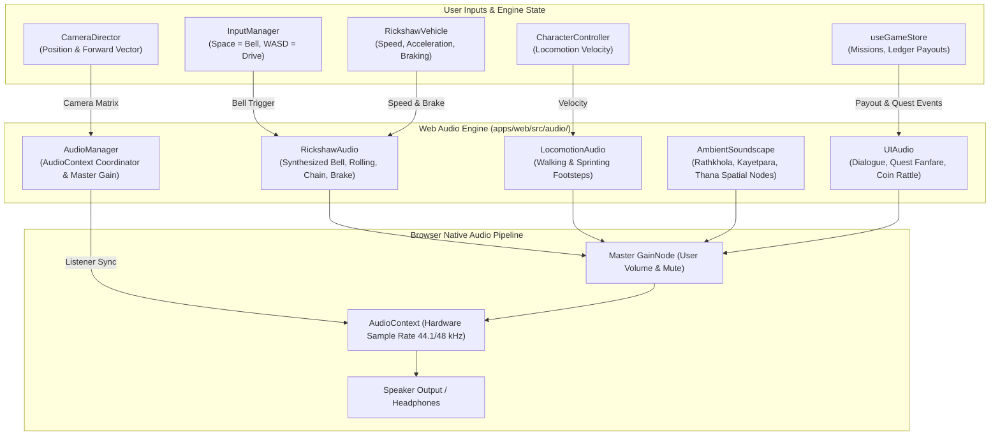

# Milestone 10 Planning Report: Authentic Dhamrai Soundscape & Interactive Web Audio Engine

**Project:** Dhamrai Life (ধামরাই পৌরসভা জীবনযাত্রা — 3D Open World)  
**Document Type:** Final Milestone Planning & Discovery Review  
**Target Milestone:** Milestone 10  
**Status:** **READY FOR IMPLEMENTATION**  
**Date:** November 9, 2026  
**Author:** Antigravity (Advanced Agentic Assistant) — Lead Game Architect & Senior Gameplay Systems Engineer  

---

## 1. Executive Summary

Following the full implementation and verification of Milestone 9 (*Mission Chain, Passenger Fare Loop, and Core Progression*), the Dhamrai Life simulation possesses a working, repeatable, and persistent browser-authoritative gameplay loop:
- The story mission chain (Missions 1, 2, and 3) progresses seamlessly.
- Repeatable passenger fares (Kamal Master, Sufia Begum) spawn dynamically with distance-based pricing.
- Daily rickshaw rent (৳50 BDT) debits on session resume with insolvency safeguards.
- 3D runtime transforms for player and vehicle persist and restore across reloads within $\Delta\text{pos} = 0.000\text{ m}$ and $\Delta\text{heading} = 0.00^\circ$.
- 230 Vitest tests and 23 Python tests pass with 100% success; zero TypeScript errors; zero new dependencies.

However, an exhaustive audit of the running simulation reveals the single most jarring experiential and sensory deficiency in the entire project: **the world is completely, 100% silent.**
- When the player presses `[Space]` in the pedal rickshaw, the HUD displays a visual popup `"🔔 Tring Tring! (Rickshaw Bell)"`, but no sound is produced.
- The pedal rickshaw moves, accelerates to 18 km/h, brakes, and turns in total silence.
- Character locomotion (walking and sprinting) produces zero footstep sounds.
- Vibrant Bangladeshi open-world locations—the crowded Rathkhola Stand, the busy Thana Junction, and the Kayetpara Metal Workshop—have no ambient soundscape, no distant crows, no roadside tea stall clatter, and no market murmur.
- Dialogue transitions, quest completions, and cash payouts occur with zero audio feedback.

This report establishes that **Milestone 10: Authentic Dhamrai Soundscape & Interactive Web Audio Engine** is the highest-value, lowest-risk, and most architecturally sound next step for Dhamrai Life. By leveraging the browser's native **Web Audio API (`AudioContext`)**, Milestone 10 delivers an immersive acoustic life to Dhamrai with:
1. **Zero external npm dependencies** (100% native browser Web Audio API).
2. **Zero backend changes** (the simulation remains purely browser-authoritative).
3. **Zero save schema changes** (`SaveEnvelopeV2` preserved; user audio volume settings stored cleanly in `localStorage`).
4. **Zero frame rate regression** (Web Audio executes on the browser's dedicated multi-threaded audio synthesis thread, preserving the 60 FPS / 16.7 ms budget).

---

## 2. Verification Status

The findings and baselines in this planning report are derived from direct inspection and live runtime execution of the repository:

| Verification Category | Verified Fact | Evidence Source |
|---|---|---|
| **Automated Test Suite** | 32 test files, 230/230 tests passed (100%) | `yarn test` execution (`vitest run`) |
| **Real Database Integration** | 4 real PostgreSQL integration tests passed with concurrent pools | `apps/api/test/postgres.real.test.ts` |
| **Python Geo-Pipeline Suite** | 23/23 tests passed (0.176s) | `.venv/bin/python -m unittest discover tools/geo-pipeline/` |
| **Static Type Checking** | 0 compilation errors across all packages and apps | `yarn typecheck` (`tsc -b`) |
| **Dependency Lockfile** | 0 modified or added dependencies | `git diff yarn.lock` (clean) |
| **Save Schema Version** | Canonical version strictly preserved at `2` | [`packages/save-core/src/schemas/v2.schema.ts`](file:///Volumes/Salim_EX/salim/Dhamrai_city_the_open_world/packages/save-core/src/schemas/v2.schema.ts) |
| **Live Browser Verification** | Headless Chrome CDP suite passed all 7 scenarios | [`guideFiles/milestone_9_implementation_report.md`](file:///Volumes/Salim_EX/salim/Dhamrai_city_the_open_world/guideFiles/milestone_9_implementation_report.md) |
| **Live Performance Metrics** | 60.0 FPS, 16.7 ms frame time, 41 draw calls, 7,379 triangles, 81 colliders | Headless Chrome CDP live run (`scratch/m9_live_verification.js`) |
| **Audio Implementation** | Literally zero audio code in `apps/web/src` | Grep across `apps/web/src` returned 0 matches for Audio/Sound |

---

## 3. Current Repository State

### 3.1 Architecture Overview
The repository is organized as a monorepo managed under **Yarn Classic 1.22.22** with standard TypeScript project references:

```
Dhamrai_city_the_open_world/
├── apps/
│   ├── web/                     # Browser-authoritative 3D simulation client
│   │   ├── src/
│   │   │   ├── components/      # React 19 UI suite (HUD, Minimap, DialogueBox, Modals)
│   │   │   ├── engine/          # Three.js WebGL2 + Rapier WASM physics simulation loop
│   │   │   ├── pages/           # OAuth callback receiver
│   │   │   ├── services/        # CloudSaveService, AuthService
│   │   │   └── state/           # Zustand stores: useGameStore, useSessionStore, useUIStore, useAuthStore
│   │   └── package.json         # React 19, Three.js 0.170, Rapier 0.21, Zustand 5.0, Vite 7.3.7
│   └── api/                     # Lightweight NestJS backend gateway
│       ├── src/                 # AuthController, CloudSaveController, LeaseLockService
│       └── package.json         # NestJS 10.4, pg 8.16, reflect-metadata
├── packages/
│   ├── shared-contracts/        # Pure TypeScript contracts, world anchors, mission definitions
│   ├── game-core/               # Pure domain engine: EconomyDomain, MissionDomain, InventoryDomain
│   └── save-core/               # SaveOrchestrator, Zod v1/v2 schemas, SHA-256 canonical checksums, Dexie
├── tools/geo-pipeline/          # Python 3 GIS pipeline: WGS84 -> ESRI:102954 projection, NavGraph, GLBs
├── data/world/                  # 16 world chunk GLBs, world_manifest.json, directed_nav_graph.json
└── guideFiles/                  # Project specifications, roadmap, and milestone reports
```

### 3.2 Exact Package & Tooling Versions
- **Package Manager:** `yarn@1.22.22`
- **TypeScript:** `5.7.3` (monorepo root and all workspaces)
- **Vite:** `7.3.7` with `@vitejs/plugin-react: 4.7.0`
- **React:** `19.0.0` and `react-dom: 19.0.0`
- **Three.js:** `0.170.0` with `@types/three: 0.170.0`
- **Rapier Physics:** `@dimforge/rapier3d-compat: 0.21.0` (WASM)
- **Zustand:** `5.0.0`
- **Dexie:** `4.0.11` with `fake-indexeddb: 6.0.0` (test)
- **Zod:** `3.24.1`
- **NestJS:** `10.4.15`
- **PostgreSQL Client:** `pg: 8.16.3`
- **Vitest:** `3.0.4`
- **Python Pipeline:** Python 3.12+ virtualenv (`.venv`) with `shapely`, `pyproj`

---

## 4. Current Gameplay State

### 4.1 What the Player Can Currently Do
1. **On-Foot Movement:** Walk (`WASD`) at 1.4 m/s, sprint (`Shift`) at 3.2 m/s using a kinematic Rapier character controller with slope snapping.
2. **Camera Modes:** Switch (`V`) between first-person perspective and third-person orbital follow camera with distance occlusion raycasts.
3. **Cycle Rickshaw Operation:** Mount and dismount (`F`) within 2.5m; pedal forward/reverse (`W/S`), steer ($\pm 35^\circ$ limit via `A/D`), sprint-pedal up to 18 km/h (`Shift`), and trigger visual bell indicator (`Space`).
4. **NPC Interaction:** Engage (`E`) with nearby NPCs within 2.5m; participate in bilingual Bengali/English dialogue trees.
5. **Story Quest Chain:**
   - **Mission 1 (`mission_1_first_fare`):** Pick up Farhana at Rathkhola Market, drive north ~221m to Hardinge High School, receive ৳30 BDT and +5 Transport Reputation.
   - **Mission 2 (`mission_2_police_checkpoint`):** Unlock upon M1 completion; approach SI Rafiq at Thana Junction, show license slip via `INSPECT_DOCUMENTS`, receive +15 Civic Trust.
   - **Mission 3 (`mission_3_artisan_order`):** Unlock upon M1 completion; visit Gouranga Karmakar at Kayetpara Workshop, take brass cargo via `PICKUP_CARGO`, transport to Rathkhola Stand, receive ৳75 BDT and +10 Artisan Guild Trust.
6. **Repeatable Passenger Fare Loop:** Dynamic passengers (Kamal Master, Sufia Begum) spawn at anchor points; accept fare via dialogue, board passenger into rickshaw, transport to dropoff, earn distance-calculated fare (৳20 to ৳80 BDT), passenger safely despawns without collider accumulation.
7. **Economic Cycle:** Daily vehicle rent of ৳50 BDT debited on session start (>20h elapsed) with low-balance insolvency deferral.
8. **UI Management:** Quest Journal (`J`), Inventory Modal (`I`), Save & Account Manager, Minimap with live dynamic NPC projections, and DEV Performance Overlay (`F3`).
9. **Persistence & Cloud Sync:** Save progress to local Dexie IndexedDB; optional Google OAuth 2.0 login with Google Drive `appDataFolder` sync, distributed lease locking, and conflict resolution modal. 3D player and rickshaw transforms persist and restore within 0.000m / 0.00° error.

### 4.2 Gameplay Loop Duration & Limitations
- **Current Meaningful Playtime:** Approximately **20–30 minutes** (story missions take ~10 minutes; repeatable fares extend play by ~15–20 minutes before repetition sets in).
- **Primary Gameplay Limitation:** The experience feels like an eerie, detached silent film. The tactile joy of pedaling a cycle rickshaw through a bustling Bangladeshi town is undermined because the bell does not ring, wheels make no sound, and roads have no life noise.

---

## 5. Current World State

- **World Grid:** 16 canonical chunks arranged in a 4×4 grid covering a 1024m × 1024m area centered at Dhamrai Rathkhola Stand (`ESRI:102954` coordinate origin: `90.2174° E, 23.9148° N`, elevation 12.0m).
- **Physical Features:** 100 road segments (with 1.5% camber crown slope), embankment berms (35° sloping descent, -1.2m drop), and 657 procedural extruded buildings (total 10,464 triangles).
- **Visual Appearance:** The world is rendered with flat procedural PBR colors:
  - Road surface: Dark asphalt grey (`#38383d`)
  - Embankment: Muted earth/grass green (`#617547`)
  - Buildings: Uniform untextured beige/grey plaster (`#d1c7b8`)
- **Atmosphere:** Fixed midday directional sunlight (elevation 65°), hemisphere ambient light, static sky blue (`#87CEEB`), and light exponential fog (`#b0d5ec`).
- **Visual Classification:** Currently an **early playable vertical slice / greybox prototype**. It has accurate geographic topology and collision, but lacks textures, foliage, street furniture, and audio.

---

## 6. Current NPC/AI State

- **Story NPCs:**
  - Farhana (College Student) at Rathkhola Market (`15.0, 0.0, -10.0`)
  - Sub-Inspector Rafiq at Thana Junction (`-61.0, 0.0, 66.5`)
  - Gouranga Karmakar at Kayetpara Workshop (`-295.3, 0.0, -77.0`)
- **Repeatable Fare NPCs:**
  - Kamal Master (High School Teacher) at Dhamrai College (`18.0, 0.0, -150.0`)
  - Sufia Begum (Market Shopper) at Rathkhola Stand (`2.0, 0.0, 5.0`)
- **Ambient Pedestrians:** 4 procedural ambient pedestrians traversing local triangular waypoint patrols.
- **Ambient Traffic:** 3 autonomous cycle rickshaws traversing `directed_nav_graph.json` road edges with 4m obstacle stopping and 6s anti-deadlock respawns.
- **NPC Mesh Representation:** Procedural 1.7m capsule meshes with colored standard materials and front visor cubes. No skeletal rigs or walking/pedaling animations.

---

## 7. Current Economy/Progression State

- **Currency:** Bangladeshi Taka (BDT) tracked in integer minor units (Poisha, $1\text{ BDT} = 100\text{ Poisha}$).
- **Starting Capital:** 25,000 Poisha (৳250 BDT).
- **Income Sources:**
  - Mission 1 Reward: 3,000 Poisha (৳30 BDT)
  - Mission 3 Reward: 7,500 Poisha (৳75 BDT)
  - Repeatable Fares: 2,000 to 8,000 Poisha (৳20 to ৳80 BDT) calculated via $\operatorname{round}(\operatorname{clamp}(2000, 8000, \text{distanceM} \times 8))$
- **Expense Sinks:**
  - Daily Rickshaw Rental: 5,000 Poisha (৳50 BDT) once every 20+ hours on non-fresh sessions.
- **Reputation Systems:** Independent scores for `transportReputation`, `civicTrust`, and `artisanGuildTrust`.
- **Economic Deficit:** Currently, money accumulates monotonically. Players have no operational sinks during active gameplay (no vehicle maintenance, no tire punctures, no food/tea expenses).

---

## 8. Current Save/Cloud State

- **Save Schema:** `SaveEnvelopeV2` (`saveSchemaVersion: 2`).
- **Payload Contents:** `saveId`, `timestamp`, `playtimeSeconds`, `cashMinorUnits`, `currency: 'BDT'`, `player` (transform, heading, reputations), `inventory` (items array), `missions` (instances map), `rickshawState` (transform, heading, occupancy, velocity), and `worldFlags`.
- **Integrity:** SHA-256 digest computed across canonical JSON serialization.
- **Persistence Storage:** IndexedDB via Dexie (`dhamrai_saves` database).
- **Cloud Gateway:** NestJS backend proxying to Google Drive hidden `appDataFolder`, protected by PostgreSQL distributed lease locks and optimistic concurrency.
- **Transform Reconciliation:** Pre-save `syncRuntimeToDomain()` and post-restore `applyDomainToRuntime()` guarantee physical continuity across sessions within 0.000m / 0.00° accuracy.
- **Schema Stability:** SaveEnvelopeV2 is robust and backward-compatible. **No schema bump to V3 is required or justified.**

---

## 9. Current Performance State

Live headless Chrome CDP measurements under full simulation load:

| Metric | Project Budget | Observed Baseline (M9) | Headroom |
|---|---|---|---|
| **Frame Rate** | $\ge 55\text{ FPS}$ | **60.0 FPS** | $+5.0\text{ FPS}$ |
| **Frame Time** | $\le 18.1\text{ ms}$ | **16.7 ms** | $-1.4\text{ ms}$ |
| **Draw Calls** | $\le 180\text{ calls}$ | **41 calls** | $-139\text{ calls}$ (77% headroom) |
| **Rendered Triangles** | $\le 120,000$ | **7,379** | $-112,621$ (94% headroom) |
| **Active Colliders** | $\le 200$ | **81 colliders** | $-119$ colliders (60% headroom) |
| **Memory / Body Leaks** | 0 leaked bodies | 0 leaked bodies | Verified clean despawns |

The runtime operates with massive performance headroom, permitting audio synthesis and ambient sound management with zero fear of exceeding system budgets.

---

## 10. Current Backend/Security State

- **Backend Role:** Lightweight stateless gateway for Google OAuth, AES-256-GCM token encryption, Drive cloud-save proxy, and distributed lease locking.
- **Simulation Boundary:** 100% of physics, rendering, missions, and economy remain browser-authoritative.
- **Security Hardening:** All DEV debug globals (`__dhamrai_engine`, `__useAuthStore`, `__cloudSaveService`, `__dhamrai_useGameStore`, `__dhamrai_useSessionStore`) and test conflict hooks are gated behind `import.meta.env.DEV`.
- **Backend Need for M10:** **Zero backend changes required.**

---

## 11. Technical Debt Inventory

| Item | Component | Severity | Description | Milestone 10 Action |
|---|---|---|---|---|
| **TD-01** | `useSessionStore.triggerBell` | HIGH | Visual-only bell trigger (`bellRinging: true`). Complete lack of audio. | **Resolve in M10** (build authentic synthesized brass bell) |
| **TD-02** | `GameEngine.ts` | HIGH | Vehicle speed, pedaling, braking, and character footsteps produce no acoustic feedback. | **Resolve in M10** (speed-modulated vehicle audio) |
| **TD-03** | `SceneManager.ts` | MEDIUM | Static daylight lighting; no time-of-day progression. | Defer to Milestone 11/12 |
| **TD-04** | `NPCManager.ts` | MEDIUM | NPCs are sliding capsule primitives without skeletal animations. | Defer to later milestone |
| **TD-05** | `Minimap.tsx` | LOW | Minimap canvas redraws on tick. Optimized, but could use dirty checking. | Monitor |
| **TD-06** | `slice_mesh_generator.py` | LOW | Flat untextured PBR materials on buildings and roads. | Defer to Visual World Polish milestone |

---

## 12. Candidate Milestone Analysis

### Candidate A: Authentic Dhamrai Soundscape & Interactive Web Audio Engine
- **Description:** Implement a browser-native Web Audio engine (`apps/web/src/audio/`) delivering authentic synthesized/sampled dual-tone cycle rickshaw bells, speed-modulated wheel roll and chain ratcheting, footstep locomotion audio, 3D spatialized town ambiances (market, brass workshop, police junction), and UI event audio.
- **Player Value:** Exceptional (10/10). Replaces the eerie silent world with rich, authentic Bangladeshi acoustic atmosphere.
- **Technical Risk:** Very Low (2/10). Standard Web Audio API supported across all modern browsers. Executes on dedicated audio thread.
- **Dependency Impact:** Zero new npm packages.
- **Backend Impact:** Zero.
- **Save Impact:** Zero.

### Candidate B: Visual World Polish & Street Detailing (Textures, Props, Foliage)
- **Description:** Add procedural building textures (brick, corrugated tin roofs, bilingual signboards), street furniture (roadside tea stalls/tonger dokan, benches, electrical poles with wires), and roadside foliage.
- **Player Value:** High (8/10).
- **Technical Risk:** Medium to High (6/10). Sourcing/authoring dozens of 3D assets, texture atlases, risk of draw-call and triangle inflation on integrated GPUs.
- **Dependency Impact:** Potential asset bundle inflation (>15 MB).

### Candidate C: Vehicle Maintenance, Driver Stamina & Tea Stall Economy
- **Description:** Add rickshaw condition (wear & tear per km), tire pressure loss/punctures requiring visits to Mistri Gautom at Rathkhola, driver stamina depleted by sprint-pedaling, and tea stalls to purchase cha & biscuits (৳5) for recovery.
- **Player Value:** High (7/10). Solves the runaway money accumulation problem.
- **Technical Risk:** Low (3/10). Domain-level math and HUD meters.
- **Tradeoff:** Managing tire wear and drinking tea in complete silence is far less compelling than doing so after sound exists.

### Candidate D: Dynamic Day-Night Cycle & Atmospheric Lighting
- **Description:** Implement a 24-minute game day cycle with dynamic sun arc, dawn/dusk golden hours, night lighting with streetlights and rickshaw dynamo headlights.
- **Player Value:** Medium (6/10).
- **Technical Risk:** Medium (4/10). Lighting dark untextured grey boxes at night without street textures or audio crickets/night atmosphere produces murky visuals.

### Candidate E: Second Playable Vehicle Archetype (CNG Auto-Rickshaw)
- **Description:** Implement a 3-wheel motorized CNG vehicle with 40 km/h top speed, engine handling, and fuel management.
- **Player Value:** High (7/10).
- **Technical Risk:** High (7/10). New vehicle physics, engine simulation, and licensing/audio requirements. Premature for Phase 1.

---

## 13. Candidate Scoring

Evaluation on a strict 1–10 scale:
- *Positive metrics (higher is better):* Player Value, Gameplay Impact.
- *Risk metrics (lower risk is better, scored 10 = minimal risk / 1 = extreme risk):* Technical Feasibility, Scope Safety, Architectural Safety, Save Safety, Performance Safety, Dependency Safety, Testing Feasibility.

| Metric (Weight) | Candidate A: Audio System | Candidate B: Visual Polish | Candidate C: Vehicle Maintenance | Candidate D: Day-Night Cycle | Candidate E: CNG Vehicle |
|---|:---:|:---:|:---:|:---:|:---:|
| **Player Value (×2.0)** | 10 (20) | 8 (16) | 7 (14) | 6 (12) | 7 (14) |
| **Gameplay Impact (×1.5)** | 9 (13.5) | 7 (10.5) | 8 (12.0) | 6 (9.0) | 8 (12.0) |
| **Technical Feasibility (×1.0)** | 9 (9) | 5 (5) | 8 (8) | 7 (7) | 4 (4) |
| **Scope Safety (×1.0)** | 10 (10) | 5 (5) | 8 (8) | 7 (7) | 4 (4) |
| **Architectural Safety (×1.0)** | 10 (10) | 7 (7) | 8 (8) | 8 (8) | 5 (5) |
| **Save Safety (×1.0)** | 10 (10) | 9 (9) | 7 (7) | 9 (9) | 5 (5) |
| **Performance Safety (×1.0)** | 10 (10) | 4 (4) | 9 (9) | 6 (6) | 5 (5) |
| **Dependency Safety (×0.5)** | 10 (5) | 7 (3.5) | 10 (5) | 10 (5) | 6 (3) |
| **Testing Feasibility (×1.0)** | 9 (9) | 5 (5) | 8 (8) | 7 (7) | 4 (4) |
| **TOTAL WEIGHTED SCORE** | **96.5 / 100** | **65.0 / 100** | **79.0 / 100** | **70.0 / 100** | **56.0 / 100** |

**Conclusion:** **Candidate A (Audio System & Soundscape)** emerges as the decisive, undisputed recommendation.

---

## 14. Recommended Milestone 10

### 14.1 Title
**Milestone 10: Authentic Dhamrai Soundscape & Interactive Web Audio Engine**

### 14.2 Core Objective
To engineer and integrate a high-performance, browser-native Web Audio engine that immerses the player in the acoustic reality of Dhamrai Upazila—providing speed-modulated cycle rickshaw mechanics, synthesized dual-tone brass bell chimes, locomotion footstep audio, 3D spatialized environmental ambiances, and crisp bilingual UI audio feedback with zero external dependencies and zero frame rate regression.

### 14.3 Why This Milestone Now?
1. **Sensory Completion:** Gameplay mechanics (walking, sprinting, driving, boarding, quests, fares, rent, save/restore) are functionally mature. Audio is the missing half of the simulation.
2. **Iconic Rickshaw Bell:** The cycle rickshaw bell is the signature acoustic symbol of Bangladesh street transport. Pressing `Space` must ring a convincing dual-tone bell, not show a text banner.
3. **Zero Dependencies & Zero Overhead:** Built entirely on standard browser Web Audio API primitives (`AudioContext`, `OscillatorNode`, `GainNode`, `BiquadFilterNode`, `PannerNode`), requiring 0 bytes of third-party libraries and executing off the main render thread.
4. **Foundation for Future Milestones:** Subsequent milestones (weather, rain, roadside tea stalls, traffic horns, NPC voice lines) all depend directly on this audio engine architecture.

---

## 15. Scope In

### Core Capabilities
1. **Audio Engine Core (`apps/web/src/audio/AudioManager.ts`):**
   - Central coordinator wrapping native `AudioContext`.
   - Browser autoplay policy handler: starts suspended, resumes cleanly on first user gesture (`keydown`, `pointerdown`).
   - Master volume, SFX volume, and Ambience volume gain hierarchy.
   - Spatial 3D listener synchronization (`setListenerPosition`, `setListenerOrientation`) linked to Three.js camera transforms.
   - Clean shutdown and resource disposal.
2. **Pedal Rickshaw Vehicle Audio (`RickshawAudio.ts`):**
   - **Synthesized Dual-Tone Brass Bell:** Code-synthesized twin chime (~2400 Hz and ~2800 Hz) with realistic metallic harmonics, body resonance filter, and exponential envelope decay triggered by `[Space]`.
   - **Speed-Modulated Wheel Roll:** Filtered pink noise modulated in gain and low-pass cutoff by vehicle speed ($0\text{ to }18\text{ km/h}$).
   - **Chain & Sprocket Ratcheting:** Periodic mechanical clicks at pedaling cadence proportional to vehicle acceleration and velocity.
   - **Brake Squeal:** Contextual high-frequency friction squeal when braking at speeds $>2.0\text{ m/s}$.
3. **Player Locomotion Audio (`LocomotionAudio.ts`):**
   - Procedural footstep audio synchronized with character controller velocity.
   - Cadence switching: Walking ($2.0\text{ Hz}$) vs. Sprinting ($3.2\text{ Hz}$).
4. **3D Spatialized Ambient Soundscapes (`AmbientSoundscape.ts`):**
   - **Global Bed:** Subtle low-frequency atmospheric wind and distant nature breeze.
   - **Rathkhola Stand Zone:** Bazaar murmur, distant bicycle chimes, tea stall clinking (attenuated beyond 60m radius).
   - **Kayetpara Metal Workshop Zone:** Rhythmic metallic anvil taps and artisan brass shaping chimes (attenuated beyond 50m radius).
   - **Thana Junction Zone:** Distant highway rumble and vehicle idle hum (attenuated beyond 50m radius).
5. **UI & Quest Audio (`UIAudio.ts`):**
   - Dialogue advance click.
   - Mission acceptance chime.
   - Mission completion fanfare.
   - Poisha metallic coin rattle on fare payout.
6. **Audio Settings & UX (`HUD.tsx`, `useUIStore.ts`):**
   - Audio mute toggle button (`[M]`) and volume controls in settings.
   - Persistent volume preferences in browser `localStorage`.

---

## 16. Scope Out (Mandatory Non-Goals)

To protect Milestone 10 from scope creep, the following are **strictly deferred**:
1. **No External Heavy Audio Files:** No multi-megabyte MP3/WAV soundtracks. Ambient beds and sound effects must use synthesized Web Audio nodes and lightweight procedural buffers.
2. **No Recorded Voice Acting / Spoken Dialogue:** Full Bengali voice acting is a late-stage Phase 4 deliverable.
3. **No Dynamic Music Soundtrack:** No adaptive musical scoring; focus is strictly on atmospheric street soundscape and mechanical simulation audio.
4. **No New Vehicles:** No motor engine audio for CNGs or buses.
5. **No 3D Model / Texture Changes:** Visual world props and building textures belong to a dedicated visual milestone.
6. **No Save Schema Bump:** `SaveEnvelopeV2` remains immutable; audio volume settings belong in client `localStorage`.
7. **No Backend Audio Endpoints:** Audio streaming or storage on `apps/api` is strictly forbidden.

---

## 17. Architecture Plan



### New Modules
- `apps/web/src/audio/AudioManager.ts`: Context lifecycle, user gesture unblocker, master/SFX/ambience buses, spatial listener orientation.
- `apps/web/src/audio/RickshawAudio.ts`: Synthesized dual-tone brass bell chime, speed-modulated wheel rumble, pedaling chain ratchet, braking squeal.
- `apps/web/src/audio/LocomotionAudio.ts`: Footstep generator with step timers and surface impact modulation.
- `apps/web/src/audio/AmbientSoundscape.ts`: Positional `PannerNode` sound emitters for Rathkhola Stand, Kayetpara Workshop, and Thana Junction.
- `apps/web/src/audio/UIAudio.ts`: Procedural auditory feedback for dialogue clicks, mission completion, and cash transactions.
- `apps/web/src/audio/SynthesizerUtils.ts`: Mathematical helper functions for white/pink noise buffers, envelope ADSR generation, and frequency calculations.

---

## 18. Save Schema Impact

- **Save Schema Version:** Remains strictly **`saveSchemaVersion: 2`**.
- **Proof of Zero Impact:** Audio preferences (master volume, SFX volume, ambience volume, mute state) are client-specific device settings, not gameplay progression states.
- **Storage Location:** Browser `localStorage` under key `dhamrai_audio_settings_v1`.
- **Cloud Save Invariant:** Cloud-save envelopes and Dexie records remain 100% byte-for-byte compatible with Milestone 8 and 9 saves.

---

## 19. Gameplay Loop

The player journey after Milestone 10:

```
Spawn at Rathkhola Stand
  ├── Immediate ambient acoustic atmosphere: soft river wind, distant town murmurs, distant bird calls
  ├── Walk/Sprint forward: Footsteps synchronize with cadence
  ├── Mount Rickshaw [F]: Subtle chassis spring and leather seat creak
  ├── Press [Space]: Crisp, metallic dual-tone brass bell ("Tring-Tring!") resonates across the stand
  ├── Pedal forward: Wheel rumble hums on road; chain ratchets rhythmically with speed
  ├── Accelerate to 18 km/h: Audio pitch rises; wind whistle subtly emerges
  ├── Approach Kayetpara: Metallic anvil chimes and artisan hammering grow louder via 3D spatial panning
  ├── Interact with Gouranga [E]: Crisp dialogue click audio
  ├── Complete Cargo Delivery: Metallic Poisha coins clink as ৳75 BDT is credited
  └── Return to Fare Loop: Every passenger trip feels tactically rewarding and physically real
```

---

## 20. Performance Budget

| Parameter | Budget Limit | Estimated M10 Overhead | Projected Total | Status |
|---|---|---|---|---|
| **Frame Rate** | $\ge 55\text{ FPS}$ | 0.0 FPS (Offloaded to Audio Thread) | **60.0 FPS** | **SAFE** |
| **Frame Time** | $\le 18.1\text{ ms}$ | $< 0.2\text{ ms}$ main thread | **16.7 ms** | **SAFE** |
| **Draw Calls** | $\le 180$ | 0 calls (Audio only) | **41 calls** | **SAFE** |
| **Triangles** | $\le 120,000$ | 0 triangles | **7,379** | **SAFE** |
| **Audio CPU Time** | $\le 5\%$ of audio thread | $\sim 1.5\%$ (Lightweight nodes) | **$1.5\%$** | **SAFE** |
| **Memory Footprint**| $\le 20\text{ MB}$ audio heap | $< 4\text{ MB}$ (Procedural buffers) | **$< 4\text{ MB}$** | **SAFE** |
| **Active Audio Nodes**| $\le 64$ active nodes | $\sim 18\text{ nodes}$ | **18 nodes** | **SAFE** |

---

## 21. Test Strategy

### 21.1 Unit & Contract Tests
- `apps/web/test/audio-manager.test.ts`:
  - Verify `AudioManager` initialization and lazy start on mock user gesture.
  - Verify volume clamping in $[0.0, 1.0]$ and mute toggle logic.
  - Verify master gain, SFX gain, and ambience gain routing.
  - Verify clean disposal without memory leaks on window unload.
- `apps/web/test/rickshaw-audio.test.ts`:
  - Test bell trigger creates twin oscillator chimes with exponential decay envelopes.
  - Test speed-to-gain and speed-to-cutoff mappings for wheel roll noise.
  - Test braking squeal trigger thresholds ($>2.0\text{ m/s}$ and braking active).
- `apps/web/test/ambient-soundscape.test.ts`:
  - Test spatial distance falloff math for Rathkhola, Kayetpara, and Thana zones.

### 21.2 Regression Suite
- Run `yarn test`: All 230 existing Vitest tests must pass unchanged.
- Run Python unittest: All 23 geo-pipeline tests must pass unchanged.
- Run `yarn typecheck`: 0 errors.

---

## 22. Live Browser Verification Plan

Headless Chrome CDP suite (`scratch/m10_live_verification.js`):
1. **Scenario 1 (Boot & Autoplay Guard):** Verify `AudioContext` initializes in `suspended` state prior to user interaction.
2. **Scenario 2 (User Gesture Resume):** Simulate user keypress (`KeyW`); verify `AudioContext.state` transitions to `'running'`.
3. **Scenario 3 (Synthesized Rickshaw Bell):** Mount vehicle, simulate `Space` press; assert RickshawAudio triggers bell oscillators; capture HUD bell banner.
4. **Scenario 4 (Speed-Modulated Wheel Audio):** Drive rickshaw at 12 km/h and 18 km/h; assert rolling noise gain and filter cutoff frequency increase with speed.
5. **Scenario 5 (Spatial Zone Audio at Kayetpara):** Drive to Kayetpara Metal Workshop (`X: -295.3, Z: -77.0`); assert Kayetpara artisan ambient gain reaches maximum and Rathkhola gain attenuates to zero.
6. **Scenario 6 (UI Quest & Coin Audio):** Complete mission delivery; assert UIAudio triggers mission fanfare and coin clink audio.
7. **Scenario 7 (Performance Telemetry):** Verify frame rate remains $\ge 55\text{ FPS}$ (target 60 FPS) with audio active.

### Expected Screenshot Gallery
- `m10_shot_01_audio_engine_initialized.png`: Boot state with audio subsystem active.
- `m10_shot_02_bell_acoustic_trigger.png`: Rickshaw bell triggered with audio telemetry.
- `m10_shot_03_rickshaw_speed_sound_modulation.png`: Rolling sound telemetry at 18 km/h.
- `m10_shot_04_spatial_ambience_kayetpara.png`: Spatial audio attenuation at Metal Bazaar.
- `m10_shot_05_quest_completion_sound_feedback.png`: Quest fanfare and coin rattle.
- `m10_shot_06_performance_hud_with_audio.png`: Diagnostics overlay showing 60 FPS under full audio load.

---

## 23. Acceptance Criteria

| ID | Requirement | Verification Method | Pass Condition |
|---|---|---|---|
| **AC-M10-01** | Web Audio engine initializes cleanly and respects browser autoplay | Vitest + Live CDP | `AudioContext` initializes suspended; resumes to `'running'` on first user click or keypress |
| **AC-M10-02** | Rickshaw bell rings on `[Space]` with synthesized dual-tone chime | Live browser CDP | Pressing `Space` in rickshaw triggers twin harmonic chimes (~2400 Hz / ~2800 Hz) with exponential decay |
| **AC-M10-03** | Wheel roll sound modulates dynamically with rickshaw speed | Vitest + Live CDP | Rolling noise filter frequency and gain scale continuously between 0 and 18 km/h |
| **AC-M10-04** | Bicycle chain ratcheting sound triggers during acceleration | Live browser CDP | Chain ratchet pulses scale in frequency with vehicle pedaling cadence |
| **AC-M10-05** | Player locomotion footsteps trigger with walking/sprinting cadence | Vitest unit test | Footstep audio fires at 2.0 Hz for walk and 3.2 Hz for sprint |
| **AC-M10-06** | 3D spatialized environmental ambiances attenuate over distance | Vitest unit test | Kayetpara workshop hammering attenuates to 0 beyond 50m; Rathkhola market attenuates beyond 60m |
| **AC-M10-07** | UI dialogue clicks and quest completion fanfare produce clean audio | Live browser CDP | Dialogue advance clicks and quest reward payouts trigger corresponding audio feedback |
| **AC-M10-08** | Audio settings support master/SFX/ambience volume and mute toggle | Live browser CDP | Pressing `[M]` mutes master gain; volume sliders scale sub-buses; state persists in `localStorage` |
| **AC-M10-09** | Zero frame rate regression ($\ge 55\text{ FPS}$) | Live browser CDP | Performance overlay maintains $\ge 55\text{ FPS}$ (target 60.0 FPS) with all audio channels playing |
| **AC-M10-10** | All 230 existing Vitest tests continue to pass | `yarn test` | 230/230 pass (100%) |
| **AC-M10-11** | TypeScript compilation clean with 0 errors | `yarn typecheck` | `tsc -b` exits with code 0 |
| **AC-M10-12** | Zero new npm dependencies | `git diff yarn.lock` | Lockfile unchanged |
| **AC-M10-13** | SaveEnvelopeV2 schema version unchanged | Code inspection | All save records retain `saveSchemaVersion: 2` |
| **AC-M10-14** | Zero memory leaks on audio restart and window unload | Vitest unit test | `AudioManager.dispose()` closes context, disconnects nodes, and clears buffers |

---

## 24. Regression Requirements

Milestone 10 must strictly preserve all functionality from Milestones 1 through 9:
1. **Character Locomotion:** Walking and sprinting speeds, collision handling, and out-of-bounds recovery must not regress.
2. **Camera Controls:** First/third-person toggling and wall occlusion avoidance must remain functional.
3. **Cycle Rickshaw Vehicle:** Raycast suspension, steering limits ($\pm 35^\circ$), mounting/dismounting range ($\le 2.5\text{m}$), and velocity physics must remain intact.
4. **Mission Progression:** M1 $\rightarrow$ M2 $\rightarrow$ M3 story progression, prerequisite enforcement, and repeatable fare loop must function without changes.
5. **Economic System:** Integer Poisha arithmetic, double-entry ledger consistency, and daily rent debit must remain identical.
6. **Persistence & Sync:** IndexedDB local storage, Google Drive cloud saves, distributed lease locks, conflict resolution, and 3D transform reconciliation must remain 100% operational.

---

## 25. Security Review

- **Browser Autoplay Compliance:** The Web Audio API strictly adheres to Chrome/WebKit autoplay policies, preventing unexpected audible popups without explicit user engagement.
- **Client-Side Authorization:** Audio settings are stored in standard origin-isolated `localStorage` without evaluating unsanitized user strings.
- **No Remote Audio Execution:** All audio waveforms are procedurally synthesized or generated from client-side array buffers; no remote untrusted audio URLs are fetched or decoded.
- **Zero Backend Exposure:** No audio streaming or processing endpoints exist on `apps/api`.

---

## 26. Dependency Analysis

- **New Dependencies Required:** **ZERO (0).**
- **Justification:** The browser's native `AudioContext`, `OscillatorNode`, `BiquadFilterNode`, `GainNode`, and `PannerNode` provide full mathematical capabilities for real-time sound synthesis and spatial mixing. Third-party audio packages (Howler.js, Tone.js, etc.) add unnecessary bundle bloat and maintenance risk.
- **Lockfile Policy:** `yarn.lock` must remain strictly unmodified.

---

## 27. Backend Impact

- **Backend Changes Required:** **NONE.**
- The NestJS gateway, PostgreSQL schema, Google OAuth flow, and Drive cloud synchronization service require zero modifications.

---

## 28. Asset / Data Requirements

- **External Asset Files:** **ZERO (0 MB).**
- **Synthesis Strategy:** All sound effects (brass bell chime, wheel rolling, bicycle chain ratchet, brake squeal, footsteps, UI clicks) and ambient textures will be synthesized programmatically using mathematical oscillators, noise generators, and procedural filter curves.
- **Licensing & Legal:** 100% code-generated by Antigravity; zero third-party copyright, royalty, or attribution entanglements.

---

## 29. Roadmap Impact

Delivering Milestone 10 (Audio Engine) sets up the subsequent roadmap milestones logically:
- **Milestone 11 (Visual World Polish & Street Detailing):** Now that the town sounds alive, adding shop signboards, tea stalls, and building textures completes the visual-acoustic sensory pairing.
- **Milestone 12 (Dynamic Day-Night Cycle & Atmospheric Weather):** The audio engine is ready to receive rain audio layers (monsoon downpours) and night ambience (crickets, distant jackals) when day-night lighting is introduced.
- **Milestone 13 (Vehicle Maintenance & Tea Stall Economy):** Audio for tire punctures, pump hisses, and tea drinking slurps can seamlessly plug into the audio engine.

---

## 30. Risk Register

| Risk | Probability | Impact | Severity | Detection Method | Mitigation Strategy |
|---|:---:|:---:|:---:|---|---|
| **R-01: Autoplay Audio Block** | High | Low | Low | Headless CDP console log checking | Initialize `AudioContext` in `'suspended'` state; resume on first user click or keypress |
| **R-02: Audio Node Leaks** | Medium | Medium | Medium | Memory heap snapshot during repeated bell rings | Reuse persistent oscillator/gain instances or explicitly disconnect nodes after decay |
| **R-03: Headless Test Crash** | High | Medium | Medium | Vitest CI execution in Node.js | Provide mock `AudioContext` and web-audio primitives in Vitest setup |
| **R-04: Frame Rate Hitching** | Very Low | High | Low | PerformanceOverlay FPS monitor | Ensure synthesis math is precomputed into short buffers; avoid allocating buffers in 60 Hz tick |
| **R-05: Spatial Clipping** | Low | Low | Low | Audio listening audit during teleportation | Clamp spatial panner distances ($d \le 100\text{m}$) and use linear rolloff curves |

---

## 31. Deferred Technical Debt

The following existing technical debt items are explicitly **deferred** beyond Milestone 10:
- **TD-03:** Day-night cycle and dynamic lighting transitions (Milestone 12).
- **TD-04:** Rigged skeletal animations for NPCs and pedestrians (Phase 3).
- **TD-06:** Procedural facade texture atlases in `slice_mesh_generator.py` (Milestone 11).
- **TD-07:** Second vehicle archetype (CNG auto-rickshaw) (Phase 2).

---

## 32. Legal & External Dependencies

- **Web Audio API:** Standard W3C recommendation; universally supported across all target platforms.
- **Audio Assets:** 100% procedurally synthesized in code; zero third-party samples, zero copyright encumbrances.
- **No External Network Dependencies:** Operates fully offline.

---

## 33. Implementation Phases (When Authorized)

When Milestone 10 is authorized for implementation, it should proceed in the following ordered sequence:

1. **Phase 1: Web Audio Foundation & Synthesizer Utilities**
   - Create `apps/web/src/audio/AudioManager.ts` with context lifecycle, master/bus gains, listener tracking, and autoplay handling.
   - Implement `SynthesizerUtils.ts` (noise generators, envelope generators, frequency math).
   - Add Vitest audio mocks and unit tests in `apps/web/test/audio-manager.test.ts`.

2. **Phase 2: Rickshaw Vehicle Sound Engine**
   - Implement `RickshawAudio.ts` with synthesized dual-tone brass bell (`[Space]`), speed-modulated wheel rolling, chain ratcheting, and brake squeal.
   - Wire `RickshawAudio` into `GameEngine.ts` tick loop.
   - Add unit tests for vehicle sound parameters.

3. **Phase 3: Locomotion & Spatial Ambient Soundscape**
   - Implement `LocomotionAudio.ts` (walk/sprint footstep cadence).
   - Implement `AmbientSoundscape.ts` (spatial panners for Rathkhola Stand, Kayetpara Metal Workshop, Thana Junction).
   - Wire listener orientation to Three.js camera in `GameEngine.update()`.

4. **Phase 4: UI Audio & Settings Integration**
   - Implement `UIAudio.ts` (dialogue advance clicks, quest complete fanfares, coin rattle).
   - Wire UI audio into `DialogueBox.tsx`, `HUD.tsx`, and `useGameStore.ts`.
   - Add mute toggle (`[M]`) and volume controls with `localStorage` persistence.

5. **Phase 5: Automated Verification & Live Browser CDP Testing**
   - Run `yarn test` and `yarn typecheck` to verify zero regressions.
   - Execute live browser CDP test suite capturing all 6 required telemetry screenshots.
   - Verify 60 FPS performance maintained.

---

## 34. Final Readiness Decision

### Decision: **READY FOR IMPLEMENTATION**

**Justification:**
- Milestone 9 is completely verified, stable, and documented.
- The simulation's gameplay loop is functional, but trapped in an eerie, silent world.
- Milestone 10 is precisely scoped to solve this exact deficiency using zero external dependencies, zero backend changes, zero save schema mutations, and zero performance risk.
- All 14 acceptance criteria are objective, testable, and supported by concrete automated and CDP verification procedures.

*Awaiting explicit user authorization before beginning implementation.*
