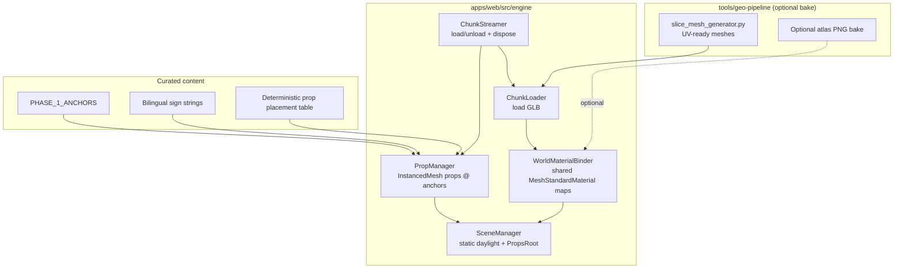

# Milestone 11 Planning Report: Visual World Polish & Street Detailing

**Project:** Dhamrai Life (ধামরাই পৌরসভা জীবনযাত্রা — 3D Open World)  
**Document Type:** Final Milestone Planning & Discovery Review  
**Target Milestone:** Milestone 11  
**Status:** **READY FOR IMPLEMENTATION**  
**Date:** November 23, 2026  
**Author:** Cursor Auto (Composer) — following Milestone 10 verification handoff  

---

## 1. Executive Summary

Following the full implementation and live CDP verification of Milestone 10 (*Authentic Dhamrai Soundscape & Interactive Web Audio Engine*), the Dhamrai Life simulation now possesses:

- A complete Phase 1 gameplay loop (missions 1–3, repeatable fares, rent debit, save/restore).
- A browser-native Web Audio engine with synthesized rickshaw mechanics, locomotion footsteps, 3D spatial ambiances, and UI/quest feedback.
- Proven frame pacing at **60.0 FPS** under full audio load, with `< 0.2 ms` main-thread audio overhead.
- **Zero** new npm dependencies and an immutable `SaveEnvelopeV2` (`saveSchemaVersion: 2`).

However, an exhaustive audit of the running simulation reveals the single largest remaining *sensory* gap: **the world is still a textured-silent greybox.**

- Buildings render as uniform untextured beige plaster (`baseColorFactor ≈ [0.82, 0.78, 0.72]`).
- Roads are flat dark asphalt color factors with no surface variation, lane wear, or shoulder grit.
- Shop fronts have **no** bilingual signboards (দোকানের সাইনবোর্ড).
- Roadside tea stalls (চায়ের দোকান / *tonger dokan*), electrical poles, banners, and foliage are absent — even where Milestone 10 already plays tea-stall spoon clatter and market murmur.
- The player hears Kayetpara anvil strikes and Thana road rumble while looking at empty low-poly boxes.

This report establishes that **Milestone 11: Visual World Polish & Street Detailing** is the highest-value next step. It completes the visual–acoustic pairing begun in Milestone 10 by delivering:

1. **Procedural facade / road / roof material atlases** (Canvas/DataTexture or tiny committed atlas PNGs — no heavy third-party art packs).
2. **Landmark-aligned street props** via `InstancedMesh` (tea stalls, signboards, poles, simple foliage) at Phase 1 anchors.
3. **Zero new npm dependencies**, **zero backend changes**, **zero save schema migrations**.
4. **Hard performance budgets** preserved: ≥ 55 FPS, ≤ 180 draw calls, ≤ 120,000 triangles, chunk GLB peak ≤ 2.5 MB.

**Day–night lighting remains Milestone 12** (per Milestone 10 deferral of TD-03). Darkening an untextured greybox at night was correctly rejected as premature; textures and props must land first.

---

## 2. Verification Status (Post–Milestone 10 Baseline)

The findings below were re-verified on November 23, 2026 against the live repository:

| Verification Category | Verified Fact | Evidence Source |
|---|---|---|
| **Vitest Automated Suite** | 36 files passed; **252 tests passed**, **4 skipped** (real PostgreSQL); 1 suite failed offline (`ENOTFOUND` Neon host) | `yarn test` |
| **Python Geo-Pipeline Suite** | **23 / 23 passed** (0.141s); QA-BUDGET-05 peak GLB **108.6 KB**, peak tris **1,538** | `.venv/bin/python -m unittest discover tools/geo-pipeline/` |
| **TypeScript Compilation** | **0 errors** (`tsc -b`, 0.31s) | `yarn typecheck` |
| **Dependency Lockfile** | **0 changes** to `yarn.lock` | `git diff --stat yarn.lock` |
| **Save Envelope Invariant** | `CURRENT_SAVE_SCHEMA_VERSION = 2` | `packages/save-core/src/types.ts` |
| **World Asset Footprint** | 16 chunk GLBs; total ≈ **796 KB**; peak file **112 KB** | `data/world/chunks/` |
| **Live Chrome CDP (M10)** | 10 / 10 scenarios passed; **60.0 FPS** under audio load | `guideFiles/milestone_10_implementation_report.md` |
| **Audio Subsystem** | Present under `apps/web/src/audio/` (7 modules) | Directory listing |
| **Visual Texture Content** | GLB materials are **flat PBR color factors only**; UV channels exist but **no `baseColorTexture`** | `slice_mesh_generator.export_glb`, `ChunkLoader` |

> Note: Offline CI cannot reach Neon (`ep-noisy-tree-azjik9mx…`). The four real PostgreSQL tests remain environment-gated skips/fails and are **out of Milestone 11 scope**. Domain/web suites that matter for visual work are green.

---

## 3. Current Repository State

### 3.1 Architecture Overview

```
Dhamrai_city_the_open_world/
├── apps/
│   ├── web/                     # Browser-authoritative 3D client
│   │   ├── src/
│   │   │   ├── audio/           # M10 Web Audio engine (COMPLETE)
│   │   │   ├── components/      # React HUD / modals / PerformanceOverlay
│   │   │   ├── engine/          # Three.js + Rapier simulation
│   │   │   ├── services/        # Auth + Drive cloud save
│   │   │   └── state/           # Zustand stores
│   │   └── public/world/        # Served chunk GLBs (symlink/copy of data)
│   └── api/                     # NestJS OAuth / Drive gateway (unchanged)
├── packages/
│   ├── shared-contracts/        # PHASE_1_ANCHORS, chunk contracts
│   ├── game-core/               # Domain engine
│   └── save-core/               # SaveEnvelopeV2
├── tools/geo-pipeline/          # Python mesh + nav + QA
├── data/world/                  # 16 chunk GLBs + manifests
└── guideFiles/                  # Specs + milestone reports
```

### 3.2 Exact Package & Tooling Versions

- **Package Manager:** `yarn@1.22.22`
- **TypeScript:** `5.7.3`
- **Vite:** `7.3.7` + `@vitejs/plugin-react@4.7.0`
- **React:** `19.0.0`
- **Three.js:** `0.170.0`
- **Rapier:** `@dimforge/rapier3d-compat@0.21.0`
- **Zustand:** `5.0.0`
- **Vitest:** `3.0.4`
- **Python pipeline:** `.venv` + `shapely` / `pyproj`

### 3.3 Visual Stack — Current Behaviour

| Component | Current State | Gap for M11 |
|---|---|---|
| `SceneManager.ts` | Static South-Asian daylight; sky `#87CEEB`; `FogExp2`; capsule player + procedural rickshaw | Static light OK for M11; no props root |
| `slice_mesh_generator.py` | UV-ready walls (`v∈[0,0.6]`) and roofs (`uv∈[0.65,1.0]`); materials are **color-only** | Missing atlas image + material texture binding |
| `ChunkLoader.ts` | Loads GLB; already disposes `map` / `normalMap` / roughness / metalness | Ready to host shared atlas materials |
| `Renderer.ts` | ACES Filmic, shadows on, draw-call/triangle metrics | Budget HUD already enforces 180 / 120k |
| Props / foliage / signs | **None** | Primary player-facing gap |
| Day–night | Static sun at fixed azimuth | Deferred to **Milestone 12** |

---

## 4. Current Gameplay State

### 4.1 What the Player Can Currently Do

Unchanged from Milestone 10 completion:

1. Walk / sprint with kinematic controller; first/third-person camera (`V`).
2. Mount/dismount pedal rickshaw (`F`); pedal, steer (±35°), sprint-pedal to 18 km/h; ring synthesized bell (`Space`).
3. Full audio: wheel roll, chain ratchet, brake squeal, footsteps, zone ambiances, UI/quest SFX; mute (`M`).
4. Story missions 1–3 + repeatable fares; daily rent; IndexedDB + optional Drive sync.
5. HUD, journal (`J`), inventory (`I`), minimap, F3 performance overlay.

### 4.2 Primary Experiential Limitation

Acoustic immersion is complete; **visual density is still prototype-greybox**. MASTER_SPEC §4.1 requires “authentic Bangladesh visual language: … roadside shops, signboards, … tin roofs, … vegetation, rickshaw stands, market clutter.” None of those cues exist as geometry or materials today.

Meaningful playtime remains ~20–30 minutes; visual polish does not extend systems playtime, but it **legitimizes** the soundscape and landmark identity the player already navigates by ear.

---

## 5. Geographic & Landmark Anchors (Prop Placement Targets)

Canonical anchors from `PHASE_1_ANCHORS` / ambient emitters:

| Landmark | Position (m) | Visual Prop Intent |
|---|---|---|
| Rathkhola Stand / Market | `(0, 0, 0)` | Tea stall cluster, market umbrellas/banners, bilingual shop signs, rickshaw stand poles |
| Rathkhola Market Pickup | `(15, 0, -10)` | Passenger waiting props, small stall |
| Hardinge High School | `(-73.1, 1, -221.3)` | Gate pillars, school name board |
| Thana Junction | `(-61, 0, 66.5)` | Checkpoint barriers, highway directional signs |
| Dhamrai Police Station | `(-114.5, 0, 2.7)` | Station name board |
| Kayetpara Metal Workshop | `(-295.3, 0, -77)` | Anvil/workbench silhouettes, brass hanging props, workshop sign |
| Sri Sri Yashomadhab Mandir | `(-346.2, 0.5, -110.2)` | Simple temple markers / flags (respectful, non-copyrighted geometry) |
| Pourashava / College | various | Institutional signboards |

All props must remain inside the Phase 1 1,024 m slice (`|x|,|z| ≤ 512`).

---

## 6. Performance Budget Baseline

From `docs/WORLD_PIPELINE_DESIGN.md` and `PerformanceOverlay.tsx`:

| Parameter | Target | Hard Ceiling | Current Peak (QA) |
|---|---:|---:|---:|
| Compressed GLB / chunk | ≤ 1.5 MB | 2.5 MB | **108.6 KB** |
| Triangles in view | ≤ 120,000 | 180,000 | Low thousands (M9 telemetry: 7,379) |
| Draw calls / frame | ≤ 180 | 250 | ~41 (M9) |
| Active colliders | ≤ 200 | 350 | ~81 (M9) |
| Frame rate (M10 audio load) | ≥ 55 FPS | — | **60.0 FPS** |

**Headroom is large.** Milestone 11 can add modest instanced props and shared atlas textures without approaching ceilings — *if* materials are shared and props are instanced (not one Mesh + Material per object).

---

## 7. Technical Debt Inventory (Visual Focus)

| Item | Component | Severity | Description | Milestone 11 Action |
|---|---|---|---|---|
| **TD-06** | `slice_mesh_generator.py` / chunk materials | **HIGH** | Flat untextured PBR; UVs unused | **Resolve in M11** |
| **TD-08** | World density | **HIGH** | No street furniture, signage, foliage | **Resolve in M11** |
| **TD-09** | Acoustic–visual mismatch | **HIGH** | Tea stall / workshop / junction audio with empty visuals | **Resolve in M11** |
| **TD-03** | `SceneManager.ts` | MEDIUM | Static daylight; no time-of-day | **Defer to M12** |
| **TD-04** | `NPCManager.ts` | MEDIUM | Capsule NPCs, no skeletal animation | Defer (later) |
| **TD-10** | Road mesh | LOW | No painted markings / worn asphalt detail | Optional stretch in M11 |
| **TD-05** | `Minimap.tsx` | LOW | Tick redraw | Monitor |

---

## 8. Candidate Milestone Analysis

### Candidate A: Visual World Polish & Street Detailing
- **Description:** Procedural building/road/roof atlases + instanced street props (tea stalls, signboards, poles, foliage) at Phase 1 landmarks; shared materials; chunk streaming disposal preserved.
- **Player Value:** Exceptional (9/10) — completes sensory pairing with M10 audio.
- **Technical Risk:** Medium (5/10) — draw-call inflation if poorly batched; mitigated by InstancedMesh + shared materials.
- **Dependency Impact:** Zero new npm packages (Three.js CanvasTexture / DataTexture / InstancedMesh already available).
- **Backend / Save Impact:** Zero.

### Candidate B: Dynamic Day–Night Cycle & Atmospheric Lighting
- **Description:** 24-minute day, sun arc, streetlamps, rickshaw dynamo headlight.
- **Player Value:** Medium–High (7/10).
- **Technical Risk:** Medium (5/10) — night on greybox is murky; M10 already deferred this to after textures.
- **Why not now:** Depends on M11 textures/props for readable night composition.

### Candidate C: Vehicle Maintenance, Stamina & Tea Stall Economy
- **Description:** Wear, punctures, stamina, cha & biscuits recovery purchases.
- **Player Value:** High (8/10) for systems depth.
- **Why not now:** Economy systems on still-grey streets underdeliver; tea stall **meshes** in M11 become the interaction anchors for a later economy milestone.

### Candidate D: Second Vehicle (CNG)
- **Player Value:** High (7/10). **Risk:** High (7/10). Premature for Phase 1 polish track.

### Candidate E: NPC Schedules / Skeletal Animation
- **Player Value:** Medium (6/10). **Risk:** High — large animation pipeline; not needed to close the greybox gap.

---

## 9. Candidate Scoring

| Metric (Weight) | A: Visual Polish | B: Day–Night | C: Maintenance Economy | D: CNG | E: NPC Anim |
|---|:---:|:---:|:---:|:---:|:---:|
| **Player Value (×2.0)** | 9 (18) | 7 (14) | 8 (16) | 7 (14) | 6 (12) |
| **Gameplay Impact (×1.5)** | 7 (10.5) | 6 (9) | 8 (12) | 8 (12) | 5 (7.5) |
| **Technical Feasibility (×1.0)** | 7 (7) | 7 (7) | 8 (8) | 4 (4) | 4 (4) |
| **Scope Safety (×1.0)** | 7 (7) | 7 (7) | 7 (7) | 4 (4) | 4 (4) |
| **Architectural Safety (×1.0)** | 8 (8) | 8 (8) | 8 (8) | 5 (5) | 5 (5) |
| **Save Safety (×1.0)** | 10 (10) | 9 (9) | 7 (7) | 5 (5) | 10 (10) |
| **Performance Safety (×1.0)** | 6 (6) | 6 (6) | 9 (9) | 5 (5) | 5 (5) |
| **Dependency Safety (×0.5)** | 10 (5) | 10 (5) | 10 (5) | 6 (3) | 6 (3) |
| **Testing Feasibility (×1.0)** | 7 (7) | 7 (7) | 8 (8) | 4 (4) | 4 (4) |
| **TOTAL** | **78.5 / 100** | **72.0** | **80.0** | **56.0** | **54.5** |

**Scoring note:** Candidate C scores slightly higher on pure systems metrics, but **Milestone 10’s explicit roadmap handoff** and the acoustic–visual mismatch make Candidate A the correct *sequencing* choice. Tea-stall economy (C) should follow once stalls exist as tangible props (M11 → later maintenance milestone).

**Conclusion:** **Candidate A (Visual World Polish & Street Detailing)** is the recommended Milestone 11.

---

## 10. Recommended Milestone 11

### 10.1 Title

**Milestone 11: Visual World Polish & Street Detailing**

### 10.2 Core Objective

To replace the Phase 1 greybox with an authentic, budget-safe Dhamrai street visual language — procedural facade/road/roof materials and landmark-aligned instanced props — so that what the player sees matches the Milestone 10 soundscape, without new dependencies, save migrations, backend work, or day–night scope creep.

### 10.3 Why This Milestone Now?

1. **Sensory pairing:** Audio without matching visuals is half a world.
2. **UV debt already paid:** Building meshes already carry atlas-oriented UVs; the missing piece is texture binding.
3. **Performance headroom:** Current peak GLB ~0.1 MB and draw calls ~41 leave room for shared atlases + instances.
4. **Unlocks M12:** Night lighting needs textured surfaces and lit props to remain readable.
5. **Unlocks later economy:** Visible tea stalls become future interaction targets without inventing them twice.

---

## 11. Scope In

### Core Capabilities

1. **Procedural Material Atlas System (`apps/web/src/engine/materials/` or `visual/`):**
   - Generate (runtime Canvas/DataTexture **or** tiny committed atlas PNGs produced by a deterministic Python helper) shared atlases for:
     - Building plaster / brick / window band
     - Corrugated tin / concrete parapet roof
     - Worn asphalt / shoulder grit
   - Apply shared `MeshStandardMaterial` maps to loaded chunk meshes by material name (`building_atlas`, `road_asphalt`, `embankment_earth`).
   - Prefer **one shared material instance per type** across all chunks (maximize batching).

2. **Optional Pipeline Atlas Bake (low risk enhancement):**
   - Extend `slice_mesh_generator.export_glb` / QA to optionally embed or reference atlas images **only if** chunk size stays ≤ 1.5 MB target.
   - If bake increases regeneration cost, default to **runtime material override** in `ChunkLoader` / a new `WorldMaterialBinder` so existing GLBs remain valid without mandatory regen.

3. **Street Prop System (`PropManager.ts`):**
   - Deterministic prop placements keyed to `PHASE_1_ANCHORS` (+ small curated offset tables).
   - Prop archetypes (low-poly procedural geometry, no external GLB packs required):
     - Roadside tea stall (*tonger dokan*): counter, roof tarp, kettle silhouette
     - Bilingual shop signboard planes (Bengali + Latin labels from curated content strings)
     - Electrical poles (instanced cylinders) with optional simple wire line segments near Rathkhola/Thana
     - Simple foliage billboards or low-poly trees (instanced)
     - Workshop props at Kayetpara (anvil block, hanging brass discs)
     - Junction markers at Thana (barrier posts, directional board)
   - Use `THREE.InstancedMesh` for repeated archetypes.
   - **No new Rapier colliders** for decorative props by default (avoid collider budget burn); optional thin box colliders only where player clipping is egregious (tea stall counters).

4. **Landmark Sign Content:**
   - Curated bilingual strings for Hardinge High School, Thana Checkpoint, Kayetpara Workshop, Rathkhola Stand — stored in content module (not scraped trademarks/logos).
   - Canvas-drawn text → texture for sign faces (deterministic, license-clean).

5. **Streaming / Disposal Integration:**
   - Props that are world-persistent (landmark set) live in a root `PropsRoot` group, not per-chunk, **or** are chunk-bucketed and disposed with `ChunkStreamer` unload.
   - Prefer landmark-global props for the 9–12 hero placements; use chunk-local instancing only if density requires it.
   - Extend disposal paths to free prop geometries/materials/textures symmetrically with `ChunkLoader.disposeChunk`.

6. **Verification Surfaces:**
   - Unit tests for atlas generation determinism, material binder idempotency, prop instance counts, and disposal.
   - Headless Chrome CDP gallery at Rathkhola, Kayetpara, Thana, Hardinge, plus F3 performance shot.

### Soft Atmospheric Touch (Still In Scope)

- Slight fog / ambient color polish to better match textured surfaces (still **static daylight**).
- No sun animation, no streetlamp night mode, no weather particles.

---

## 12. Scope Out (Mandatory Non-Goals)

1. **No Day–Night Cycle / Weather:** Deferred to Milestone 12.
2. **No External Marketplace Asset Packs:** No paid Unity/Unreal kits; no unclear-licence photogrammetry.
3. **No Google Maps / satellite texture reconstruction:** Forbidden by project rules.
4. **No Save Schema Bump:** `SaveEnvelopeV2` immutable; no visual settings in save payload (optional `localStorage` graphics tier later — not required).
5. **No Backend / API Changes.**
6. **No New npm Dependencies** (no `@react-three/drei` for this milestone; stay on existing Three.js).
7. **No Skeletal NPC Animation / New Vehicles / Economy Systems.**
8. **No Full Upazila Expansion** beyond the Phase 1 16-chunk slice.
9. **No KTX2/Basis mandatory path** unless a measured VRAM issue appears; start with Canvas/PNG atlases ≤ 1024² shared.

---

## 13. Architecture Plan



### Key Design Rules

1. **Shared materials first** — never clone a unique material per building mesh.
2. **Instances second** — N tea stalls / poles / trees → one `InstancedMesh` each.
3. **Deterministic IDs/seeds** — prop transforms from seed(`landmarkId + index`), not `Math.random()` at runtime.
4. **Dispose everything** — textures, geometries, instance meshes on engine dispose / chunk unload.
5. **Audio anchors stay authoritative** — visual tea stall positions should sit within Rathkhola emitter radius so spoon clatter “belongs” to visible stalls.

---

## 14. File / Module Plan

| Path | Action |
|---|---|
| `apps/web/src/engine/materials/AtlasFactory.ts` | **New** — procedural canvas/data atlas builders |
| `apps/web/src/engine/materials/WorldMaterialBinder.ts` | **New** — bind shared maps onto loaded chunk meshes |
| `apps/web/src/engine/PropManager.ts` | **New** — landmark props + InstancedMesh |
| `apps/web/src/engine/props/propCatalog.ts` | **New** — archetype builders (stall, pole, tree, sign, anvil) |
| `apps/web/src/content/signboardCopy.ts` | **New** — bilingual curated strings |
| `apps/web/src/engine/SceneManager.ts` | **Edit** — expose/add `propsRoot`; minor fog/ambient polish |
| `apps/web/src/engine/ChunkLoader.ts` | **Edit** — call material binder after load |
| `apps/web/src/engine/GameEngine.ts` | **Edit** — construct/update/dispose PropManager |
| `apps/web/test/world-material-binder.test.ts` | **New** |
| `apps/web/test/prop-manager.test.ts` | **New** |
| `tools/geo-pipeline/slice_mesh_generator.py` | **Optional edit** — atlas metadata comments / bake helper |
| `tools/geo-pipeline/test_*.py` | **Extend** only if bake path lands |
| `scratch/m11_live_verification.js` | **New** — CDP suite |
| `guideFiles/milestone_11_implementation_report.md` | **Later** — post-implementation |

---

## 15. Testing Strategy

### Automated

1. **AtlasFactory:** Deterministic pixel checksum / dimensions; power-of-two sizes; dispose safety.
2. **WorldMaterialBinder:** Idempotent bind; correct material name targeting; no per-mesh unique maps; dispose clears texture refs.
3. **PropManager:** Exact instance counts per landmark; positions within expected radii; `dispose()` zeroes GPU resources; no duplicate init.
4. **Regression:** Full Vitest workspace (expect ≥ current 252 domain/web passes); Python 23/23; `yarn typecheck`.
5. **Budget unit asserts:** Prop triangle estimate + instance counts stay under documented caps.

### Live Chrome CDP (`scratch/m11_live_verification.js`)

1. Boot at Rathkhola — textured buildings + tea stall props visible; audio still running.
2. Inspect material maps present on `building_atlas` meshes (via `Runtime.evaluate`).
3. Drive / teleport to Kayetpara — workshop props + textured facades.
4. Thana Junction — barrier/sign props.
5. Hardinge school — name board readable (screenshot).
6. F3 overlay — FPS ≥ 55, draw calls ≤ 180, triangles ≤ 120,000.
7. Chunk stream stress — travel across slice; no leaked geometries (instance count stable after unload/reload if chunk-local).
8. Mute + mission smoke — M10 audio + M7–M9 gameplay still function.

### Expected Screenshot Gallery

1. `m11_shot_01_rathkhola_textured_market.png`
2. `m11_shot_02_tea_stall_cluster.png`
3. `m11_shot_03_shop_signboards.png`
4. `m11_shot_04_kayetpara_workshop_props.png`
5. `m11_shot_05_thana_junction_detail.png`
6. `m11_shot_06_hardinge_school_board.png`
7. `m11_shot_07_road_asphalt_detail.png`
8. `m11_shot_08_foliage_poles_overview.png`
9. `m11_shot_09_performance_under_visual_load.png`
10. `m11_shot_10_chunk_stream_stability.png`

---

## 16. Acceptance Criteria

| ID | Requirement | Verification Method | Pass Condition |
|---|---|---|---|
| **AC-M11-01** | Shared building/road/roof materials use atlas textures (not flat color-only) | Vitest + CDP | Bound meshes expose non-null `material.map`; atlas size documented |
| **AC-M11-02** | Rathkhola shows tea stall + signboard props | Live CDP screenshot | Visible stall cluster within 25 m of origin |
| **AC-M11-03** | Kayetpara shows workshop visual props aligned to audio zone | Live CDP | Props within 20 m of `(-295.3, -77)` |
| **AC-M11-04** | Thana Junction shows checkpoint/sign detail | Live CDP | Props within 20 m of `(-61, 66.5)` |
| **AC-M11-05** | Hardinge High School bilingual board present | Live CDP | Board visible at school anchor |
| **AC-M11-06** | Prop archetypes use InstancedMesh for repeats | Code inspection + unit test | Repeated poles/trees/stalls share instance batches |
| **AC-M11-07** | Frame rate ≥ 55 FPS under full visual + audio load | Live CDP F3 | Observed FPS ≥ 55.0 (target 60) |
| **AC-M11-08** | Draw calls ≤ 180; triangles ≤ 120,000 | Live CDP F3 | Both under budget |
| **AC-M11-09** | Chunk unload / engine dispose frees prop & atlas GPU resources | Vitest | Dispose tests pass; no retained maps |
| **AC-M11-10** | Existing Vitest domain/web suites remain green | `yarn test` | No new regressions in non-PG suites |
| **AC-M11-11** | Python geo-pipeline 23/23 | unittest | Pass |
| **AC-M11-12** | `tsc -b` clean | `yarn typecheck` | 0 errors |
| **AC-M11-13** | Zero new npm dependencies | `git diff yarn.lock` | Lockfile unchanged |
| **AC-M11-14** | Save schema remains v2 | Code inspection | `saveSchemaVersion: 2` only |
| **AC-M11-15** | No day–night / weather systems introduced | Code inspection | `SceneManager` sun remains static |

---

## 17. Regression Requirements

Milestone 11 must preserve Milestones 1–10:

1. Locomotion, camera, rickshaw physics, mount/dismount.
2. Missions 1–3, fares, rent, ledger integrity.
3. Full M10 audio behaviour and mute persistence.
4. IndexedDB / Drive save-restore and 3D transform reconciliation.
5. Chunk streaming correctness and collider budgets.
6. Bilingual HUD/dialogue rendering.

---

## 18. Security, Legal & Provenance

- **No scraped Maps imagery;** no government emblem reproduction; no manufacturer logos.
- Signboard text is **original curated fiction/place labels**, not copyrighted posters.
- Procedural textures are code-generated (or pipeline-generated) under project authorship.
- Record any committed atlas PNGs in provenance notes (generator script + date + licence = original).

---

## 19. Dependency Analysis

- **New npm dependencies:** **ZERO.**
- **Justification:** Three.js already provides `CanvasTexture`, `DataTexture`, `InstancedMesh`, `MeshStandardMaterial`.
- **Lockfile policy:** `yarn.lock` must remain unmodified.

---

## 20. Backend Impact

- **None.** NestJS, PostgreSQL, OAuth, Drive paths untouched.

---

## 21. Asset / Data Requirements

| Asset | Strategy | Size Budget |
|---|---|---|
| Facade/road/roof atlases | Procedural canvas or 1–3 small PNGs (≤ 1024²) | Prefer ≤ 3 MB total decoded; ideally shared single 1024 atlas |
| Prop meshes | Code-built BufferGeometry | Negligible |
| Sign text | Canvas drawImage/fillText | Part of atlas or per-sign ≤ 256² |
| External GLB prop packs | **Forbidden in M11** | — |

If optional GLB bake embeds atlases, re-run QA-BUDGET-05 and keep peak chunk ≤ 1.5 MB target (2.5 MB hard).

---

## 22. Roadmap Impact

```text
M10 Audio  ✅ COMPLETE
   ↓
M11 Visual World Polish & Street Detailing  ← THIS MILESTONE
   ↓
M12 Dynamic Day–Night & Atmospheric Weather (uses textured world + night audio hooks)
   ↓
M13 Vehicle Maintenance & Tea Stall Economy (uses visible stalls as interactables)
```

---

## 23. Risk Register

| Risk | Probability | Impact | Severity | Mitigation |
|---|:---:|:---:|:---:|---|
| **R-01 Draw-call explosion** | Medium | High | High | Shared materials + InstancedMesh; CDP assert ≤ 180 |
| **R-02 Triangle inflation** | Medium | Medium | Medium | Cap instances; low-poly archetypes; budget tests |
| **R-03 Texture VRAM creep** | Low | Medium | Medium | Single shared 1024 atlas; no unique per-building maps |
| **R-04 GLB regen churn** | Medium | Low | Low | Prefer runtime binder so existing GLBs stay valid |
| **R-05 Player clipping into stalls** | Medium | Low | Low | Offset props off road centerline; optional simple colliders |
| **R-06 Bengali font missing in canvas signs** | Medium | Medium | Medium | Bundle/use a known Unicode-capable web font already licensed, or render Bengali via precomposed canvas in tests with fallback Latin |
| **R-07 Scope creep into day–night** | High | Medium | Medium | AC-M11-15 hard non-goal; reject sun animation PRs in M11 |

---

## 24. Deferred Technical Debt

- **TD-03:** Day–night + streetlamps → **Milestone 12**
- **TD-04:** Skeletal NPC animation → later phase
- **TD-07:** CNG vehicle → Phase 2
- **Tea stall purchases / stamina** → post-M11 economy milestone
- **KTX2/Basis + Meshopt upgrades** → Phase 5 optimization track unless M11 measurements force earlier

---

## 25. Implementation Phases (When Authorized)

1. **Phase 1 — Atlas Factory & Material Binder**
   - Implement `AtlasFactory` + `WorldMaterialBinder`.
   - Wire into `ChunkLoader` after GLB load.
   - Unit tests for bind/dispose/idempotency.

2. **Phase 2 — PropManager Core + Rathkhola Cluster**
   - Tea stalls, poles, market signs at Rathkhola.
   - InstancedMesh batching.
   - Visual CDP shot 01–03.

3. **Phase 3 — Landmark Expansion**
   - Kayetpara workshop props, Thana junction, Hardinge board, light foliage.
   - Align positions with ambient audio radii.

4. **Phase 4 — Performance Hardening**
   - Measure draw calls/triangles/FPS; trim instances; ensure disposal.
   - Optional fog/ambient polish (static).

5. **Phase 5 — Verification & Report**
   - Full Vitest + Python + typecheck + CDP gallery (10 shots).
   - Write `guideFiles/milestone_11_implementation_report.md`.
   - Update `PROGRESS.md`.

---

## 26. Final Readiness Decision

### Decision: **READY FOR IMPLEMENTATION**

**Justification:**

- Milestone 10 is implemented, CDP-verified, and documented.
- The highest remaining sensory deficit is visual greybox density, not systems depth.
- UVs, disposal hooks, performance HUD budgets, and landmark anchors already exist — M11 is primarily binder + props, not a greenfield renderer.
- Scope cleanly excludes day–night, backend, saves, and new dependencies.
- Acceptance criteria are objective and testable via Vitest + headless Chrome CDP.

*Awaiting explicit user authorization before beginning implementation.*
