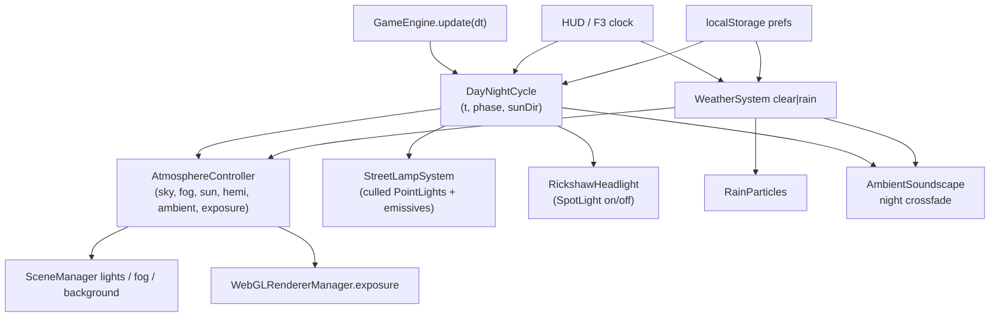

# Milestone 12 Planning Report: Dynamic Day–Night Cycle & Atmospheric Weather

**Project:** Dhamrai Life (ধামরাই পৌরসভা জীবনযাত্রা — 3D Open World)  
**Document Type:** Final Milestone Planning & Discovery Review  
**Target Milestone:** Milestone 12  
**Status:** **READY FOR IMPLEMENTATION**  
**Date:** November 23, 2026  
**Author:** Cursor Auto (Composer) — following Milestone 11 verification handoff  

---

## 1. Executive Summary

Following the full implementation and live CDP verification of Milestone 11 (*Visual World Polish & Street Detailing*), Dhamrai Life now possesses:

- Textured building/road/embankment atlases and landmark street props (tea stalls, signs, poles, foliage, workshop/junction detail).
- A complete Milestone 10 Web Audio soundscape (rickshaw, locomotion, spatial ambiances, UI).
- Proven performance under visual + audio load: **60.0 FPS**, **79 draw calls**, **10,399 triangles** on Apple M4 Metal.
- **Zero** new npm dependencies through M11; immutable `SaveEnvelopeV2`.

However, the world remains locked in a single static midday:

- `SceneManager` sun is fixed at `(120, 240, 140)` with constant sky `#7eb8d8` and `FogExp2`.
- Electrical poles from M11 cast no night glow.
- The rickshaw has no dynamo headlight after dusk.
- Ambient audio never shifts to night beds (crickets) or monsoon rain layers — despite ROADMAP Phase 3 calling for “Rain/day-night cycle and audio ambience.”
- TD-03 (static daylight) has been explicitly deferred since Milestone 10 and is now unblocked by textured surfaces.

This report establishes that **Milestone 12: Dynamic Day–Night Cycle & Atmospheric Weather** is the correct next step. It delivers:

1. A **compact game-day clock** (default **24 real minutes = 1 game day**) driving sun arc, sky/fog/ambient/hemi color, and exposure.
2. **Night lighting:** distance-culled streetlamp glow on M11 poles + rickshaw dynamo headlight when mounted after dusk.
3. **Light atmospheric weather:** clear ↔ light rain toggle with fog tint, subtle rain particle overlay, and synthesized rain ambience on the existing Web Audio bus.
4. **Zero new npm dependencies**, **zero backend changes**, **zero save schema migrations** (time/weather prefs in `localStorage`, like audio mute).

---

## 2. Verification Status (Post–Milestone 11 Baseline)

Re-verified November 23, 2026:

| Verification Category | Verified Fact | Evidence |
|---|---|---|
| **Vitest** | 270 passed / 4 skipped; 38 files green; 1 Neon PG suite fails offline | `yarn test` |
| **Python geo-pipeline** | 23 / 23; QA budgets intact | unittest |
| **Typecheck** | 0 errors | `yarn typecheck` |
| **Lockfile** | Unchanged | `git diff yarn.lock` |
| **Save schema** | `CURRENT_SAVE_SCHEMA_VERSION = 2` | `packages/save-core` |
| **Live M11 CDP** | 10/10; 60 FPS; 79 draw calls; 10,399 tris | `milestone_11_implementation_report.md` |
| **Lighting code** | Static sun/hemi/ambient/fog only; no `PointLight`/`SpotLight` yet | `SceneManager.ts`, `Renderer.ts` |
| **Audio hooks** | `AmbientSoundscape` has global bed + 3 zone emitters; ready for night/rain layers | `apps/web/src/audio/` |
| **Prop poles** | 12 instanced poles at curated sites — natural lamp anchors | `PropManager.ts` |

---

## 3. Current Repository State (Lighting-Relevant)

| Component | Current State | M12 Gap |
|---|---|---|
| `SceneManager.ts` | Static DirectionalLight + Hemisphere + Ambient + FogExp2 | Needs driven sun/sky/fog |
| `Renderer.ts` | ACES Filmic, exposure `1.05`, shadows on | Exposure should track time-of-day |
| `GameEngine.update(dt)` | Physics, audio, streaming, NPCs — **no atmosphere tick** | Wire `DayNightController.update(dt)` |
| `PropManager` | Poles exist; no lamp lights | Attach culled lamp lights / emissive bulbs |
| `RickshawVehicle` / rickshaw mesh | Visual only at night | Dynamo `SpotLight` when occupied after dusk |
| `AmbientSoundscape` | Day market / workshop / junction beds | Night cricket bed + rain layer |
| `useUIStore` / HUD | Audio mute `[M]`; no clock | Optional clock + weather indicator |
| Save / API | Unrelated | **Must not change** |

---

## 4. Current Player Experience Limitation

The player can hear tea-stall clatter and see orange stall tarps under permanent noon light. There is no dusk gold hour, no night market mood, no monsoon atmosphere — the sensory world never *changes*. MASTER_SPEC and ROADMAP Phase 3 both expect day–night and rain ambience; M11 textures finally make night readable.

---

## 5. Technical Debt Inventory (Atmosphere Focus)

| Item | Component | Severity | Description | Milestone 12 Action |
|---|---|---|---|---|
| **TD-03** | `SceneManager.ts` | **HIGH** | Static daylight; no time-of-day | **Resolve in M12** |
| **TD-11** | Night readability | **HIGH** | No streetlamps / headlights | **Resolve in M12** |
| **TD-12** | Weather ambience | **MEDIUM** | No rain visual/audio | **Resolve in M12** (light rain only) |
| **TD-04** | NPC schedules | MEDIUM | Capsules; no day/night behavior | Defer (schedules later) |
| **TD-13** | Tea stall economy | MEDIUM | Visible stalls unused for purchases | Defer to M13 |
| **TD-07** | CNG vehicle | LOW for now | Phase 2 | Defer |

---

## 6. Candidate Milestone Analysis

### Candidate A: Dynamic Day–Night Cycle & Atmospheric Weather
- **Description:** Game-day clock, sun arc, sky/fog/lighting lerp, streetlamps, rickshaw headlight, light rain + night/rain audio.
- **Player Value:** High (9/10) — world becomes temporally alive.
- **Technical Risk:** Medium (5/10) — light-count and particle budgets; mitigated by culling + caps.
- **Deps / Save / Backend:** Zero / Zero / Zero.

### Candidate B: Vehicle Maintenance & Tea Stall Economy
- **Description:** Wear, punctures, stamina, cha purchases at M11 stalls.
- **Player Value:** High (8/10).
- **Why not now:** Economy systems benefit from night/rain atmosphere (lamps near stalls, wet roads); ROADMAP groups rain/day-night before deeper Phase 3 systems polish. M11 handoff explicitly points to M12 next.

### Candidate C: NPC Day Schedules / Animation
- **Risk:** High. Wrong sequencing before atmosphere.

### Candidate D: CNG Vehicle
- Premature Phase 2 scope.

### Candidate E: Heavy Post-Processing / Volumetric Clouds
- High GPU risk on Low profile; out of Phase 1 budget philosophy.

---

## 7. Candidate Scoring

| Metric (Weight) | A: Day–Night + Weather | B: Maintenance Economy | C: NPC Schedules | D: CNG | E: Heavy PP |
|---|:---:|:---:|:---:|:---:|:---:|
| **Player Value (×2.0)** | 9 (18) | 8 (16) | 6 (12) | 7 (14) | 5 (10) |
| **Gameplay Impact (×1.5)** | 7 (10.5) | 8 (12) | 6 (9) | 8 (12) | 3 (4.5) |
| **Technical Feasibility (×1.0)** | 7 (7) | 8 (8) | 4 (4) | 4 (4) | 3 (3) |
| **Scope Safety (×1.0)** | 7 (7) | 7 (7) | 4 (4) | 4 (4) | 3 (3) |
| **Architectural Safety (×1.0)** | 8 (8) | 8 (8) | 5 (5) | 5 (5) | 4 (4) |
| **Save Safety (×1.0)** | 10 (10) | 7 (7) | 9 (9) | 5 (5) | 10 (10) |
| **Performance Safety (×1.0)** | 6 (6) | 9 (9) | 5 (5) | 5 (5) | 2 (2) |
| **Dependency Safety (×0.5)** | 10 (5) | 10 (5) | 8 (4) | 6 (3) | 6 (3) |
| **Testing Feasibility (×1.0)** | 7 (7) | 8 (8) | 4 (4) | 4 (4) | 4 (4) |
| **TOTAL** | **78.5 / 100** | **80.0** | **56.0** | **56.0** | **43.5** |

**Scoring note:** Candidate B edges pure systems scoring, but **M11’s documented next step**, ROADMAP Phase 3 rain/day-night language, and TD-03 age make Candidate A the correct *sequence*. Maintenance economy remains **Milestone 13**.

**Conclusion:** **Candidate A** is the recommended Milestone 12.

---

## 8. Recommended Milestone 12

### 8.1 Title

**Milestone 12: Dynamic Day–Night Cycle & Atmospheric Weather**

### 8.2 Core Objective

Drive a performant, browser-native day–night cycle and light rain atmosphere over the textured M11 world — sun arc, sky/fog/lighting, culled streetlamps, rickshaw dynamo headlight, and night/rain audio layers — without new dependencies, save migrations, or backend work.

### 8.3 Why Now?

1. Textures + props make night readable (M10 deferred day–night until this was true).
2. Pole instances already exist as lamp anchors.
3. Audio engine can accept night/rain beds with zero architectural rewrite.
4. Unblocks M13 (tea stall economy) with richer place mood.

---

## 9. Scope In

### 9.1 Day–Night Clock (`DayNightCycle.ts`)

- Normalized time `t ∈ [0, 1)` where `0 = midnight`, `0.25 ≈ dawn`, `0.5 = noon`, `0.75 ≈ dusk`.
- Default real-time scale: **1 game day = 24 real minutes** (`fullDaySeconds = 1440`).
- Deterministic `setTimeOfDay(t)`, `setPaused(boolean)`, `setTimeScale(mult)` for tests/CDP.
- Emits derived phase enum: `night | dawn | day | dusk`.
- Persist optional prefs in `localStorage` (`dhamrai.timeScale`, `dhamrai.weather`) — **not** in SaveEnvelope.

### 9.2 Sky / Lighting Driver (`AtmosphereController.ts`)

Each frame (or throttled ~10 Hz for color lerps):

| Parameter | Driven By |
|---|---|
| `sunLight.position` | Spherical arc (elevation/azimuth from `t`) |
| `sunLight.intensity` / color | Day high / dusk warm / night near-zero |
| `hemiLight` / `ambientLight` | Phase color/intensity curves |
| `scene.background` + `FogExp2` color/density | Sky gradient + night deeper fog |
| `renderer.toneMappingExposure` | Day ~1.05 → night ~0.55–0.7 |

Shadow map: keep enabled; at deep night reduce sun shadow intensity or disable sun shadows when intensity `< ε` to save GPU.

### 9.3 Streetlamps

- Reuse M11 pole instance transforms (or curated subset ≤ 12).
- Visual: small emissive bulb mesh (InstancedMesh) OR PointLights with **hard cap**.
- **Active light budget:** max **6** `PointLight`s enabled nearest to player (others emissive-only or off).
- Auto-enable when phase is `dusk|night|dawn` (sun elevation below threshold); disable in full day.
- Dispose with PropManager / AtmosphereController teardown.

### 9.4 Rickshaw Dynamo Headlight

- `SpotLight` parented to rickshaw mesh, aimed forward (−Z local).
- Active only when `isInVehicle && isNightLike`.
- Soft intensity; no second shadow caster required (castShadow false) for budget.

### 9.5 Light Rain Weather

- Weather states: `clear` | `rain` (no storm/flood/lightning in M12).
- Visual: lightweight particle system **or** screen-space streak overlay (prefer particles ≤ **1,500** with shared material).
- Fog density/color nudge while raining; slight exposure dip.
- Audio: looped filtered noise rain bed on ambience bus; duck slightly under zone emitters.
- Toggle: key `[N]` cycle weather **or** HUD control; persist in `localStorage`.

### 9.6 Night Ambience Audio

- Extend `AmbientSoundscape`:
  - Night bed: high-pass sparse cricket-like pulses / quiet insect bed (synthesized).
  - Crossfade day bed ↔ night bed by phase factor.
  - Rain gain layer independent of day/night.
- Zero new audio libraries.

### 9.7 HUD / UX

- Compact clock readout (game HH:MM) on HUD or F3 overlay.
- Weather icon/text (Clear / বৃষ্টি).
- Optional `[ ,` / `.` ] or debug-only time scrub for CDP (DEV only).

---

## 10. Scope Out (Mandatory Non-Goals)

1. **No SaveEnvelopeV3** — time/weather are client prefs / session state only.
2. **No backend weather services.**
3. **No new npm packages** (no weather SDKs, no postprocessing packages).
4. **No volumetric clouds, god rays, SSR, or heavy bloom stacks.**
5. **No flooding, lightning, cyclone, or physics wet-friction overhaul.**
6. **No NPC sleep schedules / shop open-hours** (defer with TD-04).
7. **No tea stall purchases / stamina** (M13).
8. **No CNG headlights as a new vehicle** — only existing rickshaw dynamo.
9. **No full monsoon soundtrack / licensed music.**

---

## 11. Architecture Plan



### Design Rules

1. **One clock owner** — `DayNightCycle` is the only source of `t` / phase.
2. **Light budget first** — never enable unbounded PointLights per pole.
3. **Audio on existing buses** — ambience bus only; respect mute/`[M]`.
4. **Testability** — pure functions for sun direction & color curves; injectable `t`.
5. **Dispose everything** — lights, particles, night audio nodes.

---

## 12. File / Module Plan

| Path | Action |
|---|---|
| `apps/web/src/engine/atmosphere/DayNightCycle.ts` | **New** — clock, phase, sun direction math |
| `apps/web/src/engine/atmosphere/AtmosphereController.ts` | **New** — applies lighting/sky/fog/exposure |
| `apps/web/src/engine/atmosphere/StreetLampSystem.ts` | **New** — culled night lights on poles |
| `apps/web/src/engine/atmosphere/RickshawHeadlight.ts` | **New** — vehicle SpotLight |
| `apps/web/src/engine/atmosphere/WeatherSystem.ts` | **New** — clear/rain state + particles |
| `apps/web/src/engine/atmosphere/atmosphereCurves.ts` | **New** — pure lerp curves (unit-tested) |
| `apps/web/src/engine/SceneManager.ts` | **Edit** — expose lights/fog for controller; remove “static forever” assumption |
| `apps/web/src/engine/GameEngine.ts` | **Edit** — construct/update/dispose atmosphere stack |
| `apps/web/src/engine/PropManager.ts` | **Edit** — export pole world matrices for lamps |
| `apps/web/src/audio/AmbientSoundscape.ts` | **Edit** — night + rain layers |
| `apps/web/src/components/HUD.tsx` / `PerformanceOverlay.tsx` | **Edit** — clock + weather readout |
| `apps/web/src/engine/InputManager.ts` | **Edit** — weather toggle key (e.g. `[N]`) |
| `apps/web/test/day-night-cycle.test.ts` | **New** |
| `apps/web/test/atmosphere-curves.test.ts` | **New** |
| `apps/web/test/weather-system.test.ts` | **New** |
| `apps/web/test/street-lamp-system.test.ts` | **New** |
| `scratch/m12_live_verification.cjs` | **New** — CDP dawn/noon/dusk/night/rain + FPS |
| `guideFiles/milestone_12_implementation_report.md` | **Later** |

---

## 13. Testing Strategy

### Automated

1. **DayNightCycle:** wrap-around at `t=1→0`; phase boundaries; pause; time scale; deterministic sun direction at noon/midnight.
2. **atmosphereCurves:** color/intensity monotonicity checks at fixed samples; no NaN.
3. **StreetLampSystem:** ≤ 6 active lights; day disables; dispose clears.
4. **WeatherSystem:** toggle idempotent; particle count cap; dispose.
5. **AmbientSoundscape:** night factor increases night bed gain; rain gain independent; mute still zeros master.
6. Regression: full Vitest + Python 23/23 + `yarn typecheck`.

### Live Chrome CDP

1. Force noon — sun high, lamps off, exposure ~1.05.
2. Force dusk — warm sky, lamps begin enabling.
3. Force night — dark sky, ≤6 lamps on, headlight on when mounted.
4. Force dawn — lamps fade; sky warms.
5. Toggle rain at day and night — particles + fog + rain audio.
6. F3: FPS ≥ 55, draw calls ≤ 180, triangles ≤ 120k under night+rain+audio.
7. Stream travel at night — lamps re-cull; no light leaks after dispose/reinit.
8. Mute `[M]` still silences rain/night beds.

### Expected Screenshots

1. `m12_shot_01_noon_clear.png`
2. `m12_shot_02_golden_dusk.png`
3. `m12_shot_03_night_streetlamps.png`
4. `m12_shot_04_rickshaw_headlight.png`
5. `m12_shot_05_dawn_transition.png`
6. `m12_shot_06_day_light_rain.png`
7. `m12_shot_07_night_rain.png`
8. `m12_shot_08_hud_clock_weather.png`
9. `m12_shot_09_performance_night_rain.png`
10. `m12_shot_10_chunk_stream_night.png`

---

## 14. Acceptance Criteria

| ID | Requirement | Verification | Pass Condition |
|---|---|---|---|
| **AC-M12-01** | Game-day clock advances and wraps | Vitest | `t` increases with dt; wraps `[0,1)` |
| **AC-M12-02** | Sun position/intensity follow time-of-day | Vitest + CDP | Noon elevation high; night sun intensity ≈ 0 |
| **AC-M12-03** | Sky, fog, ambient, hemi, exposure update by phase | CDP screenshots | Visible noon/dusk/night differences |
| **AC-M12-04** | Streetlamps enable at night, capped ≤ 6 active PointLights | Vitest + CDP | Day: 0 active; night: 1–6 |
| **AC-M12-05** | Rickshaw headlight on when mounted at night | CDP | SpotLight visible forward; off on foot / by day |
| **AC-M12-06** | Light rain visual + fog response | CDP | Particles/overlay visible; fog denser |
| **AC-M12-07** | Night + rain ambience on audio bus; mute respected | Vitest + CDP | Gains track phase/weather; `[M]` → 0 |
| **AC-M12-08** | HUD/F3 shows clock and weather | CDP | HH:MM + Clear/Rain readable |
| **AC-M12-09** | FPS ≥ 55 under night + rain + audio | CDP | Observed ≥ 55 (target 60) |
| **AC-M12-10** | Draw calls ≤ 180; triangles ≤ 120,000 | CDP | Both under budget |
| **AC-M12-11** | Existing Vitest domain/web suites green | `yarn test` | No new regressions (non-PG) |
| **AC-M12-12** | Python 23/23; typecheck clean | CI cmds | Pass |
| **AC-M12-13** | Zero new npm dependencies | `git diff yarn.lock` | Unchanged |
| **AC-M12-14** | Save schema remains v2 | Inspection | No V3 / no time fields in envelope |
| **AC-M12-15** | No flood/lightning/NPC schedules/economy systems | Inspection | Out-of-scope modules absent |

---

## 15. Regression Requirements

Preserve Milestones 1–11:

1. Locomotion, camera, rickshaw physics, missions, fares, rent, ledger.
2. M10 audio (bell, roll, footsteps, zone beds, UI) under new layers.
3. M11 atlases/props remain visible and correctly lit day and night.
4. Chunk streaming + shared material dispose safety.
5. IndexedDB / Drive save-restore unchanged.

---

## 16. Performance Budgets (M12 Additions)

| Resource | Soft Cap | Hard Cap | Strategy |
|---|---:|---:|---|
| Active PointLights | 4–6 | 8 | Distance cull to player |
| Rain particles | 1,000 | 1,500 | Shared material; recycle |
| Atmosphere CPU | ≤ 0.3 ms/frame | 0.5 ms | Throttle color updates ~10 Hz |
| Draw calls | ≤ 180 | 250 | No per-lamp unique materials |
| FPS | ≥ 55 | — | Night+rain CDP gate |

---

## 17. Security / Legal / Provenance

- Procedural rain/night audio only (no third-party samples).
- No scraped skyboxes or satellite night lights.
- `localStorage` prefs are origin-scoped non-secrets.

---

## 18. Dependency / Backend / Save Impact

| Area | Impact |
|---|---|
| npm / yarn.lock | **None** |
| `apps/api` | **None** |
| SaveEnvelope | **None** (v2 immutable) |
| localStorage | Optional timeScale + weather keys |

---

## 19. Roadmap Impact

```text
M10 Audio ✅
M11 Visual Polish ✅
M12 Day–Night & Weather  ← THIS MILESTONE
M13 Vehicle Maintenance & Tea Stall Economy
```

---

## 20. Risk Register

| Risk | Prob. | Impact | Mitigation |
|---|:---:|:---:|---|
| **R-01 Too many PointLights** | Med | High | Hard cap 6; emissive fallback |
| **R-02 Night too dark / unreadable** | Med | Med | Exposure floor; lamp density at landmarks |
| **R-03 Rain particle cost** | Med | Med | Cap 1.5k; disable on Low profile if needed |
| **R-04 Audio bed fighting** | Low | Med | Crossfade gains; respect mute |
| **R-05 Shadow acne at dusk** | Low | Low | Fade sun shadows with intensity |
| **R-06 Scope creep (storms/NPC hours)** | High | Med | AC-M12-15 non-goals |

---

## 21. Implementation Phases (When Authorized)

1. **Phase 1 — Clock & Curves:** `DayNightCycle` + pure `atmosphereCurves` + unit tests.
2. **Phase 2 — Atmosphere Driver:** Wire sky/fog/lights/exposure into `GameEngine.update`.
3. **Phase 3 — Lamps & Headlight:** StreetLampSystem + RickshawHeadlight; pole matrix export.
4. **Phase 4 — Weather & Audio:** Rain particles + AmbientSoundscape night/rain layers + HUD/input.
5. **Phase 5 — CDP Verification & Report:** Force time/weather scenarios; 10 screenshots; implementation report; update `PROGRESS.md`.

---

## 22. Final Readiness Decision

### Decision: **READY FOR IMPLEMENTATION**

**Justification:**

- Milestone 11 is complete, textured, and performance-verified — night is no longer a greybox risk.
- TD-03 is the oldest deferred atmosphere debt and is now unblocked.
- Scope is bounded (light rain only, light caps, no save/backend/deps).
- Acceptance criteria are objective and CDP-testable.

*Awaiting explicit user authorization before beginning implementation.*
