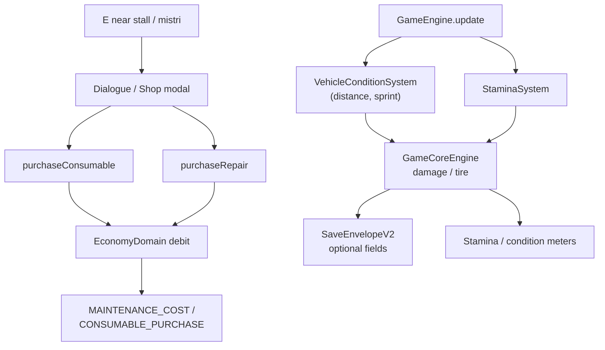

# Milestone 13 Planning Report: Vehicle Maintenance, Driver Stamina & Tea Stall Economy

**Project:** Dhamrai Life (ধামরাই পৌরসভা জীবনযাত্রা — 3D Open World)  
**Document Type:** Final Milestone Planning & Discovery Review  
**Target Milestone:** Milestone 13  
**Status:** **IMPLEMENTED — see milestone_13_implementation_report.md**  
**Date:** November 23, 2026  
**Author:** Cursor Auto (Composer) — following Milestone 12 verification handoff  

---

## 1. Executive Summary

Following Milestone 12 (*Dynamic Day–Night Cycle & Atmospheric Weather*), Dhamrai Life has:

- A complete Phase 1 loop (missions, fares, rent, save/cloud).
- Authentic audio (M10), textured streets + tea stall props (M11), and living day/night + rain (M12).
- Proven performance (~60 FPS under night+rain load).
- Economy ledger categories already defined for **`MAINTENANCE_COST`** and vehicle **`damagePercent`** — but **unused in gameplay**.

The remaining Phase 1 systems gap is economic *pressure and recovery*:

- Cash accumulates via fares/missions with only ৳50/day rent as a sink.
- `damagePercent` exists on `vehicleState` but never increases from riding.
- Sprint-pedaling has no stamina cost; players can sprint forever.
- M11 tea stalls are visual/audio only — no cha purchase interaction.
- No repair loop (Mistri / workshop visit) despite Kayetpara/Rathkhola narrative anchors.

This report establishes **Milestone 13: Vehicle Maintenance, Driver Stamina & Tea Stall Economy** as the highest-value next step. It activates dormant domain fields, adds a light stamina loop, makes tea stalls interactable, and introduces wear → repair → spend sinks — **without new npm dependencies**, and **without a SaveEnvelopeV3 bump** (additive optional V2 fields + existing `damagePercent` / `MAINTENANCE_COST` / `CONSUMABLE` inventory).

---

## 2. Verification Status (Post–Milestone 12 Baseline)

| Gate | Observed | Source |
|---|---|---|
| Vitest | 288 passed / 4 skipped; Neon PG offline | `yarn test` |
| Typecheck | 0 errors | `yarn typecheck` |
| Python geo-pipeline | 23/23 | unittest |
| Lockfile | Clean | `git diff yarn.lock` |
| Save schema | `saveSchemaVersion: 2` | `save-core` |
| Live M12 CDP | 11/11; 60 FPS night+rain | `milestone_12_implementation_report.md` |
| Domain hooks present | `damagePercent`, `MAINTENANCE_COST`, `CONSUMABLE` item category, daily rent | `shared-contracts`, `game-core` |
| Tea stalls present | PropManager unique stalls near Rathkhola | `PropManager.ts` |

---

## 3. Current State — Economy & Vehicle Hooks

### 3.1 Already Implemented (Dormant or Partial)

| Hook | Location | Status |
|---|---|---|
| `damagePercent` 0–100 | `vehicleState` / SaveEnvelopeV2 | Persisted; **never raised by gameplay** |
| `conditionPercent` | Runtime archetype only | Derived as `100 - damage`; not saved separately |
| `MAINTENANCE_COST` category | Ledger enum | Defined; **unused** (except test drains) |
| Daily rent ৳50 | `processDailyVehicleRent` | Active (M9) |
| Inventory `CONSUMABLE` | Item category | Available for cha / biscuits |
| Tea stall meshes | M11 `PropManager` | Visual + M10 audio clatter only |
| Sprint input | Character / rickshaw | Unlimited |

### 3.2 Save Compatibility Constraint

Canonical V2 `vehicleState` fields: `id`, `speedMps`, `steeringAngleRad`, `damagePercent`.

**M13 policy:** Keep `saveSchemaVersion: 2`. Persist new values via:

1. **Existing** `damagePercent` for overall wear.
2. **Optional additive V2 fields** (Zod `.optional()` + hydrate defaults):
   - `player.staminaPercent?: number` (default 100)
   - `player.vehicleState.tirePressurePercent?: number` (default 100)
3. World flags only as ephemeral session helpers (e.g. last puncture time), not sole persistence.

No V3 migration step required if optional fields default on load.

---

## 4. Player Experience Gap

After ~20–30 minutes the player has cash, atmosphere, and missions — but **no resource tension**. Sprint forever, never repair, never buy tea at the stalls they hear clattering. Milestone 13 closes that loop and spends down runaway balances.

---

## 5. Technical Debt Inventory

| Item | Severity | Description | M13 Action |
|---|---|---|---|
| **TD-13** | **HIGH** | `damagePercent` unused | **Resolve** — wear from km / sprint |
| **TD-14** | **HIGH** | Tea stalls non-interactive | **Resolve** — cha purchase |
| **TD-15** | **MEDIUM** | No stamina | **Resolve** — sprint drain + tea recovery |
| **TD-16** | **MEDIUM** | `MAINTENANCE_COST` unreachable | **Resolve** — repair purchases |
| **TD-04** | LOW | NPC skeletal anim | Defer |
| **TD-07** | LOW | CNG vehicle | Defer Phase 2 |

---

## 6. Candidate Analysis

### Candidate A: Vehicle Maintenance, Stamina & Tea Stall Economy
- Wear/tires/stamina + cha + repair at Rathkhola mistri.
- **Player Value:** 9/10 — sinks cash, uses M11 stalls, activates domain hooks.
- **Risk:** Low–Medium (3/10) — domain math + HUD + proximity interact.
- **Save:** Additive V2 optional fields; no V3.
- **Deps:** Zero.

### Candidate B: CNG Vehicle
- High risk / Phase 2 premature.

### Candidate C: NPC Schedules Tied to Day–Night
- Nice with M12 clock, but larger content scope; stalls/wear deliver clearer Phase 1 closure.

### Candidate D: Property / Plot Purchase
- Phase 4 roadmap; too large.

### Candidate E: Wanted / Fine System Expansion
- Partial (`FINE_PENALTY` unused); less tied to M11 stall investment.

**Conclusion:** **Candidate A**.

---

## 7. Candidate Scoring

| Metric (Weight) | A: Maint+Stamina+Tea | B: CNG | C: NPC Schedules | D: Property | E: Fines |
|---|:---:|:---:|:---:|:---:|:---:|
| Player Value (×2) | 9 (18) | 7 (14) | 6 (12) | 7 (14) | 6 (12) |
| Gameplay Impact (×1.5) | 9 (13.5) | 8 (12) | 6 (9) | 7 (10.5) | 6 (9) |
| Technical Feasibility | 8 (8) | 4 (4) | 5 (5) | 4 (4) | 7 (7) |
| Scope Safety | 8 (8) | 4 (4) | 5 (5) | 3 (3) | 7 (7) |
| Architectural Safety | 8 (8) | 5 (5) | 6 (6) | 5 (5) | 8 (8) |
| Save Safety | 8 (8) | 5 (5) | 9 (9) | 4 (4) | 8 (8) |
| Performance Safety | 9 (9) | 5 (5) | 6 (6) | 7 (7) | 9 (9) |
| Dependency Safety (×0.5) | 10 (5) | 6 (3) | 10 (5) | 10 (5) | 10 (5) |
| Testing Feasibility | 8 (8) | 4 (4) | 5 (5) | 4 (4) | 7 (7) |
| **TOTAL** | **85.5** | **56** | **62** | **56.5** | **72** |

---

## 8. Recommended Milestone 13

### 8.1 Title

**Milestone 13: Vehicle Maintenance, Driver Stamina & Tea Stall Economy**

### 8.2 Core Objective

Introduce a lightweight resource economy: rickshaw wear and tire pressure from distance/sprint, driver stamina drain/recovery, tea stall consumable purchases, and a Rathkhola repair interaction — using existing ledger categories and additive SaveEnvelopeV2 fields.

### 8.3 Why Now?

1. M11 stalls + M12 atmosphere make tea/repair *feel* grounded.
2. Domain already has `damagePercent` + `MAINTENANCE_COST`.
3. Solves runaway cash without new vehicles or map expansion.
4. Completes Phase 1 “livelihood” fantasy: earn → spend → maintain → recover.

---

## 9. Scope In

### 9.1 Vehicle Wear & Tire Pressure (`VehicleConditionSystem` in game-core + web bridge)

- Accumulate **odometer meters** while mounted (from rickshaw speed × dt).
- Wear rules (tunable constants):
  - `damagePercent` += f(distance, sprintPedal).
  - `tirePressurePercent` decreases with distance; faster under sprint.
- Soft caps: damage 0–100; tire 0–100.
- Gameplay effects (runtime only):
  - High damage (>60): top speed × 0.85; (>85) × 0.7.
  - Low tire (<30): steering response reduced; chance of **puncture event** (status banner + force speed 0 until repaired or temporary limp).
- Persist: `damagePercent` (existing); `tirePressurePercent` optional on vehicleState.

### 9.2 Driver Stamina

- `staminaPercent` 0–100 on player (optional V2 field).
- Drain while sprinting on foot or sprint-pedaling in rickshaw.
- Regen slowly while walking/idle; faster when seated drinking tea buff.
- At stamina &lt; 15: block sprint (foot + pedal); show HUD warning.
- Persist optional `staminaPercent`.

### 9.3 Tea Stall Purchases (Rathkhola)

- Interact `[E]` within ~2.5 m of a tea stall prop (or dedicated stall NPC / interactable volume at stall anchors).
- Menu / dialogue:
  - চা (Cha) — ৳5 → +35 stamina (clamp 100); ledger debit; optional inventory `CONSUMABLE` stack.
  - বিস্কুট (Biscuits) — ৳8 → +20 stamina + short buff.
- Insufficient funds: refuse with Bengali/English toast (existing economy guard).
- New ledger category **`CONSUMABLE_PURCHASE`** (additive enum; no schema version bump) **or** reuse description under a dedicated category — prefer new enum value for clarity.
- UI audio: reuse M10 coin/UI ticks.

### 9.4 Repair at Rathkhola Mistri

- New interactive NPC or dialogue tree: **Mistri Gautom** near Rathkhola Stand (fiction; not a real person claim).
- Services:
  - Tire pump / puncture fix — ৳20 → tirePressure = 100; clear puncture flag.
  - Tune-up — ৳40 → reduce damage by 25 (min 0).
  - Full service — ৳75 → damage = 0, tire = 100.
- Ledger: `MAINTENANCE_COST` debits (idempotent tx ids).
- Optional: Kayetpara workshop can offer brass-themed “chain oil” minor repair (৳15, −10 damage) for destination variety.

### 9.5 HUD

- Stamina bar (foot/vehicle).
- Vehicle condition / tire icons when mounted (or always small meters).
- Puncture / low-stamina status messages.

### 9.6 Domain API (`game-core`)

- `applyTravelWear(distanceM, sprinting)`
- `spendStamina(amount)` / `recoverStamina(amount)`
- `purchaseConsumable(itemId)` → debit + inventory
- `purchaseRepair(serviceId)` → debit + mutate vehicle stats
- Pure unit tests for all math and insufficient-funds paths.

---

## 10. Scope Out

1. **No SaveEnvelopeV3** — additive optional V2 fields only.
2. **No new npm dependencies.**
3. **No backend changes.**
4. **No CNG / second vehicle.**
5. **No full inventory crafting / hunger system.**
6. **No NPC skeletal animation.**
7. **No real-world person naming as corrupt/criminal.**
8. **No physics tire friction overhaul** — soft gameplay multipliers only.
9. **No property purchase.**

---

## 11. Architecture Plan



---

## 12. File / Module Plan

| Path | Action |
|---|---|
| `packages/shared-contracts/src/index.ts` | Add `CONSUMABLE_PURCHASE`; optional player/vehicle fields on types |
| `packages/save-core/src/schemas/v2.schema.ts` | Optional `staminaPercent`, `tirePressurePercent` |
| `packages/game-core/src/vehicle-condition.ts` | **New** — wear/tire/puncture pure logic |
| `packages/game-core/src/stamina.ts` | **New** — drain/regen |
| `packages/game-core/src/engine.ts` | Wire purchase/wear APIs; serialize new fields |
| `packages/game-core/test/vehicle-condition.test.ts` | **New** |
| `packages/game-core/test/stamina.test.ts` | **New** |
| `apps/web/src/engine/EconomyInteractables.ts` | **New** — stall/mistri proximity |
| `apps/web/src/content/teaStallDialogue.ts` / repair dialogue | **New** |
| `apps/web/src/engine/GameEngine.ts` | Accumulate distance; call wear/stamina; interact |
| `apps/web/src/components/HUD.tsx` | Stamina + condition meters |
| `apps/web/src/state/useGameStore.ts` | Expose meters / purchase actions |
| `apps/web/test/…` | Interaction + HUD unit tests |
| `scratch/m13_live_verification.cjs` | CDP: wear, tea buy, repair, sprint block |
| `guideFiles/milestone_13_implementation_report.md` | Later |

---

## 13. Testing Strategy

### Automated

1. Wear increases with distance; sprint accelerates tire loss.
2. Puncture triggers below tire threshold (deterministic seed).
3. Stamina drain/regen/clamp; sprint blocked at low stamina.
4. Tea purchase debits ৳5 idempotently; rejects insolvency.
5. Repair services mutate damage/tire; ledger `MAINTENANCE_COST`.
6. Old V2 saves without new optional fields hydrate with defaults.
7. Full Vitest + Python 23/23 + typecheck; lockfile clean.

### Live CDP

1. Ride ~500 m — damage/tire meters move.
2. Sprint until stamina low — sprint blocked.
3. Buy cha at Rathkhola stall — cash −৳5; stamina up.
4. Force high damage — repair at mistri — cash debit; meters restore.
5. Puncture event banner + limp until repair.
6. Save/reload — stamina/tire/damage preserved.
7. F3: FPS ≥ 55; draw calls ≤ 180.

### Screenshots

1. `m13_shot_01_stamina_hud.png`
2. `m13_shot_02_vehicle_condition_meters.png`
3. `m13_shot_03_tea_stall_prompt.png`
4. `m13_shot_04_cha_purchase.png`
5. `m13_shot_05_low_stamina_sprint_block.png`
6. `m13_shot_06_wear_after_travel.png`
7. `m13_shot_07_puncture_event.png`
8. `m13_shot_08_mistri_repair_menu.png`
9. `m13_shot_09_post_repair_meters.png`
10. `m13_shot_10_performance.png`

---

## 14. Acceptance Criteria

| ID | Requirement | Pass Condition |
|---|---|---|
| **AC-M13-01** | Travel increases damage and decreases tire pressure | Unit + CDP meters change after ride |
| **AC-M13-02** | Sprint drains stamina; blocked when critical | Unit + CDP |
| **AC-M13-03** | Tea stall `[E]` purchases cha for ৳5 and restores stamina | CDP + ledger entry |
| **AC-M13-04** | Insufficient funds rejects purchase | Unit test |
| **AC-M13-05** | Mistri repair services debit `MAINTENANCE_COST` and restore stats | CDP + ledger |
| **AC-M13-06** | Puncture event at low tire with clear recovery path | CDP |
| **AC-M13-07** | High damage reduces top speed | Unit + CDP speed check |
| **AC-M13-08** | Save/reload preserves damage, tire, stamina | Vitest save-restore |
| **AC-M13-09** | `saveSchemaVersion` remains **2** | Inspection |
| **AC-M13-10** | Old saves without new fields load with defaults | Migration/hydrate test |
| **AC-M13-11** | Vitest suites green (non-PG) | `yarn test` |
| **AC-M13-12** | Typecheck + Python 23/23 | Pass |
| **AC-M13-13** | Zero new npm deps | `yarn.lock` clean |
| **AC-M13-14** | FPS ≥ 55 under systems | CDP |
| **AC-M13-15** | No CNG / property / NPC animation / V3 | Inspection |

---

## 15. Economy Constants (Proposed)

| Item | Value |
|---|---|
| Cha | ৳5 (500 Poisha) → +35 stamina |
| Biscuits | ৳8 → +20 stamina |
| Tire fix | ৳20 |
| Tune-up | ৳40 (−25 damage) |
| Full service | ৳75 |
| Wear | ~1 damage / 2 km base; sprint ×1.5 |
| Tire loss | ~8% / km base; sprint ×1.4 |
| Stamina drain | ~12%/s sprint pedal; ~8%/s foot sprint |
| Stamina regen | ~4%/s idle; tea buff ×2 for 30s |

*(Final numbers tunable during implementation; unit tests lock behavior.)*

---

## 16. Risk Register

| Risk | Prob. | Impact | Mitigation |
|---|:---:|:---:|---|
| Save break from new fields | Med | High | Optional Zod fields + defaults; AC-M13-09/10 |
| Economy too punishing | Med | Med | Soft caps; cheap tea; tune constants |
| Stall interact conflicts with NPC `[E]` | Med | Med | Priority: dialogue NPC &gt; stall &gt; mistri by distance |
| Puncture frustration | Med | Med | Clear banner + nearest repair hint |
| Scope creep into hunger/crafting | High | Med | Hard non-goals |

---

## 17. Implementation Phases (When Authorized)

1. **Domain:** vehicle-condition + stamina + engine APIs + tests.
2. **Save/contracts:** optional V2 fields + ledger category.
3. **Web interactables:** stall + mistri proximity/dialogue + purchases.
4. **HUD meters** + GameEngine distance/stamina tick.
5. **CDP + report** + `PROGRESS.md`.

---

## 18. Roadmap Impact

```text
M10 Audio ✅
M11 Visual stalls ✅
M12 Day–Night ✅
M13 Maintenance & Tea Economy  ← THIS MILESTONE
M14+ Phase 2 candidates (CNG, traffic depth, fines expansion, …)
```

---

## 19. Final Readiness Decision

### Decision: **READY FOR IMPLEMENTATION**

**Justification:** Dormant domain hooks + M11 stalls + cash-sink need make this the clean Phase 1 economy closeout. Scope is testable, save-safe without V3, and dependency-free.

*Awaiting explicit user authorization before beginning implementation.*
