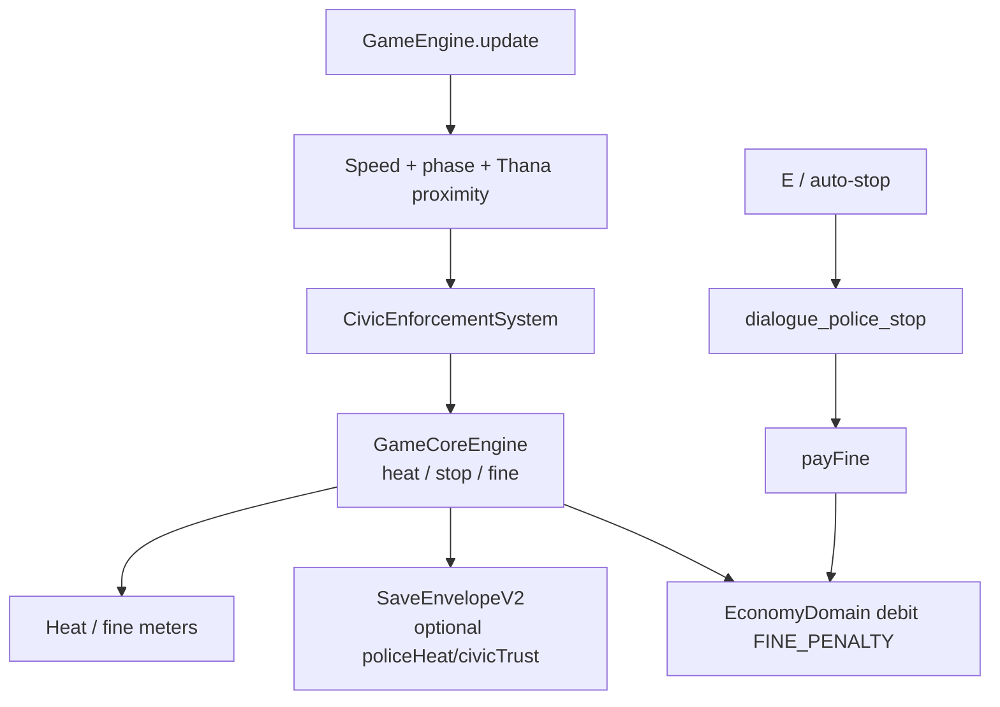

# Milestone 14 Planning Report: Police Fine, Wanted Heat & Checkpoint Enforcement

**Project:** Dhamrai Life (ধামরাই পৌরসভা জীবনযাত্রা — 3D Open World)  
**Document Type:** Final Milestone Planning & Discovery Review  
**Target Milestone:** Milestone 14  
**Status:** **READY FOR IMPLEMENTATION**  
**Date:** November 23, 2026  
**Author:** Cursor Auto (Composer) — following Milestone 13 verification handoff  

---

## 1. Executive Summary

Milestone 13 closed the Phase 1 *livelihood* loop (wear → tea → repair → cash sinks). The vertical slice now has missions, atmosphere, audio, stalls, and maintenance — but **civic consequence is still missing**:

- Ledger category **`FINE_PENALTY`** exists and is unused in gameplay.
- Archetype field **`policeHeat`** exists, always `0`, and is **not persisted** in SaveEnvelopeV2.
- Mission 2 (SI Rafiq checkpoint) is a one-shot document check with no ongoing enforcement.
- Speeding, fleeing a stop, or unpaid fines have no simulation effect.
- ROADMAP **Phase 2** explicitly lists: *“Police stop, fine, wanted, arrest and jail simulation (fictional).”*

This report establishes **Milestone 14: Police Fine, Wanted Heat & Checkpoint Enforcement** as the highest-value next step — the first Phase 2 systems slice. It activates dormant fine/heat hooks, extends Thana Junction enforcement with light traffic-rule pressure, and adds another cash sink — **without new npm deps**, **without SaveEnvelopeV3** (additive optional V2 fields), and **without full arrest/jail** (deferred).

---

## 2. Verification Status (Post–Milestone 13 Baseline)

| Gate | Observed | Source |
|---|---|---|
| Vitest | 306 passed / 4 skipped; Neon PG offline | `yarn test` |
| Typecheck | 0 errors | `yarn typecheck` |
| Python geo-pipeline | 23/23 | `.venv` unittest |
| Lockfile | Clean | `git diff yarn.lock` |
| Save schema | `saveSchemaVersion: 2` + optional stamina/tire | save-core |
| Live M13 CDP | 11/11; 60 FPS | `milestone_13_implementation_report.md` |
| Domain hooks present | `FINE_PENALTY`, `policeHeat`, SI Rafiq NPC, Thana anchor | contracts / roles / NPCManager |
| Atmosphere | Day–Night + rain (M12) | usable for night stops |

---

## 3. Current State — Civic / Traffic Hooks

### 3.1 Already Implemented (Dormant or Partial)

| Hook | Location | Status |
|---|---|---|
| `FINE_PENALTY` category | Ledger enum | Defined; **unused in gameplay** |
| `policeHeat` | `RickshawDriverArchetype.reputations` | Always 0; **not saved** |
| `civicTrust` | Same | Raised by M2; **not saved** (only transport `reputation` persists) |
| SI Rafiq + dialogue | NPCManager / dialogue_police_rafiq | One-shot license check (M2) |
| Thana Junction anchor | `PHASE_1_ANCHORS.THANA_JUNCTION_CHECKPOINT` | Present |
| Traffic agents | TrafficManager pool of 3 | Yield to player; no fines |
| Speeding | RickshawVehicle ~12–18 km/h | No civic consequence |

### 3.2 Save Compatibility Constraint

**M14 policy:** Keep `saveSchemaVersion: 2`. Persist via:

1. **Optional additive V2 player fields** (Zod `.optional()` + hydrate defaults):
   - `player.policeHeat?: number` (0–100, default 0)
   - `player.civicTrust?: number` (default 10) — also closes M2 persistence gap
2. **World flags** for ephemeral session state (last stop time, unpaid fine ids, fleeing flag) — not sole persistence for heat.
3. Ledger already supports `FINE_PENALTY` — no enum bump beyond existing value.

No V3 migration required.

---

## 4. Player Experience Gap

After M13 the player can earn, maintain, and drink tea — but nothing *civic* ever happens again after Mission 2. Speeding past Thana at night is free. `FINE_PENALTY` and `policeHeat` are dead code. Milestone 14 makes the police checkpoint *alive* and spends cash through fines, completing the Phase 1→2 handoff into ROADMAP Phase 2 enforcement.

---

## 5. Technical Debt Inventory

| Item | Severity | Description | M14 Action |
|---|---|---|---|
| **TD-17** | **HIGH** | `FINE_PENALTY` unused | **Resolve** — issue fines |
| **TD-18** | **HIGH** | `policeHeat` unused / unsaved | **Resolve** — heat loop + V2 optional field |
| **TD-19** | **MEDIUM** | `civicTrust` not persisted | **Resolve** — optional V2 field |
| **TD-20** | **MEDIUM** | Post-M2 Thana is inert | **Resolve** — repeatable soft stops |
| **TD-04** | LOW–MED | NPC day/night schedules | Defer M15+ |
| **TD-07** | LOW | CNG vehicle | Defer Phase 2 later |
| **TD-21** | MED | Traffic intersection depth | Defer (perf-sensitive) |
| **TD-22** | MED | Mission 3D wayfinding arrow | Defer (UX polish alternate) |

---

## 6. Candidate Analysis

### Candidate A: Police Fine, Wanted Heat & Checkpoint Enforcement
- Speeding / stop refusal / unpaid fine → heat; pay fine at Thana or SI dialogue; soft wanted banner.
- **Player Value:** 9/10 — consequence + cash sink + Phase 2 roadmap.
- **Risk:** Low–Medium (3.5/10) — domain math + proximity trigger + HUD.
- **Save:** Additive V2 optional fields; no V3.
- **Deps:** Zero.

### Candidate B: Mission Wayfinding / Compass Arrow
- 3D or HUD arrow to active objective.
- High UX value, but does not activate dormant ledger hooks; weaker Phase 2 alignment.

### Candidate C: NPC Day–Night Schedules (TD-04)
- Stall vendors vanish at night; pedestrians thin out; SI patrol window.
- Nice with M12; larger content/AI scope; less economy punch than fines.

### Candidate D: Traffic Yielding & Intersection Depth
- More agents, junction logic, congestion.
- ROADMAP Phase 2 core, but performance-sensitive and less tied to dormant domain fields.

### Candidate E: CNG Vehicle
- High risk / premature as first Phase 2 systems bite after M13.

**Conclusion:** **Candidate A**.

---

## 7. Candidate Scoring

| Metric (Weight) | A: Fine+Wanted | B: Wayfinding | C: NPC Schedules | D: Traffic Depth | E: CNG |
|---|:---:|:---:|:---:|:---:|:---:|
| Player Value (×2) | 9 (18) | 8 (16) | 7 (14) | 7 (14) | 7 (14) |
| Gameplay Impact (×1.5) | 9 (13.5) | 6 (9) | 7 (10.5) | 8 (12) | 8 (12) |
| Technical Feasibility | 8 (8) | 9 (9) | 6 (6) | 5 (5) | 4 (4) |
| Scope Safety | 8 (8) | 9 (9) | 6 (6) | 5 (5) | 4 (4) |
| Architectural Safety | 8 (8) | 9 (9) | 7 (7) | 6 (6) | 5 (5) |
| Save Safety | 8 (8) | 10 (10) | 8 (8) | 9 (9) | 5 (5) |
| Performance Safety | 9 (9) | 9 (9) | 7 (7) | 5 (5) | 5 (5) |
| Dependency Safety (×0.5) | 10 (5) | 10 (5) | 10 (5) | 10 (5) | 6 (3) |
| Testing Feasibility | 8 (8) | 8 (8) | 6 (6) | 5 (5) | 4 (4) |
| Roadmap Fit (×1) | 10 (10) | 5 (5) | 7 (7) | 9 (9) | 9 (9) |
| **TOTAL** | **95.5** | **89** | **76.5** | **75** | **65** |

---

## 8. Recommended Milestone 14

### 8.1 Title

**Milestone 14: Police Fine, Wanted Heat & Checkpoint Enforcement**

### 8.2 Core Objective

Introduce a lightweight civic enforcement loop: detect traffic infractions near Thana / SI Rafiq, issue `FINE_PENALTY` debits, raise/decay `policeHeat`, offer pay-at-checkpoint dialogue, and surface wanted/heat on the HUD — using existing ledger categories and additive SaveEnvelopeV2 fields.

### 8.3 Why Now?

1. M13 closed economy sinks; fines are the natural *civic* sink and Phase 2 opener.
2. Domain already has `FINE_PENALTY` + `policeHeat`.
3. SI Rafiq + Thana Junction already exist from M2.
4. M12 clock enables “night stop” flavor without new atmosphere work.
5. Arrest/jail can wait; soft heat is enough for a testable slice.

---

## 9. Scope In

### 9.1 Infraction Detection (`CivicEnforcementSystem` in game-core + web bridge)

Infractions (tunable constants):

| Code | Trigger | Base fine | Heat Δ |
|---|---|---|---|
| `SPEEDING` | Mounted speed ≥ 16 km/h inside 40 m of Thana (or while SI is “on duty”) | ৳25 | +8 |
| `NO_LICENSE` | Stopped without `rickshaw_license_slip` (post-M2 rare edge) | ৳50 | +15 |
| `FLEE_STOP` | Player leaves >12 m radius during an active stop without paying | ৳40 | +20 |
| `NIGHT_RECKLESS` | Speeding during `night` / `dusk` phase (M12) | ৳15 extra | +5 |

Rules:
- Cooldown between auto-stops (≥ 90 s) to avoid spam.
- Max one active stop session at a time.
- Deterministic unit-testable pure functions for fine amounts / heat clamp 0–100.

### 9.2 Checkpoint Stop Flow

1. When an infraction fires → status banner + optional auto-open dialogue with SI Rafiq (`dialogue_police_stop` tree).
2. Choices:
   - **Pay fine** → `FINE_PENALTY` debit (idempotent tx id); heat − partial; close stop.
   - **Show license** (if held) → reduce fine by ৳10 once per stop.
   - **Refuse / leave** → sets fleeing; `FLEE_STOP` if leaving radius.
3. Insufficient funds → refuse pay; heat stays; toast in Bn/En.

### 9.3 Wanted / Heat Loop

- `policeHeat` 0–100.
- HUD wanted pip / heat bar when heat ≥ 15.
- Soft gameplay effects (runtime only):
  - Heat ≥ 40: SI interaction radius +0.5 m; ambient “watchful” status copy.
  - Heat ≥ 70: occasional re-stop chance near Thana (still cooldown-gated).
- Passive decay: ~2 heat / game-minute while not fleeing (or ~1 / 30 real seconds) — tunable.
- Paying fine: heat −10 (min 0) in addition to clearing the stop.

### 9.4 Persistence

- Optional V2: `policeHeat`, `civicTrust`.
- World flags: `activePoliceStopId`, `lastPoliceStopMs`, `unpaidFineMinorUnits` (optional helper).
- Paying clears unpaid helper flag.

### 9.5 HUD

- Heat / wanted indicator beside reputation.
- Active fine amount when stop is open.
- Reuse M10 UI coin / dialogue ticks.

### 9.6 Domain API (`game-core`)

- `evaluateInfraction(ctx) → Infraction | null`
- `openPoliceStop(infraction)`
- `payFine(stopId)` / `dismissStop()`
- `applyPoliceHeat(delta)` / `decayPoliceHeat(dt)`
- Pure unit tests for amounts, cooldowns, insolvency, heat clamp, save hydrate defaults.

### 9.7 Content

- New dialogue tree `dialogue_police_stop` (and optionally extend Rafiq greet for post-M2 returns).
- Fiction only — no real-person naming as corrupt/criminal (existing SI Rafiq character continues as game fiction).

---

## 10. Scope Out

1. **No SaveEnvelopeV3.**
2. **No new npm dependencies.**
3. **No backend changes.**
4. **No arrest / jail / bribe tree** (Phase 2 later).
5. **No CNG / second vehicle.**
6. **No full traffic intersection rewrite.**
7. **No NPC skeletal animation / full day–night vendor schedules** (M15+ candidate).
8. **No real-world person naming as criminal.**
9. **No property / bank accounts.**
10. **No physics “wrong-way” lane enforcement** — soft proximity rules only.

---

## 11. Architecture Plan



---

## 12. File / Module Plan

| Path | Action |
|---|---|
| `packages/shared-contracts/src/index.ts` | Optional `policeHeat` / `civicTrust` on `PlayerState`; actionTriggers `PAY_FINE` / `SHOW_LICENSE_STOP` / `FLEE_STOP` |
| `packages/save-core/src/schemas/v2.schema.ts` | Optional number fields |
| `packages/game-core/src/civic-enforcement.ts` | **New** — pure fine/heat/stop logic |
| `packages/game-core/src/engine.ts` | Wire APIs; serialize heat/civicTrust |
| `packages/game-core/src/dialogue.ts` | `dialogue_police_stop` |
| `packages/game-core/test/civic-enforcement.test.ts` | **New** |
| `apps/web/src/engine/CivicEnforcementBridge.ts` | **New** — proximity + speed sampling |
| `apps/web/src/engine/GameEngine.ts` | Tick bridge; night phase input |
| `apps/web/src/components/DialogueBox.tsx` | PAY_FINE handlers |
| `apps/web/src/components/HUD.tsx` | Heat / fine readout |
| `apps/web/src/state/useSessionStore.ts` | Heat HUD fields |
| `apps/web/test/…` | Bridge + HUD unit tests |
| `scratch/m14_live_verification.cjs` | CDP: speed stop, pay, flee, heat, save |
| `guideFiles/milestone_14_implementation_report.md` | Later |

---

## 13. Testing Strategy

### Automated

1. Speeding near Thana opens stop with correct fine/heat.
2. Pay fine debits `FINE_PENALTY` idempotently; rejects insolvency.
3. Flee adds heat + flee fine.
4. Heat clamps 0–100; decay over time.
5. Old V2 saves without heat hydrate to 0; civicTrust defaults to 10.
6. Cooldown prevents stop spam.
7. Full Vitest + Python 23/23 + typecheck; lockfile clean.

### Live CDP

1. Force speed ≥ 16 km/h at Thana → stop banner + dialogue.
2. Pay ৳25 → cash down; heat reduced; ledger entry.
3. Insufficient funds path.
4. Flee stop → heat spike + banner.
5. Save/reload preserves policeHeat.
6. Night reckless surcharge when phase is night.
7. F3: FPS ≥ 55; draw calls ≤ 180.

### Screenshots

1. `m14_shot_01_heat_hud.png`
2. `m14_shot_02_speeding_stop.png`
3. `m14_shot_03_police_dialogue.png`
4. `m14_shot_04_fine_paid.png`
5. `m14_shot_05_insufficient_funds.png`
6. `m14_shot_06_flee_wanted.png`
7. `m14_shot_07_high_heat.png`
8. `m14_shot_08_night_stop.png`
9. `m14_shot_09_save_reload_heat.png`
10. `m14_shot_10_performance.png`

---

## 14. Acceptance Criteria

| ID | Requirement | Pass Condition |
|---|---|---|
| **AC-M14-01** | Speeding near Thana opens a police stop | Unit + CDP |
| **AC-M14-02** | Paying fine debits `FINE_PENALTY` and clears stop | CDP + ledger |
| **AC-M14-03** | Insufficient funds rejects payment | Unit |
| **AC-M14-04** | Fleeing raises heat and may add flee fine | Unit + CDP |
| **AC-M14-05** | Heat decays over time when not fleeing | Unit |
| **AC-M14-06** | Night reckless adds surcharge when phase is night | Unit + CDP |
| **AC-M14-07** | HUD shows heat when ≥ 15 | CDP |
| **AC-M14-08** | Save/reload preserves policeHeat (+ civicTrust) | Vitest |
| **AC-M14-09** | `saveSchemaVersion` remains **2** | Inspection |
| **AC-M14-10** | Old saves without new fields load with defaults | Hydrate test |
| **AC-M14-11** | Vitest suites green (non-PG) | `yarn test` |
| **AC-M14-12** | Typecheck + Python 23/23 | Pass |
| **AC-M14-13** | Zero new npm deps | `yarn.lock` clean |
| **AC-M14-14** | FPS ≥ 55 under systems | CDP |
| **AC-M14-15** | No arrest/jail/CNG/V3/traffic rewrite | Inspection |

---

## 15. Economy / Heat Constants (Proposed)

| Item | Value |
|---|---|
| Speeding fine | ৳25 (2,500 Poisha) |
| Flee fine | ৳40 |
| No-license fine | ৳50 |
| Night reckless add-on | ৳15 |
| License discount | −৳10 once/stop |
| Heat on speeding | +8 |
| Heat on flee | +20 |
| Heat on pay | −10 |
| Heat decay | ~2 / game-minute |
| Stop cooldown | 90 s |
| Thana enforce radius | 40 m |
| Speed threshold | 16 km/h |

*(Final numbers tunable during implementation; unit tests lock behavior.)*

---

## 16. Risk Register

| Risk | Prob. | Impact | Mitigation |
|---|:---:|:---:|---|
| Stop spam frustrates players | Med | Med | Hard cooldown + one active stop |
| Economy too punishing with M13 sinks | Med | Med | Low base fines; license discount |
| Save break from new fields | Med | High | Optional Zod + defaults |
| Conflicts with M2 dialogue | Med | Med | Separate `dialogue_police_stop` tree; M2 tree unchanged |
| Scope creep into jail/bribes | High | Med | Hard non-goals |
| Real-person harm | Low | High | Keep SI Rafiq as established fiction; no new real names |

---

## 17. Implementation Phases (When Authorized)

1. **Domain:** civic-enforcement + engine APIs + tests.
2. **Save/contracts:** optional V2 policeHeat/civicTrust + actionTriggers.
3. **Web bridge:** proximity/speed/night sampling + dialogue.
4. **HUD** + GameEngine tick.
5. **CDP + report** + `PROGRESS.md`.

---

## 18. Roadmap Impact

```text
M10 Audio ✅
M11 Visual stalls ✅
M12 Day–Night ✅
M13 Maintenance & Tea ✅
M14 Police Fine & Wanted  ← THIS MILESTONE (Phase 2 opener)
M15+ candidates: NPC schedules, traffic depth, wayfinding, CNG, …
```

---

## 19. Final Readiness Decision

### Decision: **READY FOR IMPLEMENTATION**

**Justification:** Highest scored candidate; activates dormant `FINE_PENALTY` / `policeHeat`; aligns with ROADMAP Phase 2; save-safe without V3; dependency-free; tightly testable against existing Thana/SI content.

*Awaiting explicit user authorization before beginning implementation.*
