# Milestone 7 Acceptance Report: Browser-Side Gameplay Simulation Layer

**Project:** Dhamrai Life (ধামরাই পৌরসভা জীবনযাত্রা — 3D Open World)  
**Milestone:** 7 — NPCs, Dialogue, Mission 1 Lifecycle, Autonomous Road Traffic, Authentic HUD, Minimap, Quest Journal, and Dexie Persistence  
**Date:** November 3, 2026  
**Status:** **COMPLETE & VERIFIED**  
**Runtime:** Browser-Authoritative Client (`apps/web`)  

---

## 1. Executive Summary

Milestone 7 delivers the complete **browser-side gameplay simulation layer** for Dhamrai Life, bringing the 3D open world to life with interactive characters, story missions, autonomous traffic, an authentic South Asian UI suite, and local persistence—all running strictly in the browser runtime without adding backend complexity.

### Key Deliverables Completed
1. **Domain Engine Runtime Wiring:** Integrated `@dhamrai/game-core` (`GameCoreEngine`) and `@dhamrai/save-core` (`SaveOrchestrator`) into `apps/web` via Zustand store facades (`useGameStore.ts`, `useSessionStore.ts`, `useUIStore.ts`).
2. **First-Generation NPC System:** Built `NPCManager.ts` spawning key story NPCs at canonical anchors:
   - **Farhana (College Student):** Rathkhola Market Corner $(15.0, 0.0, -10.0)$.
   - **SI Rafiq (Police Patrol):** Thana Junction Checkpoint $(-61.0, 0.0, 66.5)$.
   - **Gouranga Karmakar (Brass Artisan):** Kayetpara Metal Workshop $(-295.3, 0.0, -77.0)$.
   - Plus 2 ambient pedestrians on roadside walking patrol loops.
3. **Declarative Bilingual Dialogue Engine:** Implemented authentic Bengali + English dialogue trees (`dialogue.ts`, `DialogueBox.tsx`) with speaker badges, keyboard shortcuts (`[1]`, `[2]`, `[Esc]`, `[Enter]`), and game action triggers (`BOARD_PASSENGER`, `CLOSE_DIALOGUE`).
4. **Mission 1 ("First Fare" / দিনের প্রথম যাত্রী) Full Lifecycle:**
   - Spatial interaction ($2.5$m range) at Rathkhola Market Corner.
   - Farhana boarding transition: mesh re-parented to rickshaw passenger seat, physics collider disabled.
   - Dynamic destination tracker on HUD and Minimap with real-time countdown distance to Hardinge High School Gate.
   - Destination arrival check ($15$m threshold): passenger safely dismounts at school gate, objective `obj_m1_dropoff` completes, mission completes, **৳30.00 BDT (3,000 Poisha)** is credited to the append-only ledger, **+5 Transport Reputation** is awarded, and automatic Dexie/IndexedDB persistence is executed.
5. **Lightweight Autonomous Road Traffic AI:** Implemented `TrafficManager.ts` running 3 pooled ambient pedal rickshaws along road edges from `directed_nav_graph.json` at 8–12 km/h ($2.22 - 3.33$ m/s). Features 4m forward obstacle detection, anti-deadlock respawning ($>6$s halted), distance recycling ($>140$m), and zero garbage collection allocations.
6. **South Asian Authentic React 19 UI Layer:**
   - **HUD Overlay (`HUD.tsx`):** Bengali currency balance (`৳250.00` $\to$ `৳280.00`), Transport Reputation (`★ 10` $\to$ `★ 15`), speedometer, active mission banner, objective distance countdown, contextual prompt bar, and toast notification feed.
   - **2D Canvas Minimap Radar (`Minimap.tsx`):** Real-time road graph radar, player heading cone, 40m/80m/120m range rings, and gold pulsating destination beacon.
   - **Quest Journal Modal (`JournalModal.tsx`):** 3-tab layout (`চলতি দায়িত্ব`, `সম্পন্ন কাজ`, `ধামরাই পরিচিতি`) showing task objectives, payouts, and Dhamrai heritage lore.
   - **Inventory Modal (`InventoryModal.tsx`):** 20-slot inventory grid holding the Rickshaw License Slip, item descriptions, and recent ledger feed.
   - **Diagnostics Overlay (`PerformanceOverlay.tsx`):** Toggleable with `[F3]`, displaying FPS, frame times, draw calls, triangles, and active colliders without overlapping HUD elements.
7. **Zero Schema Bump:** Preserved canonical `SaveEnvelopeV2` with zero schema bump, recording completed mission states and ledger transactions cleanly.

---

## 2. Architecture & Runtime Dataflow

```mermaid
flowchart TD
    subgraph BrowserAuthoritativeRuntime ["apps/web — Browser Authoritative Client"]
        subgraph EngineLoop ["60 Hz Fixed-Timestep Loop (GameEngine.ts)"]
            IM["InputManager (WASD, E, F, J, I, V, F3)"]
            PW["PhysicsWorld (Rapier 3D WASM)"]
            CC["CharacterController (Kinematic)"]
            RV["RickshawVehicle (Raycast Vehicle)"]
            NM["NPCManager (Story & Ambient Pedestrians)"]
            TM["TrafficManager (Road Graph AI)"]
            CS["ChunkStreamer (3x3 Ring)"]
            CD["CameraDirector (Occlusion Avoidance)"]
            SM["SceneManager (Three.js WebGL2)"]
        end

        subgraph StoreFacades ["Zustand State Stores"]
            SS["useSessionStore<br>(Coords, Speed, FPS, Bell)"]
            GS["useGameStore<br>(GameCoreEngine & Save Facade)"]
            UIS["useUIStore<br>(Dialogue, Journal, Inventory, F3)"]
        end

        subgraph UIComponents ["React 19 South Asian UI Suite"]
            HUD["HUD Overlay (৳ Cash, ★ Rep, Objective)"]
            MM["Minimap (2D Canvas Road Graph)"]
            DB["DialogueBox (Bengali/English Choice Engine)"]
            JM["JournalModal (Active & Completed Quests)"]
            IM_UI["InventoryModal (20-Slot Grid & Ledger Feed)"]
            PO["PerformanceOverlay (Diagnostics HUD)"]
        end

        subgraph LocalPersistence ["Local Browser Storage"]
            IDB["Dexie / IndexedDB (IndexedDBStorageAdapter)"]
            SO["SaveOrchestrator (SaveEnvelopeV2)"]
        end
    end

    subgraph DomainPackage ["packages/game-core (Pure TypeScript Domain)"]
        GCE["GameCoreEngine"]
        MD["MissionDomain (M1, M2, M3)"]
        ED["EconomyDomain (Integer Poisha Ledger)"]
        ID["InventoryDomain (Items, Category Slots)"]
    end

    subgraph DataWorld ["data/world (Geospatial Pipeline Assets)"]
        DNG["directed_nav_graph.json (453 Nodes, 934 Edges)"]
        GLB["16 Chunk GLBs (LOD Terrains & Buildings)"]
    end

    IM --> EngineLoop
    EngineLoop --> PW
    EngineLoop --> NM
    EngineLoop --> TM
    EngineLoop --> CS
    EngineLoop --> CD
    EngineLoop --> SM

    EngineLoop --> StoreFacades
    StoreFacades --> UIComponents
    GS --> GCE
    GS --> SO
    SO --> IDB

    TM --> DNG
    MM --> DNG
    CS --> GLB
```



---

## 3. Implementation Verification & Test Results

### 3.1 Automated Test Suite (100% Pass)
The full monorepo test suite was executed via Yarn Classic `1.22.22`. All **28 test files** and **200 tests passed with zero failures and zero skipped tests**.

```text
 ✓ apps/web/test/vehicle-controller.test.ts (5 tests)
 ✓ apps/web/test/npc-manager.test.ts (4 tests)
 ✓ apps/web/test/traffic-ai.test.ts (6 tests)
 ✓ apps/web/test/physics-integration.test.ts (6 tests)
 ✓ packages/save-core/test/save-restore.test.ts (16 tests)
 ✓ apps/web/test/gamestore-persistence.test.ts (4 tests)
 ✓ apps/api/test/env.test.ts (12 tests)
 ✓ packages/game-core/test/inventory.test.ts (6 tests)
 ✓ packages/game-core/test/engine.test.ts (3 tests)
 ✓ apps/web/test/camera-director.test.ts (5 tests)
 ✓ packages/save-core/test/checksum.test.ts (5 tests)
 ✓ apps/api/test/startup.test.ts (5 tests)
 ✓ packages/game-core/test/roles.test.ts (3 tests)
 ✓ apps/api/test/postgres-repository.test.ts (2 tests)
 ✓ packages/shared-contracts/test/contracts.test.ts (8 tests)
 ✓ packages/game-core/test/economy.test.ts (7 tests)
 ✓ packages/game-core/test/missions.test.ts (6 tests)
 ✓ packages/game-core/test/dialogue.test.ts (3 tests)
 ✓ apps/web/test/webgl-detection.test.ts (5 tests)
 ✓ apps/api/test/aes-gcm.test.ts (6 tests)
 ✓ apps/api/test/postgres.real.test.ts (4 tests)
 ... and remaining suites

 Test Files  28 passed (28)
      Tests  200 passed (200)
   Duration  6.62s
```

### 3.2 Real PostgreSQL Integration Tests
Verified against the live PostgreSQL database configured in `apps/api/.env`:
- Two independent connection pools: **PASS**
- Concurrent first registration convergence: **PASS**
- Concurrent registrations retain existing user ID: **PASS**
- Distributed PostgreSQL lease locking & atomic expiry reclamation: **PASS** (4/4 passed).

### 3.3 Python Slice & Geospatial QA Suite
Ran `./.venv/bin/python -m unittest discover -s tools/geo-pipeline -p "test_*.py"`:
- **QA-GEO-01:** Chunks strictly contained in $[-512\text{m}, 512\text{m}]$: **PASS**
- **QA-TOPO-02:** Seam continuity verified across 96 chunk boundaries ($\le 0.001\text{m}$): **PASS**
- **QA-ROUTING-03:** Traversable route found (597.4m, 25 edges): **PASS**
- **QA-COLLISION-04:** Watertight mesh non-degenerate geometry: **PASS**
- **QA-BUDGET-05:** Peak file size 108.6 KB ($<2.5\text{MB}$), peak tris 1,538 ($<40,000$): **PASS**
- Total python tests: **23 passed in 0.176s**.

### 3.4 TypeScript Typecheck
- Command: `yarn typecheck` (`tsc -b`).
- Result: **0 errors across all 5 workspace projects**.

---

## 4. Live Browser Verification & Visual Evidence

Live browser testing was conducted against the Vite WebGL2 runtime (`http://localhost:5175`) using Chrome Headless with Chrome DevTools Protocol (CDP) WebSocket automation. Every phase of Milestone 7 gameplay was exercised and documented with high-resolution screenshots.

### Screenshot 1: Spawn HUD & Minimap at Rathkhola Stand

- **Observed:**
  - Player spawns on foot at Rathkhola Stand $(0, 0.5, 0)$.
  - Top Left: Initial cash balance `৳250.00 BDT`, Transport Reputation `★ 10`, Mode `হেঁটে চলছেন (ON FOOT)`, Coordinates $(0, 0)$.
  - Top Right: Active mission tracker displays `বর্তমান দায়িত্ব: দিনের প্রথম যাত্রী` and `যাত্রী তুলুন (রথখোলা বাজার মোড়) (18m)`.
  - Bottom Left: Circular radar minimap rendering road network from `directed_nav_graph.json` with range rings and gold objective marker.
  - Bottom Center: Contextual prompt `Ready — Dhamrai Rathkhola Stand`.
  - Bottom Right: Control guide `[E] কথা বলুন · [F] রিকশা · [J] ডায়েরি · [I] থলে · [F3] ডিবাগ`.

---

### Screenshot 2: Bilingual Dialogue Box with Farhana

- **Observed:**
  - Player walked within 2.5m of Farhana at Rathkhola Market Corner $(14.0, 0.5, -9.5)$ and pressed `[E]`.
  - Contextual prompt detected interactive NPC: `[E] কথা বলুন (Talk to Farhana (College Student))`.
  - Dialogue Box opened with blue `STUDENT FARHANA` badge.
  - Bengali: *"ভাইয়া, হার্ডিঞ্জ স্কুল গেটে যাবেন? ক্লাস শুরু হয়ে যাবে, একটু তাড়া আছে!"*
  - English: *"Brother, will you go to Hardinge School Gate? Class is about to start, I am in a hurry!"*
  - Choices displayed:
    - `[1] হ্যাঁ চলুন, রিকশায় উঠুন। ভাড়া ৩০ টাকা। (Yes let's go, please board the rickshaw. Fare is ৳30.)`
    - `[2] এখন যেতে পারছি না বোন, অন্য রিকশা দেখুন। (I cannot go right now sister, please find another rickshaw.)`

---

### Screenshot 3: Passenger Boarded into Rickshaw

- **Observed:**
  - Player selected Choice 1 by pressing `[1]`.
  - Action trigger `BOARD_PASSENGER` executed:
    - Farhana's mesh re-parented to rickshaw passenger seat $(0, 0.65, 0.55)$.
    - Proximity physics collider disabled to prevent self-collision.
    - Objective `obj_m1_pickup` completed.
    - Active objective transitioned to: `যাত্রী নামিয়ে দিন (হার্ডিঞ্জ স্কুল গেট) (229m)`.
    - Toast notification: *"ফারহানা রিকশায় উঠেছে। গন্তব্য: হরগোবিন্দ স্কুল গেট।"*

---

### Screenshot 4: Quest Journal Modal (`[J]`)

- **Observed:**
  - Pressed `[J]` to open the Quest Journal overlay with backdrop blur.
  - Header: `ডায়েরি ও কর্মতালিকা (Journal & Tasks) — ধামরাই পৌরসভা জীবনযাত্রা`.
  - 3 Tabs: `চলতি দায়িত্ব (3)`, `সম্পন্ন কাজ (0)`, `ধামরাই পরিচিতি`.
  - Mission 1 Card:
    - Title: `দিনের প্রথম যাত্রী` / `First Fare` / `৳30.00`.
    - Description: *"Pick up passenger at Rathkhola Market Corner and transport to Hardinge High School Gate."*
    - Checkbox: `✓ যাত্রী তুলুন (রথখোলা বাজার মোড়)` (checked in green).
    - Checkbox: `○ যাত্রী নামিয়ে দিন (হার্ডিঞ্জ স্কুল গেট)` (pending).
  - Mission 2 (`চেকপোস্ট ও কাগজপত্র`) and Mission 3 (`কাঁসা-পিতলের ফরমায়শ`) listed as available.

---

### Screenshot 5: Inventory Modal (`[I]`)

- **Observed:**
  - Pressed `[I]` to open the Inventory modal.
  - Header: `রিকশাচালকের থলে (Inventory)` with green balance: `নগদ তহবিল: ৳250.00 BDT`.
  - 20-slot item grid showing:
    - Slot 1: `রিকশার লাইসেন্স স্লিপ` (Rickshaw License Slip item).
    - Slots 2–20: Available empty slots.
  - Right panel:
    - Item inspection details.
    - `সাম্প্রতিক লেনদেন (RECENT LEDGER)`: shows starting ledger transaction `+৳250.00`.

---

### Screenshot 6: Mission 1 Completed at Hardinge High School Gate

- **Observed:**
  - Transported Farhana to Hardinge High School Gate $(-73.0, 1.0, -221.0)$.
  - Distance check triggered ($<15$m threshold):
    - Farhana dismounted safely at the school gate mesh.
    - Objective `obj_m1_dropoff` marked complete.
    - Mission 1 completed with celebratory banner: `✓ মিশন সম্পন্ন (Completed)`.
    - Payout applied: Ledger balance increased from `৳250.00` to **`৳280.00 BDT` (+৳30.00)**.
    - Transport Reputation increased from `★ 10` to **`★ 15` (+5 সুনাম)**.
    - Automatic persistence triggered: green toast displays **`সংরক্ষিত (Saved: Autosave)`**.
    - 3D world shows town buildings of Hardinge High School area loaded seamlessly.

---

### Screenshot 7: Completed Mission in Quest Journal

- **Observed:**
  - Opened Quest Journal after delivery:
  - Active tasks decreased from 3 to **2** (`চলতি দায়িত্ব (2)`).
  - Completed tasks incremented from 0 to **1** (`সম্পন্ন কাজ (1)`).
  - Mission 1 (`দিনের প্রথম যাত্রী`) successfully transitioned to the Completed archive.

---

### Screenshot 8: Updated Economy Ledger in Inventory

- **Observed:**
  - Opened Inventory modal after delivery:
  - Cash balance reflects **`৳280.00 BDT`**.
  - Recent Ledger shows immutable transaction history:
    - `Reward for completing mission_1_first_fare: +৳30.00`
    - `Starting cash balance: +৳250.00`

---

### Screenshot 9: Diagnostics & Performance Overlay (`[F3]`)

- **Observed Diagnostics HUD:**
  - **Frame Rate:** **60 FPS (16.7 ms)** (Budget: $\ge 30$ FPS — **PASS**)
  - **Draw Calls:** **24 calls** / 180 max (Budget: $\le 180$ — **PASS**)
  - **Triangles:** **4,607 tris** / 120,000 max (Budget: $\le 120,000$ — **PASS**)
  - **Active Colliders:** **81 colliders** / 200 max (Budget: $\le 200$ — **PASS**)
  - **Active Chunks:** **9 / 16 chunks** (Standard 3×3 streaming ring active around Hardinge High School area)
  - **Active Traffic Agents:** **3 autonomous rickshaws** operating on road edges.

---

## 5. Performance Metrics Summary Table

| Metric | Measured Value | Target Budget | Margin | Evaluation |
|---|---|---|---|---|
| **Frame Rate** | **60 FPS** | $\ge 30\text{ FPS}$ | $+30\text{ FPS}$ ($2.0\times$ budget) | **EXCELLENT** |
| **Frame Time** | **16.7 ms** | $\le 33.3\text{ ms}$ | $-16.6\text{ ms}$ headroom | **EXCELLENT** |
| **Draw Calls** | **24 calls** | $\le 180\text{ calls}$ | $86.7\%$ under budget | **EXCELLENT** |
| **Triangles Rendered** | **4,607 tris** | $\le 120,000\text{ tris}$ | $96.2\%$ under budget | **EXCELLENT** |
| **Active Colliders** | **81 colliders** | $\le 200\text{ colliders}$ | $59.5\%$ under budget | **EXCELLENT** |
| **Active Chunks** | **9 chunks** | 9 chunks ($3\times3$ ring) | Exactly on specification | **EXCELLENT** |
| **Active Traffic Agents** | **3 vehicles** | $2\text{--}4\text{ vehicles}$ | Within pool bounds | **EXCELLENT** |
| **GC Allocations in Tick** | **0 allocs/frame** | Zero per-frame GC | Vectors/Quaternions pre-allocated | **EXCELLENT** |

---

## 6. Save Schema Compatibility Review

- **Canonical Version:** Retained `SaveEnvelopeV2` (Zero schema bump to V3).
- **Storage Adapter:** Transactional Dexie/IndexedDB storage via `IndexedDBStorageAdapter`.
- **Integrity:** SHA-256 checksum generated and validated on every write and load.
- **Payload Verification:**
  - Cash balance persisted as integer minor units (`28000` Poisha = ৳280.00 BDT).
  - Mission 1 recorded with state `'COMPLETED'`.
  - Reputation recorded with `transportReputation: 15`.
  - Zero schema violations or migration regressions.

---

## 7. Compliance Checklist

- [x] **Browser-Authoritative Runtime:** Gameplay, Three.js, Rapier WASM, NPCs, road traffic, missions, economy ledger, and persistence executed 100% in browser.
- [x] **Lightweight NestJS API:** `apps/api` untouched; no server-side simulation or physics.
- [x] **Package Manager Integrity:** Preserved Yarn Classic `1.22.22` with zero lockfile drift.
- [x] **Zero New Dependencies:** Implemented entire Milestone 7 using pre-existing React 19, Three.js, Rapier, and Zustand dependencies.
- [x] **Git Safety:** Zero git commits or pushes executed.
- [x] **Milestone Boundary:** Scope strictly confined to Milestone 7; Milestone 8 (Google OAuth cloud saves) has not been started.
- [x] **Automated Tests:** 200/200 tests passing across 28 test suites.
- [x] **Geospatial & Slice QA:** 23/23 python tests passing.
- [x] **Live Browser Verification:** Verified with 9 screenshots capturing the full gameplay loop.

---

## 8. Conclusion & Milestone 8 Recommendation

Milestone 7 is **100% complete, fully verified, and ready for acceptance**.

The browser-authoritative gameplay simulation layer provides an authentic, high-performance foundation with rich character interaction, quest progression, autonomous road traffic, and instant local persistence.

With Milestone 7 verified, the project is ready to proceed to **Milestone 8 Planning** (Google OAuth authentication UI and Google Drive cloud-save synchronization) upon user authorization.
