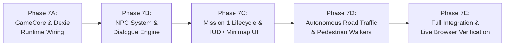

# Milestone 7 Planning Report
**Browser-Side Gameplay Simulation Layer: NPCs, Dialogue, Mission 1, Lightweight Road Traffic, HUD, Minimap, Journal, and Dexie Persistence**

**Date:** 3 November 2026  
**Document Status:** PROPOSAL & TECHNICAL SPECIFICATION (PLANNING ONLY)  
**Milestone Scope:** Milestone 7  
**Author:** Google DeepMind / Antigravity Agent  
**Baseline Acceptance:** Milestone 6 Approved & Verified  

---

## 1. Current Repository State

The Dhamrai Life repository is a monorepo managed with **Yarn Classic 1.22.22**, organized with a strict browser-first architecture:

1. **`apps/web`:** React 19, Vite 7.3.7, Three.js 0.170.0 (WebGL 2), `@dimforge/rapier3d-compat` 0.21.0 (Rapier 3D WASM), Zustand 5.0.0. Houses the 3D runtime, camera director, character controller, 3-wheel raycast cycle rickshaw, and distance-based 3×3 chunk streamer.
2. **`apps/api`:** Lightweight NestJS service for Google OAuth authentication, session tokens, AES-256-GCM encryption, PostgreSQL-backed distributed lease locks, and Google Drive cloud-save storage. Untouched by 3D rendering, physics, or game logic.
3. **`packages/game-core`:** Pure TypeScript domain engine without DOM or Node dependencies:
   - `GameCoreEngine`: Aggregate root coordinating domain subsystems and save envelope generation.
   - `MissionDomain`: Declarative state machine containing 3 Phase 1 missions (`mission_1_first_fare`, `mission_2_police_checkpoint`, `mission_3_artisan_order`).
   - `EconomyDomain`: Append-only transaction ledger with integer minor-unit arithmetic (Poisha: 1 BDT = 100 Poisha).
   - `InventoryDomain`: Item management with stack limits and category classifications.
   - `roles.ts`: `RickshawDriverArchetype` role definitions, starting cash (৳120 = 12,000 Poisha), daily vehicle rent, and reputations.
4. **`packages/save-core`:** Save persistence and schema validation:
   - `SaveEnvelopeV2`: Canonical Zod schema requiring BDT currency, integer minor units, and SHA-256 checksums.
   - `Dexie / IndexedDB`: `IndexedDBStorageAdapter` for transactional browser-local persistence.
   - `SaveOrchestrator`: Coordinates validation, checksum generation, slot management, export/import, and V1 $\to$ V2 migrations.
5. **`packages/shared-contracts`:** Single source of truth for spatial coordinates, `PHASE_1_ANCHORS`, `WorldPosition`, currency constants, and DTOs.
6. **`data/world/`:** Offline geospatial pipeline outputs:
   - `directed_nav_graph.json`: 453 nodes, 934 directed edges, 13.132 km total road length.
   - `mission_routes.json`: Pre-computed routes between anchor points.
   - `world_manifest.json` and 16 GLB chunk meshes (`dhamrai_chunk_x-2_z-2.glb` through `dhamrai_chunk_x1_z1.glb`).

---

## 2. Milestone 6 Baseline

Milestone 6 delivered a verified browser-side 3D runtime:
- **Verified Metrics:**
  - 183 / 183 Vitest tests passed (24 test files).
  - 4 / 4 real PostgreSQL integration tests passed.
  - TypeScript compiler typecheck clean (`tsc -b`, 0 errors).
  - 23 / 23 Python tests and 5 / 5 slice QA checks (`QA-GEO-01` – `QA-BUDGET-05`) passed.
  - 59 / 59 evidence file checksums verified.
- **Verified Runtime Capabilities:**
  - WebGL 2 Three.js renderer with PCF shadows, ACESFilmic tone mapping, and fog.
  - 60 Hz fixed-timestep game loop sub-stepping Rapier 3D WASM physics.
  - Kinematic character capsule controller with autostep (0.3m) and slope limit (45°).
  - 3-wheel raycast cycle rickshaw with dynamic mass, suspension, steering angle ($\pm 35^\circ$), pedaling acceleration, braking, and bell banner notification.
  - Dual-mode camera (1st person eye level, 3rd person 4.5m follow) with raycast occlusion pullback against buildings.
  - 3×3 distance-based chunk streaming ring across 16 canonical chunks.
- **Observed Performance Envelope (M6 Benchmark):**
  - **Frame Rate:** 60 FPS (16.6 – 16.8 ms)
  - **Draw Calls:** 23 – 40 calls (limit: 180 max)
  - **Triangles:** 3,643 – 8,485 tris (limit: 120,000 max)
  - **Colliders:** 62 – 74 active colliders (limit: 200 max)
  - **Active Chunks:** 9 / 16 chunks

---

## 3. Proposed Milestone 7 Objective

> **"Implement the browser-side gameplay simulation layer for Dhamrai Life by integrating `@dhamrai/game-core` domain execution, local IndexedDB persistence via `SaveOrchestrator`, practical ambient NPCs with spatial dialogue interaction, the full lifecycle of Mission 1 ('First Fare'), lightweight autonomous road traffic, and an authentic South Asian HUD, Minimap, Journal, and Inventory UI—maintaining a strict 60 FPS budget with zero new backend complexity."**

---

## 4. Proposed Feature Scope

### 4.1 GameCore Runtime Integration & Local Persistence
- **Domain Engine Instantiation:** Instantiate `GameCoreEngine` within `apps/web` upon session start (either creating a new game or hydrating from a Dexie save slot).
- **Domain-to-Physics Synchronization:** Synchronize player world position, heading, vehicle occupancy, cash balance, and inventory between the 60 Hz physics loop and `GameCoreEngine`.
- **Dexie / IndexedDB Local Storage:** Wire `SaveOrchestrator` to automatically save the session:
  - Periodic autosave every 60 seconds.
  - Event-driven autosave upon mission objective completion or fare payout.
  - Slot management: Support `Slot 1`, `Slot 2`, and `Autosave`.
  - Manual Save / Load / Export / Import `.json` envelope controls in a settings/save panel.

### 4.2 First-Generation NPC System
- **Key Story NPCs (Fixed World Anchors):**
  1. `npc_student_farhana` (Farhana — Student Passenger): Spawns at `PHASE_1_ANCHORS.RATHKHOLA_MARKET_PICKUP` $(15.0, 0.0, -10.0)$. Boardable passenger for Mission 1.
  2. `npc_police_rafiq` (Sub-Inspector Rafiq — Patrol Officer): Spawns at `PHASE_1_ANCHORS.THANA_JUNCTION_CHECKPOINT` $(-61.0, 0.0, 66.5)$. Document inspection NPC for Mission 2.
  3. `npc_artisan_gouranga` (Gouranga Karmakar — Master Artisan): Spawns at `PHASE_1_ANCHORS.KAYETPARA_METAL_WORKSHOP` $(-295.3, 0.0, -77.0)$. Brass bell cargo quest-giver for Mission 3.
- **Ambient Pedestrian Walkers:**
  - Up to 6–8 ambient pedestrians active in the 3×3 chunk ring.
  - Spawn within 40m–80m of player along sidewalk road edges; despawn beyond 100m.
  - Simple kinematic walk behavior between local sidewalk waypoints (speed: 1.2 m/s).
- **Visual Representation:**
  - Lightweight procedural 3D meshes (capsule body + traditional colored attire: salwar kameez, lungi, saree, police uniform).
  - Low poly count ($\le 250$ triangles per NPC). Zero external asset downloading overhead.
- **Collision & Proximity:**
  - Kinematic Rapier capsule colliders for key NPCs.
  - Proximity interaction trigger: detected when player is within $2.5$m.

### 4.3 Dialogue & Interaction System
- **Interaction Prompt:** Contextual HUD prompt appears when within $2.5$m:
  - On foot near NPC: `[E] Talk to Farhana (যাত্রী)`
  - Near rickshaw: `[F] Enter Rickshaw`
- **Declarative Dialogue Trees:**
  - Nodes defined with unique IDs, bilingual speaker name, bilingual dialogue text (Bengali + English), and optional response choices.
  - Action triggers attached to nodes: `START_MISSION_1`, `BOARD_PASSENGER`, `INSPECT_DOCUMENTS`, `CLOSE_DIALOGUE`.
- **Dialogue UI Component:**
  - Clean bottom-center dialogue card rendered in React layered above the WebGL canvas.
  - Authentic typography: Hind Siliguri / Noto Sans Bengali font support, high-contrast dark theme (`rgba(13, 17, 23, 0.92)`).
  - Keyboard navigation: `[1]`, `[2]` or `[Enter]` to choose options; `[Escape]` or `[E]` to close.

### 4.4 Mission 1: 'First Fare' (দিনের প্রথম যাত্রী) Full Lifecycle
- **Step 1 — Discovery & Acceptance:**
  - Player spawns at Rathkhola Stand, drives rickshaw 15m east to Rathkhola Market Corner $(15.0, 0.0, -10.0)$.
  - Farhana is waiting with a school bag. Interaction prompt `[E] Talk to Farhana` activates.
  - Dialogue triggers mission activation (`MissionDomain.activateMission('mission_1_first_fare')`).
- **Step 2 — Boarding:**
  - Farhana climbs onto the rickshaw passenger seat (NPC mesh attaches to `rickshaw.getPassengerSeatPosition()`).
  - Objective 1 completes (`obj_m1_pickup`).
  - HUD and Minimap update with objective 2: "Drive to Hardinge High School Gate" $(-73.1, 1.0, -221.3)$ ($597\text{m}$ journey along the town road).
- **Step 3 — Transit & Road Navigation:**
  - Player pedals rickshaw north along the town road following road geometry.
  - Distance indicator on HUD counts down in real time.
- **Step 4 — Drop-Off & Payout:**
  - Upon reaching within 15m of Hardinge Gate, Farhana dismounts to the school entrance.
  - Objective 2 completes (`obj_m1_dropoff`).
  - Mission completes:
    - Fare payment of 3,000 Poisha (৳30.00 BDT) credited to `EconomyDomain` append-only ledger (`FARE_PAYMENT`).
    - Reputation +5 Transport Reputation awarded.
    - Notification fanfare banner displayed on HUD: `🎉 মিশন সম্পন্ন: দিনের প্রথম যাত্রী! +৳৩০.০০ | +৫ সুনাম`.
    - Autosave triggered immediately.

### 4.5 Heads-Up Display (HUD)
- **Top-Left (Player Status Bar):**
  - Cash balance formatted in BDT: `৳150.00` (computed from integer minor units).
  - Transport Reputation badge: `★ 15`.
  - Mode badge: `ON FOOT` or `RICKSHAW (11.4 km/h)`.
- **Top-Right (Mission Tracker):**
  - Active Mission title: `দিনের প্রথম যাত্রী (First Fare)`.
  - Active Objective: `হার্ডিঞ্জ স্কুল গেটে পৌঁছান (142m)`.
- **Center-Bottom (Interaction Prompt):**
  - Contextual prompt when near interactive objects/NPCs: `[E] Talk` / `[F] Mount`.
- **Bottom Banner (Event Toast):**
  - Bell ringing toast (`🔔 Tring Tring!`).
  - Earnings/Reputation popups.
- **Debug Performance Toggle:**
  - Milestone 6 diagnostics HUD hidden by default, toggled on/off with `F3`.

### 4.6 2D Radar Minimap
- **Rendering Approach:** Lightweight 2D Canvas in bottom-left corner ($180\text{px} \times 180\text{px}$).
- **Contents:**
  - Local road centerlines within 150m radius extracted from `directed_nav_graph.json`.
  - Player blip with directional heading cone.
  - Parked rickshaw blip (green icon).
  - Story NPCs (blue dots) and ambient pedestrians (white dots).
  - Active mission destination waypoint (pulsing gold beacon with distance in metres).
- **Performance:** Rendered via 2D Canvas 2D context; 0 Three.js draw calls, $< 0.4\text{ ms}$ per frame.

### 4.7 Journal Panel
- **Access:** Toggled with `J` or `M`.
- **Features:**
  - Tab 1: **Active Missions** (description, current objective, reward, waypoint button).
  - Tab 2: **Completed Missions** (completion timestamp, payout received, reputation earned).
  - Tab 3: **Town Landmarks** (Rathkhola Stand, Hardinge High School, Yashomadhab Mandir, etc.).
- **Zero Simulation Cost:** Pauses or blurs background while open; zero 3D overhead.

### 4.8 Inventory UI
- **Access:** Toggled with `I` or `Tab`.
- **Features:**
  - 20-slot inventory grid.
  - Displays initial starting item: `Rickshaw Registration Slip` (`রিকশা লাইসেন্স কাগজ`).
  - Tooltip showing item category, stack size, and bilingual descriptions.
  - Wallet balance display and recent transaction ledger feed (`+৳30.00 Fare Payment`, `-৳50.00 Vehicle Rental`).

### 4.9 Lightweight Autonomous Road Traffic AI
- **Scope Limit:** 2–4 ambient pedal rickshaws / bicycles operating on `directed_nav_graph.json`.
- **Behavior:**
  - Spawn on road graph nodes 40m–80m from player.
  - Follow road edges at 8–12 km/h.
  - Raycast obstacle detection: forward raycast (4m) stops vehicle if blocked by player or another rickshaw.
  - Despawn when distance to player exceeds 120m.
  - Vehicle pooling: reuse 4 pre-allocated vehicle instances to avoid garbage collection.

---

## 5. Architecture

```mermaid
flowchart TD
    subgraph BrowserAuthoritativeRuntime ["apps/web (Browser Client Autoritative)"]
        subgraph EngineCore ["3D Engine Loop (60 Hz)"]
            GE["GameEngine.ts Coordinator"]
            PW["PhysicsWorld (Rapier 3D WASM)"]
            CC["CharacterController"]
            RV["RickshawVehicle"]
            NM["NPCManager (Kinematic NPCs)"]
            TM["TrafficManager (Road Graph AI)"]
            CS["ChunkStreamer (3x3 Ring)"]
            CD["CameraDirector"]
            SM["SceneManager (Three.js WebGL2)"]
        end

        subgraph DomainBridge ["Zustand State Stores"]
            SS["useSessionStore (Coords, Speed, FPS)"]
            GS["useGameStore (Engine Facade Bridge)"]
            UIS["useUIStore (Modals: Dialogue, Journal, Inv)"]
        end

        subgraph ReactHUD ["React 19 UI Layer"]
            HUD["HUDOverlay (Cash, Rep, Mission)"]
            MM["Minimap (2D Canvas Road Graph)"]
            DB["DialogueBox (Bengali/English)"]
            JM["JournalModal (Missions & Lore)"]
            IM["InventoryModal (Items & Ledger)"]
            SM_UI["SaveManagerModal (Slots & JSON)"]
        end
    end

    subgraph DomainPackage ["packages/game-core (Pure Domain)"]
        GCE["GameCoreEngine"]
        MD["MissionDomain (M1, M2, M3)"]
        ED["EconomyDomain (Ledger, Poisha)"]
        ID["InventoryDomain (Items, Slots)"]
    end

    subgraph SavePackage ["packages/save-core (Persistence)"]
        SO["SaveOrchestrator"]
        IDB["IndexedDBStorageAdapter (Dexie)"]
        V2S["SaveEnvelopeV2 Schema"]
    end

    subgraph DataWorld ["data/world (Static Offline Assets)"]
        DNG["directed_nav_graph.json"]
        MR["mission_routes.json"]
        GLB["16 Chunk GLBs"]
    end

    GE --> PW
    GE --> NM
    GE --> TM
    GE --> CS
    CS --> GLB
    TM --> DNG
    GE --> GS
    GS --> GCE
    GCE --> MD
    GCE --> ED
    GCE --> ID
    GS --> SO
    SO --> IDB
    SO --> V2S
    GS --> HUD
    GS --> MM
    GS --> DB
    GS --> JM
    GS --> IM
    GS --> SM_UI
```



### Exact Package & App Ownership

| Component | Target Location | Responsibilities |
| :--- | :--- | :--- |
| **Domain Logic** | `packages/game-core` | Pure domain rules: mission state machine, payout ledger calculations, inventory capacity, role definitions. Zero Three.js or DOM code. |
| **Contracts** | `packages/shared-contracts` | DTO interfaces: `DialogueTree`, `NPCEntityDefinition`, `TrafficAgentState`, `SaveEnvelopeV2`, `WorldPosition`. |
| **Save Persistence** | `packages/save-core` | `SaveOrchestrator`, `IndexedDBStorageAdapter` (Dexie), Zod V2 validator, SHA-256 integrity hasher. |
| **3D Simulation & AI** | `apps/web/src/engine/` | `NPCManager.ts`, `TrafficManager.ts`, `GameEngine.ts`, `MinimapRenderer.ts`. 3D mesh instancing, Rapier colliders, path advancement. |
| **UI & Reactive State**| `apps/web/src/state/`, `apps/web/src/components/` | Zustand stores (`useGameStore.ts`, `useUIStore.ts`), React 19 UI overlays (`HUD.tsx`, `DialogueBox.tsx`, `Minimap.tsx`, `JournalModal.tsx`, `InventoryModal.tsx`). |
| **Backend API** | `apps/api` | **UNTOUCHED.** Remains lightweight OAuth & distributed lease-lock service. |
| **Geospatial Pipeline** | `tools/geo-pipeline` | **UNTOUCHED.** Reuses existing `directed_nav_graph.json` and chunk GLBs. |

---

## 6. Data Contracts

The following data contracts will be added to `packages/shared-contracts/src/index.ts`:

### 6.1 Dialogue Contracts
```typescript
export interface DialogueChoice {
  id: string;
  textBn: string;
  textEn: string;
  nextNodeId?: string;
  actionTrigger?: 'START_MISSION_1' | 'BOARD_PASSENGER' | 'INSPECT_DOCUMENTS' | 'CLOSE_DIALOGUE';
}

export interface DialogueNode {
  id: string;
  speakerId: string;
  speakerNameBn: string;
  speakerNameEn: string;
  textBn: string;
  textEn: string;
  choices?: DialogueChoice[];
  autoNextNodeId?: string;
  onEnterAction?: string;
}

export interface DialogueTree {
  id: string;
  initialNodeId: string;
  nodes: Record<string, DialogueNode>;
}
```

### 6.2 NPC Entity Definition
```typescript
export type NPCRoleType = 'STORY_PASSENGER' | 'POLICE_PATROL' | 'ARTISAN' | 'AMBIENT_PEDESTRIAN';

export interface NPCEntityDefinition {
  id: string;
  nameBn: string;
  nameEn: string;
  role: NPCRoleType;
  spawnPosition: WorldPosition;
  spawnHeadingRadians: number;
  dialogueTreeId?: string;
  associatedMissionId?: string;
  isBoardablePassenger?: boolean;
}
```

### 6.3 Traffic Vehicle State
```typescript
export interface TrafficVehicleAgent {
  id: string;
  currentEdgeId: string;
  edgeProgressPercent: number; // 0.0 to 1.0 along current road edge
  speedMps: number;
  position: WorldPosition;
  headingRadians: number;
  isHalted: boolean;
}
```

---

## 7. Save Schema Impact

### Canonical Save Version: Retain Version 2 (`SaveEnvelopeV2`)
> [!IMPORTANT]
> **No save schema bump to V3 is required for Milestone 7.**

### Detailed Compatibility Justification
Every persistent requirement of Milestone 7 maps directly to existing `SaveEnvelopeV2` schema fields:
1. **Player State:** `player.position`, `player.headingRadians`, `player.isInVehicle`, `player.vehicleState`, `player.cashMinorUnits`, `player.reputation` are already validated in V2.
2. **Inventory:** `inventory` stores an array of items (`DOCUMENT`, `TOOL`, `CARGO`, etc.), already fully typed and validated in V2.
3. **Missions:** `missions` stores a dictionary of mission instances (`state`, `completedObjectiveIds`, `startedAtMs`, `completedAtMs`), already validated in V2.
4. **Ledger:** `ledger` stores append-only `EconomyTransaction` records in integer Poisha BDT, already validated in V2.
5. **Dialogue & Story Progression:** Stored in `worldFlags: Record<string, boolean | number | string>`, which is explicitly designed for arbitrary game progression flags (e.g., `farhana_fare_accepted: true`, `daily_rent_paid_day_1: true`).

### Backward Compatibility Guarantees
- Retaining V2 schema preserves 100% compatibility with all existing Milestone 2–6 tests.
- Existing `SaveEnvelopeV1` $\to$ `SaveEnvelopeV2` migration pipeline remains valid and unaffected.
- Zero risk of migration snapshot conflicts or deserialization errors.

---

## 8. Runtime State

To maintain clean architecture and memory safety, state is strictly partitioned:

| State Classification | Storage Mechanism | Lifetime | Examples |
| :--- | :--- | :--- | :--- |
| **Persistent Gameplay State** | `GameCoreEngine` $\to$ `SaveEnvelopeV2` $\to$ Dexie IndexedDB | Across sessions & game restarts | Player coordinates, cash balance, inventory items, mission states, completed objective IDs, ledger transactions, world progression flags. |
| **Transient 3D World State** | `GameEngine.ts`, `PhysicsWorld.ts`, `SceneManager.ts` | Per-session (garbage-collected on chunk unload/exit) | Three.js `Mesh` and `Group` hierarchies, Rapier rigid bodies and collider handles, raycast suspension compression, front wheel steering angle. |
| **Transient AI & Traffic State** | `NPCManager.ts`, `TrafficManager.ts` | Per-chunk / distance-pooled | Ambient pedestrian step progress, traffic agent edge interpolation, obstacle distance buffers. |
| **Transient UI State** | `useUIStore.ts` (Zustand) | Active modal lifetime | Dialogue modal open/closed, current dialogue node ID, active journal tab, inventory hovered item tooltip, minimap zoom level. |

---

## 9. Performance Budgets

Milestone 7 must strictly uphold the 60 FPS performance envelope achieved in Milestone 6:

| Diagnostic Metric | Milestone 6 Baseline | Milestone 7 Ceiling | Budget Enforcement Strategy |
| :--- | :--- | :--- | :--- |
| **Target Frame Rate** | 60 FPS (16.7 ms) | **60 FPS ($\le 16.7\text{ ms}$)** | Profiler assertion in test suite; sub-step physics fixed at 60 Hz. |
| **Draw Calls** | 23 – 40 calls | **$\le 65\text{ calls}$** (Limit: 180) | Procedural instanced geometries for NPCs; reuse shared material shaders. |
| **Triangles in View** | 3,643 – 8,485 tris | **$\le 20,000\text{ tris}$** (Limit: 120,000) | Low-poly NPC meshes ($\le 250$ tris); ambient rickshaws ($\le 450$ tris). |
| **Active Colliders** | 62 – 74 colliders | **$\le 95\text{ colliders}$** (Limit: 200) | Only key story NPCs and player vehicle use dynamic colliders; ambient walkers use distance-culled simple kinematic capsules. |
| **Active NPCs** | 0 | **$\le 12\text{ NPCs}$** (3 story + 9 ambient) | Distance-based spawning (spawn $\le 60\text{m}$, despawn $> 100\text{m}$). |
| **Active Traffic Vehicles**| 0 | **$\le 4\text{ vehicles}$** | Fixed pool of 4 agents; reuse instances when crossing chunk bounds. |
| **CPU AI Per-Frame Time** | 0 ms | **$\le 2.0\text{ ms}$** | Spatial hash grid for proximity queries; throttled AI updates (15 Hz logic tick). |
| **2D Minimap Render Time** | 0 ms | **$\le 0.5\text{ ms}$** | Render road vectors on 2D canvas only when player moves $> 2\text{m}$. |
| **Active Chunks** | 9 / 16 chunks | **9 / 16 chunks (3×3 ring)** | Existing distance-based eviction maintains constant 9-chunk memory footprint. |

---

## 10. Testing Strategy

### 10.1 Automated Verification (Vitest & Python)
1. **GameCoreEngine Runtime Integration Tests:**
   - Test hydration of `GameCoreEngine` from `SaveEnvelopeV2`.
   - Test state synchronization between physics updates and `GameCoreEngine.updatePlayerPosition()`.
2. **Mission 1 Lifecycle Domain Tests:**
   - Test activation of `mission_1_first_fare`.
   - Test pickup objective completion within $15$m radius of `RATHKHOLA_MARKET_PICKUP`.
   - Test drop-off objective completion within $15$m radius of `HARDINGE_HIGH_SCHOOL`.
   - Verify idempotent fare payment of 3,000 Poisha (৳30.00 BDT) credited to ledger.
   - Verify double-completion attempts return `{ success: true, payoutApplied: false }`.
3. **NPC & Dialogue Unit Tests:**
   - Test proximity detection: interaction prompt emits at $\le 2.5$m, clears at $> 2.5$m.
   - Test dialogue tree state traversal and choice selection.
   - Test action trigger execution (`START_MISSION_1`, `BOARD_PASSENGER`).
4. **Traffic Navigation Tests:**
   - Test road edge interpolation along `directed_nav_graph.json`.
   - Test obstacle raycast stop behavior (halts when obstacle detected within 4m).
5. **Dexie / IndexedDB Persistence Integration Tests:**
   - Test autosave creation in IndexedDB.
   - Test slot save, load, and restore fidelity.
   - Test `.json` export and import validation against Zod V2 schema and SHA-256 checksums.

### 10.2 Live Browser Verification (Chrome CDP Automation)
1. **Scene with NPCs & Vehicles:** Visual verification of Farhana at Rathkhola Market Corner, Sub-Inspector Rafiq at Thana Junction, and ambient walkers.
2. **Dialogue Modal Interaction:** Player approaches Farhana, presses `E`, dialogue box appears with Bengali and English text.
3. **Passenger Boarding & Rickshaw Ride:** Farhana mounts rickshaw rear seat upon dialogue choice; player rides along town road.
4. **Mission 1 Drop-Off & Fanfare:** Arrival at Hardinge High School Gate triggers passenger dismount, mission completion fanfare banner, cash update to `৳150.00`, and autosave toast.
5. **Minimap & HUD Audit:** Minimap accurately reflects local roads, player heading, and pulsing gold mission marker; HUD displays BDT cash, speed, and objective.
6. **Journal & Inventory Modals:** Opening `J` displays completed Mission 1 with payout details; opening `I` displays license slip and ledger transactions.

---

## 11. Acceptance Criteria

| ID | Requirement | Verification Method | Pass Condition |
| :--- | :--- | :--- | :--- |
| **AC-M7-01** | `GameCoreEngine` Runtime Integration | Vitest Unit Test | `GameCoreEngine` successfully instantiates in `apps/web` and synchronizes player position, cash balance, and mission states. |
| **AC-M7-02** | Dexie / IndexedDB Local Persistence | Vitest + Browser CDP | Session autosaves every 60s and on mission completion; page refresh restores player position, cash, and mission state identically. |
| **AC-M7-03** | Key Story NPC Spawning | Browser CDP Visual | Farhana spawns at $(15.0, 0.0, -10.0)$ and Rafiq spawns at $(-61.0, 0.0, 66.5)$ with accurate orientation and attire coloring. |
| **AC-M7-04** | Dialogue Proximity & Interaction | Browser CDP Test | Interaction prompt `[E]` displays when player is $\le 2.5$m from Farhana; pressing `E` opens the dialogue box; pressing `Escape` closes it. |
| **AC-M7-05** | Mission 1 Boarding Interaction | Browser CDP Test | Dialogue choice "উঠুন (Please board)" mounts Farhana into the rickshaw rear passenger seat and completes `obj_m1_pickup`. |
| **AC-M7-06** | Mission 1 Drop-off & Payout | Browser CDP Test | Reaching within 15m of Hardinge School Gate dismounts Farhana, completes `obj_m1_dropoff`, credits ৳30.00 BDT to ledger, and awards +5 reputation. |
| **AC-M7-07** | HUD Real-Time Tracking | Browser CDP Visual | HUD updates in real time displaying player cash (`৳150.00`), speed, and current objective distance without obstructing WebGL canvas. |
| **AC-M7-08** | 2D Radar Minimap | Browser CDP Visual | 2D canvas renders local roads from `directed_nav_graph.json`, player heading cone, and gold objective marker with $< 0.5\text{ ms}$ render time. |
| **AC-M7-09** | Journal Panel | Browser CDP Test | Pressing `J` opens Journal displaying active and completed missions; closing with `J` or `Escape` returns focus to 3D controls cleanly. |
| **AC-M7-10** | Inventory UI & Ledger Feed | Browser CDP Test | Pressing `I` opens inventory grid displaying vehicle registration slip, cash balance, and recent ledger transactions. |
| **AC-M7-11** | Road Traffic AI | Vitest + Browser CDP | 2–4 autonomous rickshaws follow road graph waypoints at 8–12 km/h and stop when an obstacle is within 4m without colliding. |
| **AC-M7-12** | Performance & Frame Rate | Live Browser Diagnostics | Sustained **60 FPS** (16.6–16.8 ms), draw calls $\le 65$, triangles $\le 20,000$, and active colliders $\le 95$ across all gameplay actions. |

---

## 12. Implementation Phases

To ensure stability and verify each layer incrementally, Milestone 7 is organized into five sequential phases:



- **Phase 7A: GameCore & Dexie Runtime Wiring**
  - Connect `GameCoreEngine` to `apps/web`.
  - Wire `SaveOrchestrator` with `IndexedDBStorageAdapter`.
  - Implement save slot serialization, periodic autosave, and save/load UI modal.
- **Phase 7B: NPC System & Dialogue Engine**
  - Implement `NPCManager.ts` in `apps/web/src/engine/`.
  - Create story NPC meshes (Farhana, Rafiq, Gouranga).
  - Implement proximity detection ($2.5$m) and input handling (`KeyE`).
  - Build `DialogueBox.tsx` React component with bilingual dialogue trees.
- **Phase 7C: Mission 1 Lifecycle & HUD / Minimap UI**
  - Wire passenger mount logic (attaches NPC to rickshaw passenger seat).
  - Implement objective tracking and waypoint trigger at Hardinge High School Gate.
  - Implement `HUD.tsx` with cash in BDT, speed, and objective tracker.
  - Implement `Minimap.tsx` (2D Canvas road graph radar).
  - Implement `JournalModal.tsx` and `InventoryModal.tsx`.
- **Phase 7D: Autonomous Road Traffic & Pedestrian Walkers**
  - Implement `TrafficManager.ts` utilizing `directed_nav_graph.json`.
  - Spawn 2–4 ambient rickshaws with forward raycast obstacle detection.
  - Spawn 4–8 ambient pedestrian walkers along sidewalk paths.
- **Phase 7E: Full Integration, Regression Testing & Live Browser Verification**
  - Run full TypeScript Vitest test suite and Python pipeline QA checks.
  - Execute automated Chrome CDP browser verification suite with screenshots of dialogue, boarding, riding, drop-off, journal, and inventory.
  - Verify 60 FPS performance envelope.

---

## 13. Risks & Mitigations

| Risk | Impact | Mitigation Strategy |
| :--- | :--- | :--- |
| **React UI Rerender Overhead** | Frame drops if React rerenders on every 60 Hz frame. | Strict Zustand selector isolation: high-frequency physics coordinates bypass React state; React components only subscribe to low-frequency events (money change, mission change, modal toggle). |
| **Passenger Physics Jitter** | Passenger model jittering or detaching while rickshaw is moving. | When passenger boards, disable passenger Rapier physics body and parent the Three.js mesh directly to the rickshaw chassis group at `rickshaw.getPassengerSeatPosition()`. Re-enable physics upon dismount. |
| **Traffic Jam / Deadlock** | Ambient traffic vehicles blocking junctions or player path. | Simple anti-deadlock timer: if a traffic agent remains halted for $> 6$ seconds, it gracefully despawns and respawns on a distant edge. |
| **IndexedDB Quota / Latency** | Disk I/O stalling the 60 Hz game loop during autosave. | IndexedDB operations run asynchronously in web worker/background thread; `SaveOrchestrator` snapshots JSON in-memory non-blockingly. |
| **Minimap CPU Overhead** | Redrawing complex road network every frame causing CPU spikes. | Cache the local road network to an offscreen canvas; only redraw when the player moves more than $2.0$m or rotates $> 5^\circ$. |

---

## 14. Out of Scope for Milestone 7

The following features are explicitly excluded from Milestone 7 to prevent scope creep:
1. **Google OAuth & Google Drive Cloud Sync UI:** Deferred to Milestone 8 (Cloud Sync & Identity Integration). Milestone 7 focuses on local IndexedDB persistence.
2. **Backend NestJS Changes:** Zero changes to `apps/api`. Backend remains untouched.
3. **Complex Traffic Simulation:** No multi-lane overtaking, traffic signal states, or police pursuit AI. Ambient traffic is strictly low-overhead road following.
4. **Voiceover / Web Audio Speech:** Dialogue is text-only (bilingual Bengali + English).
5. **Multiplayer / WebSockets:** Browser-authoritative single-player simulation only.
6. **Save Schema V3:** Retain canonical `SaveEnvelopeV2`; no schema migrations.

---

## 15. Expected Files to be Added or Modified in Milestone 7

*(Note: Listed for planning reference only; NO files are modified during this planning phase)*

### Packages:
- `packages/shared-contracts/src/index.ts`: Add `DialogueTree`, `DialogueNode`, `NPCEntityDefinition`, `TrafficVehicleAgent` contracts.
- `packages/game-core/src/index.ts`: Export dialogue trees and mission helper utilities.

### Web Engine (`apps/web/src/engine/`):
- `apps/web/src/engine/NPCManager.ts` *(new)*: Manages NPC spawning, visual meshes, proximity, and passenger attachment.
- `apps/web/src/engine/TrafficManager.ts` *(new)*: Manages 2–4 ambient road vehicles on `directed_nav_graph.json`.
- `apps/web/src/engine/MinimapRenderer.ts` *(new)*: 2D Canvas road graph and blip renderer.
- `apps/web/src/engine/InputManager.ts`: Add `'KeyE'` (interact), `'KeyJ'` (journal), `'KeyI'` (inventory) keys.
- `apps/web/src/engine/GameEngine.ts`: Coordinate NPC and Traffic systems in the 60 Hz game loop.

### Web State & UI (`apps/web/src/state/`, `apps/web/src/components/`):
- `apps/web/src/state/useGameStore.ts` *(new)*: Bridges `GameCoreEngine` and `SaveOrchestrator` to React.
- `apps/web/src/state/useUIStore.ts` *(new)*: Manages modal visibility and active dialogue node.
- `apps/web/src/components/HUD.tsx` *(new)*: Clean player status and objective overlay.
- `apps/web/src/components/Minimap.tsx` *(new)*: 2D Radar canvas component.
- `apps/web/src/components/DialogueBox.tsx` *(new)*: Bilingual dialogue interaction card.
- `apps/web/src/components/JournalModal.tsx` *(new)*: Mission log and landmark directory.
- `apps/web/src/components/InventoryModal.tsx` *(new)*: Inventory grid and ledger feed.
- `apps/web/src/components/SaveManagerModal.tsx` *(new)*: Save slot manager and JSON export/import.
- `apps/web/src/App.tsx`: Layer UI overlays above `CanvasContainer`.

### Test Files (`apps/web/test/`):
- `apps/web/test/npc-manager.test.ts` *(new)*
- `apps/web/test/dialogue-system.test.ts` *(new)*
- `apps/web/test/mission-lifecycle.test.ts` *(new)*
- `apps/web/test/traffic-ai.test.ts` *(new)*
- `apps/web/test/persistence-dexie.test.ts` *(new)*

---

## 16. Dependency Changes

> [!TIP]
> **Zero new npm dependencies are required.**

The existing dependencies in `apps/web` and `packages/` are completely sufficient:
- `react: ^19.0.0` & `react-dom: ^19.0.0` (HUD, Dialogue, Modals)
- `three: ^0.170.0` (3D scene, procedural meshes, lighting)
- `@dimforge/rapier3d-compat: ^0.21.0` (Physics, kinematics, raycasts)
- `zustand: ^5.0.0` (Reactive state stores)
- `dexie: ^4.0.11` (Already in `@dhamrai/save-core`, imported into `apps/web`)
- `zod: ^3.24.1` (Already in `@dhamrai/save-core`)

No UI library (e.g., Tailwind, MUI, Lucide) or external AI package is required. All UI components will use lightweight, modular standard CSS-in-JS styles consistent with the existing `PerformanceOverlay.tsx` and `FallbackScreen.tsx`.

---

## 17. Final Recommendation

**STATUS: READY FOR IMPLEMENTATION**

### Justification:
1. **Architectural Cohesion:** Milestone 7 directly connects the proven domain logic in `@dhamrai/game-core` and persistence in `@dhamrai/save-core` to the 3D WebGL runtime established in Milestone 6.
2. **Zero Schema Risk:** Retaining `SaveEnvelopeV2` avoids all migration risks and maintains 100% test compatibility.
3. **Strict Performance Preservation:** Low-poly procedural meshes, distance-based culling, and 2D canvas minimap rendering guarantee that the 60 FPS performance envelope is preserved.
4. **Clean Scope Isolation:** Google OAuth / Drive UI is safely deferred to Milestone 8, keeping Milestone 7 focused entirely on gameplay, simulation, and local persistence.
5. **Zero New Dependencies:** Zero package manager friction or lockfile bloat.
