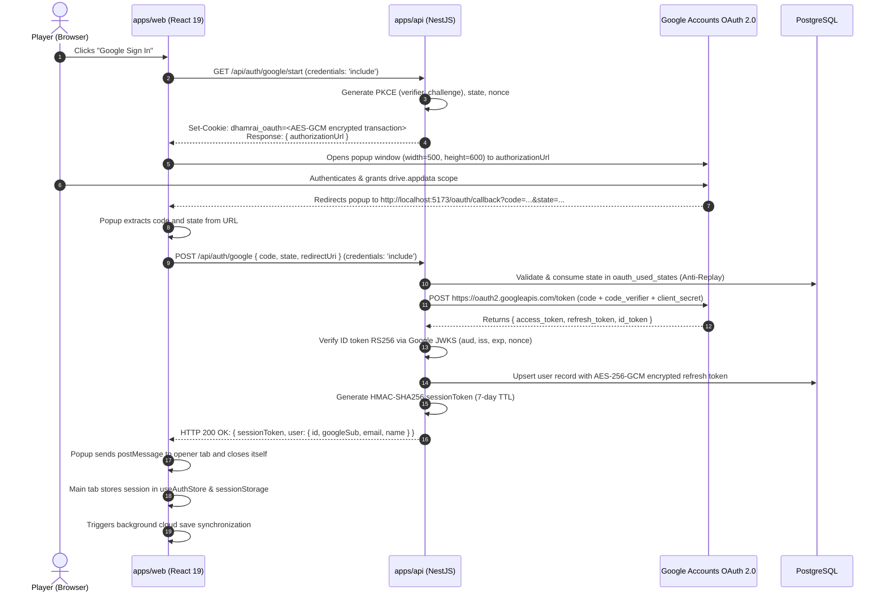
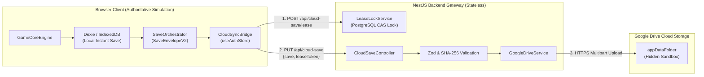
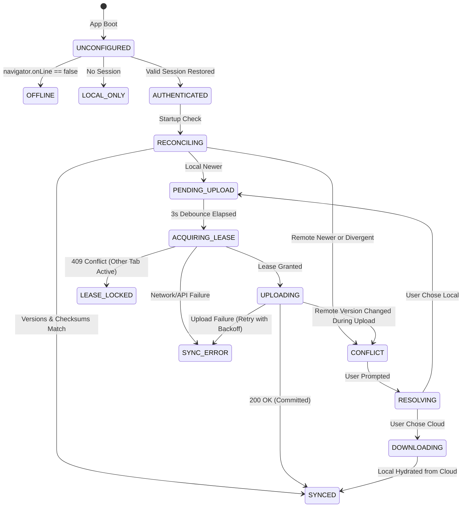
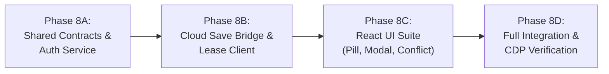

# Milestone 8 Planning Report: Google OAuth Authentication UI & Google Drive Cloud-Save Synchronization

**Project:** Dhamrai Life (ধামরাই পৌরসভা জীবনযাত্রা — 3D Open World)  
**Document Type:** Milestone 8 Specification & Implementation Plan  
**Target Milestone:** Milestone 8 (Auth UI & Cloud Save Synchronization)  
**Prerequisites:** Milestone 6 (Approved), Milestone 7 (Approved)  
**Author:** Antigravity (Assistant)  
**Date:** November 3, 2026  
**Status:** **PLANNING ONLY (No implementation changes committed)**  

---

## 1. Current Repository State

The Dhamrai Life repository is a monorepo managed with **Yarn Classic 1.22.22**, organized with a strict browser-first architecture:

1. **`apps/web` (Browser Gameplay Authority):**
   - **Framework & Rendering:** React 19, Vite 7.3.7, Three.js 0.170.0 (WebGL 2), `@dimforge/rapier3d-compat` 0.21.0 (Rapier 3D WASM), Zustand 5.0.0.
   - **Simulation Runtime:** 60 Hz fixed-timestep loop (`GameEngine.ts`), kinematic character controller (`CharacterController.ts`), 3-wheel raycast cycle rickshaw (`RickshawVehicle.ts`), occlusion-aware camera director (`CameraDirector.ts`), distance-based 3×3 chunk streamer (`ChunkStreamer.ts`), first-generation NPC manager (`NPCManager.ts`), and lightweight autonomous road traffic AI (`TrafficManager.ts`).
   - **UI Suite:** South Asian authentic HUD (`HUD.tsx`), 2D Canvas road graph Minimap radar (`Minimap.tsx`), bilingual Bengali/English dialogue system (`DialogueBox.tsx`), Quest Journal (`JournalModal.tsx`), 20-slot Inventory grid (`InventoryModal.tsx`), and diagnostic overlay (`PerformanceOverlay.tsx`).
   - **Persistence Bridge:** `useGameStore.ts` bridging `GameCoreEngine` and `SaveOrchestrator` to browser `IndexedDB` (`IndexedDBStorageAdapter`) with in-memory fallback.
2. **`apps/api` (Lightweight NestJS Gateway):**
   - **Architecture:** Stateless, lightweight NestJS gateway. Zero 3D rendering, zero physics, zero NPC simulation.
   - **Authentication:** Google OAuth 2.0 PKCE initiation (`/api/auth/google/start`), token exchange (`/api/auth/google`), RS256 JWKS ID token verification, and 7-day HMAC-SHA256 session bearer tokens (`SessionService`).
   - **Data Security:** AES-256-GCM authenticated encryption for OAuth refresh tokens at rest (`AesGcmService`).
   - **Cloud Storage Gateway:** Mediation of Google Drive `appDataFolder` hidden storage via HTTPS REST API (`GoogleDriveService`) and test fixture (`MockGoogleDriveClient`).
   - **Concurrency Control:** Distributed PostgreSQL optimistic save leases (`LeaseLockService`) with atomic version fencing and committed pointer management.
3. **`packages/game-core` (Pure Domain Engine):**
   - `GameCoreEngine`: Aggregate root coordinating missions (`mission_1_first_fare`, `mission_2_police_checkpoint`, `mission_3_artisan_order`), integer Poisha economy ledger (1 BDT = 100 Poisha), inventory domain, and role archetypes (`RickshawDriverArchetype`).
4. **`packages/save-core` (Persistence & Integrity Engine):**
   - `SaveEnvelopeV2`: Canonical Zod schema requiring BDT currency, integer minor units, and SHA-256 integrity checksums.
   - `SaveOrchestrator`: Coordinates schema validation, migration snapshots, checksum generation, slot management, and export/import.
5. **`packages/shared-contracts` (Cross-Package DTOs & Constants):**
   - Canonical spatial anchors (`PHASE_1_ANCHORS`), dialogue definitions, NPC entity schemas, traffic agent DTOs, and save envelope interfaces.
6. **`data/world/` (Geospatial Pipeline):**
   - `directed_nav_graph.json` (453 nodes, 934 edges), `mission_routes.json`, and 16 chunk GLB files.

---

## 2. Milestone 4 Backend Capabilities (Verified Audit)

A comprehensive code-level audit of `apps/api` was performed to confirm the exact capabilities established in Milestone 4:

| Backend Component | Source File | Actual Implementation Verification |
|---|---|---|
| **OAuth Initiation** | `src/auth/auth.controller.ts:48-54`<br>`src/auth/google-auth.service.ts:46-59` | Generates PKCE `code_verifier`, `code_challenge` (S256), `state`, and `nonce`. Seals transaction in an AES-256-GCM encrypted HttpOnly cookie `dhamrai_oauth` (`maxAge: 600_000ms`, `sameSite: 'lax'`, `path: '/api/auth'`). Returns `{ authorizationUrl }`. |
| **OAuth Exchange** | `src/auth/auth.controller.ts:56-153`<br>`src/auth/google-auth.service.ts:126-144` | Accepts `code` or `idToken` with `state` and encrypted cookie. Consumes state atomically in PostgreSQL `oauth_used_states` table to prevent replays. Exchanges code for Google access token and refresh token via HTTPS POST. |
| **ID Token Verification** | `src/auth/google-auth.service.ts:85-124` | Validates RS256 signature against Google HTTPS JWKS endpoint (`https://www.googleapis.com/oauth2/v3/certs`). Validates audience (`aud === GOOGLE_CLIENT_ID`), issuer (`accounts.google.com`), expiry, and `nonce`. |
| **Refresh Token Crypto** | `src/crypto/aes-gcm.service.ts:1-92` | Encrypts Google refresh token with AES-256-GCM using 32-byte production key. Stores `ciphertextHex`, `ivHex` (12 bytes), and `tagHex` (16 bytes) in PostgreSQL. |
| **Session Issuance** | `src/auth/session.service.ts:30-41` | Signs session bearer token: `payloadBase64.signature` using HMAC-SHA256 with 7-day TTL (`userId`, `googleSub`, `email`, `exp`). |
| **Session Verification** | `src/auth/session.service.ts:46-80`<br>`src/auth/auth.guard.ts:15-35` | Validates signature using `crypto.timingSafeEqual` in constant time. Checks token expiration and extracts `SessionPayload`. `AuthGuard` extracts token from `Authorization: Bearer <token>` header. |
| **Lease Lock Acquisition** | `src/cloud-save/lease-lock.service.ts:36-84`<br>`src/cloud-save/cloud-save.controller.ts:117-140` | `POST /api/cloud-save/lease`: Atomic compare-and-swap (CAS) acquisition in PostgreSQL `save_leases` table. Checks `expected_version` against `known_version`. Enforces configurable TTL ($1\text{--}120\text{s}$, default $30\text{s}$). Rejects concurrent or stale holders with HTTP 409 Conflict. |
| **Cloud Save Upload** | `src/cloud-save/cloud-save.controller.ts:146-217` | `PUT /api/cloud-save`: Validates `SaveEnvelopeV2` schema with Zod, validates SHA-256 checksum integrity, verifies held lease token, uploads staged file to Google Drive `appDataFolder`, and atomically updates committed file pointer and `known_version` in PostgreSQL. |
| **Cloud Save Download** | `src/cloud-save/cloud-save.controller.ts:70-112` | `GET /api/cloud-save`: Resolves user's committed file from `save_leases`, fetches content from Google Drive `appDataFolder` using refreshed access token, validates `SaveEnvelopeV2` and SHA-256 checksum, and returns `{ found, fileName, save, version, checksumSha256 }`. |
| **Drive Client Isolation** | `src/cloud-save/google-drive.service.ts:1-148`<br>`src/cloud-save/mock-google-drive.client.ts:1-68` | Zero direct client Drive access. Drive credentials remain strictly on backend. Development/test uses `MockGoogleDriveClient`; production requires `USE_REAL_GOOGLE_DRIVE=true`. |

---

## 3. Milestone 7 Frontend Capabilities (Verified Audit)

A complete audit of `apps/web` confirms the current client-side state and persistence baseline:

1. **State Stores (`Zustand 5`):**
   - `useSessionStore.ts`: Coordinates player spatial coordinates, vehicle speed, locomotion mode (`ON FOOT` / `RICKSHAW`), active chunks, camera mode, and performance metrics.
   - `useGameStore.ts`: Wraps `GameCoreEngine` and `SaveOrchestrator`. Exposes reactive getters for BDT cash balance (`৳250.00` $\to$ `৳280.00`), transport reputation, active missions, and recent ledger feed.
   - `useUIStore.ts`: Central modal state machine controlling `isDialogueOpen`, `isJournalOpen`, `isInventoryOpen`, and `isDebugOverlayVisible`. Contains unused stub `isSaveManagerOpen`.
2. **Local Persistence (`SaveOrchestrator` + Dexie):**
   - Automatically initializes `IndexedDBStorageAdapter('DhamraiLifeSaveDB')` in browser.
   - Canonical slot `Autosave` is written on mission completions and game lifecycle triggers.
   - Pre-migration snapshots and V1 $\to$ V2 migrations fully supported.
3. **UI Components & HUD:**
   - `HUD.tsx`: South Asian player status bar, active mission card, contextual action prompt (`[E]`, `[F]`, `[J]`, `[I]`, `[F3]`).
   - `Minimap.tsx`: 2D Canvas radar rendering road edges and mission markers.
   - `JournalModal.tsx` & `InventoryModal.tsx`: Styled modal overlays with dark slate palette, high-contrast borders, and keyboard dismiss (`Escape`, `J`, `I`).

---

## 4. Milestone 8 Objective

> **"Implement a secure, seamless, and resilient Google OAuth authentication and Google Drive cloud-save synchronization layer for Dhamrai Life—integrating the browser runtime with the existing NestJS API and Google Drive `appDataFolder` without modifying the browser-authoritative simulation architecture, without introducing new backend infrastructure, and without bumping `SaveEnvelopeV2`."**

---

## 5. Authentication Architecture

### 5.1 OAuth Flow Specification: Popup with Fallback
The client will implement a **Popup Window OAuth Flow** with a full-page redirect fallback:



### 5.2 Public vs Private OAuth Values
To guarantee zero credential leakage:
- **Strictly Server-Side (Never in Client):**
  - `GOOGLE_CLIENT_SECRET`: Managed exclusively in `apps/api/.env`.
  - `TOKEN_ENCRYPTION_KEY_HEX`: Server-side key for AES-256-GCM encryption of refresh tokens.
  - `SESSION_SECRET`: Server-side key for HMAC-SHA256 session token signatures.
  - Google Refresh Tokens & Access Tokens: Held only in server memory / encrypted database.
- **Client-Side (Public):**
  - `GOOGLE_CLIENT_ID`: Public OAuth identifier (e.g., `xxx.apps.googleusercontent.com`).
  - `GOOGLE_REDIRECT_URI`: Public URI (`http://localhost:5173/oauth/callback`).

### 5.3 Cross-Tab PostMessage Security
When the popup redirects back to `/oauth/callback`:
```typescript
// Popup callback script
const params = new URLSearchParams(window.location.search);
const code = params.get('code');
const state = params.get('state');

if (window.opener && !window.opener.closed) {
  // Strict origin validation to prevent exfiltration
  window.opener.postMessage(
    { type: 'DHAMRAI_OAUTH_CODE', code, state },
    window.location.origin
  );
  window.close();
}
```

---

## 6. Session Architecture

### 6.1 Storage Strategy Analysis

| Storage Mechanism | XSS Vulnerability | CSRF Vulnerability | Survives Reload | Multi-Tab Sync | Recommendation |
|---|---|---|---|---|---|
| **HttpOnly Cookie** | Immune to JS theft | Vulnerable unless SameSite=Strict/CSRF header | Yes | Yes | Ideal for server auth, but existing `AuthGuard` expects `Authorization: Bearer <token>`. |
| **`sessionStorage`** | Protected from cross-tab XSS leakage | Immune to CSRF | Yes (within tab) | Isolated per tab | **Recommended Primary Storage** |
| **`localStorage`** | Vulnerable to XSS token exfiltration | Immune to CSRF | Yes (persistent) | Shared across tabs | Insecure for long-lived tokens without hardware binding. |
| **In-Memory (Zustand)** | Immune to persistent storage theft | Immune to CSRF | No (lost on F5) | Requires broadcast | **Recommended Runtime Cache** |

### 6.2 Chosen Hybrid Session Model
1. **Runtime Cache:** `useAuthStore` (Zustand) holds active `sessionToken` and `user` profile in memory.
2. **Reload Persistence:** On successful login, the session is written to `sessionStorage` (`dhamrai_session`).
3. **Session Restoration on Startup:**
   - App checks `sessionStorage.getItem('dhamrai_session')`.
   - Parses payload and checks `payload.exp > Date.now() / 1000`.
   - Dispatches a lightweight verification request to `GET /api/cloud-save` (or `/api/auth/me`).
   - If HTTP 401: Clears `sessionStorage`, resets to unauthenticated local-only state.
   - If HTTP 200: Hydrates `useAuthStore` and initiates cloud synchronization.
4. **Logout Semantics:**
   - User clicks "Sign Out".
   - Clears `sessionStorage.removeItem('dhamrai_session')`.
   - Resets `useAuthStore` to `{ isAuthenticated: false, user: null, sessionToken: null }`.
   - Releases any active cloud leases (`POST /api/cloud-save/lease` release or backend lease expiry).
   - Local save in Dexie remains 100% intact.

---

## 7. Google Account UI & UX Specification

The UI will be designed following the authentic South Asian aesthetic established in Milestone 7:

```
+-----------------------------------------------------------------------------------------------+
|  ৳280.00 | ★ 15 সুনাম  [হেঁটে চলছেন]                 [☁️ সিঙ্ক সম্পন্ন (Synced) | ফারহানা 👤]   |
+-----------------------------------------------------------------------------------------------+
```

### 7.1 HUD Account Pill (`HUD.tsx`)
Positioned in the Top-Right navigation bar (adjacent to the Mission Tracker):
- **Unauthenticated State:**
  ```tsx
  <button onClick={openAuthModal} className="hud-auth-btn">
    <GoogleIcon /> সাইন ইন (Sign In)
  </button>
  ```
- **Syncing State:**
  ```tsx
  <div className="hud-sync-badge syncing">
    <SpinnerIcon className="spin" /> সিঙ্ক হচ্ছে... (Syncing)
  </div>
  ```
- **Synced State:**
  ```tsx
  <button onClick={openSaveManagerModal} className="hud-auth-pill synced">
    <span className="dot green" /> ☁️ সিঙ্ক সম্পন্ন | {user.name?.split(' ')[0]}
  </button>
  ```
- **Conflict / Error State:**
  ```tsx
  <button onClick={openConflictModal} className="hud-auth-pill error">
    <span className="dot amber" /> ⚠️ অসঙ্গতি (Conflict)
  </button>
  ```

### 7.2 Cloud Save & Account Modal (`SaveManagerModal.tsx`)
A dedicated modal (toggled by clicking the Account Pill or from the Game Menu):
1. **Account Identity Card:** User avatar, full name, email, Google Subject ID, and "Sign Out" button.
2. **Cloud Save Status Card:**
   - Cloud save slot name (`Autosave`).
   - Remote version hash (`save_usr_..._v1`).
   - Last synced time (`যেমন: ৩ মিনিট আগে / 3 minutes ago`).
   - SHA-256 payload checksum snippet (`a3b8...4e21`).
   - **[🔄 এখনই সিঙ্ক করুন (Sync Now)]** button.
3. **Local Save Backup Status:**
   - Dexie local save timestamp.
   - Minor units balance (`৳280.00 BDT`).
   - Reputation and completed missions count.
   - Export Save JSON (`exportSaveJson`) and Import Save JSON (`importSaveJson`).

---

## 8. Cloud Save Architecture & Google Drive Integration



### 8.1 Google Drive File Storage Invariants
1. **Isolated Hidden Sandbox:** Saves are stored in Google Drive's hidden `appDataFolder` (`drive.appdata` scope). They are invisible in the user's regular Google Drive UI, preventing accidental player deletion or external modification.
2. **Staged Immutable Files:** The backend generates unique immutable staged filenames:
   ```text
   save_${userId}_${sha256(slotName).slice(0, 16)}_${versionUUID}.json
   ```
3. **Atomic Pointer Publication:** Once the file is successfully uploaded to Drive, the backend atomically publishes the new `committed_file_name` and `known_version` in PostgreSQL. Stale or superseded uploads cannot overwrite the committed pointer.

---

## 9. Synchronization Strategy

### 9.1 Local-First Asynchronous Model
- **Immediate Local Save:** All gameplay actions (mission completion, cash transactions, manual save) save immediately to Dexie in $<5\text{ ms}$. Gameplay NEVER halts or waits for HTTP responses.
- **Debounced Cloud Sync:** Cloud synchronization is triggered asynchronously with a **3-second debounce window**. Multiple rapid local writes coalesce into a single cloud save.
- **Sync Trigger Events:**
  1. **On Login:** Startup reconciliation compares local and remote saves.
  2. **On Mission Completion:** Debounced 3s sync after reward distribution.
  3. **On Manual "Sync Now":** Immediate forced sync.
  4. **On Page Close / Navigation (`beforeunload`):** Triggers `navigator.sendBeacon` or final sync attempt.

### 9.2 Complete Synchronization Lifecycle Machine



---

## 10. Conflict Handling Policy

### 10.1 Deterministic Conflict Rules

| Scenario | Condition | Resolution Action |
|---|---|---|
| **Clean Fast-Forward (Local Newer)** | `local.updatedAtIso > remote.updatedAtIso` AND `expectedVersion == remote.known_version` | **Auto-Upload:** Acquire lease, upload local save, update version pointer. |
| **Identical Content** | `local.checksumSha256 == remote.checksumSha256` | **No-Op:** Mark as `SYNCED`; update `lastKnownRemoteVersion` without network write. |
| **Clean Fast-Forward (Cloud Newer)** | `remote.updatedAtIso > local.updatedAtIso` AND local save has no subsequent un-synced ledger items | **Prompt / Auto-Download:** Hydrate local Dexie database from remote cloud save. |
| **True Divergent Conflict** | `remote.updatedAtIso > local.updatedAtIso` AND local save has un-synced ledger transactions OR version mismatch (409) | **Interactive Conflict Modal:** Never silently overwrite. Require player decision. |
| **Concurrent Lease Lock (Other Tab)** | `POST /api/cloud-save/lease` returns 409 Conflict (active lease held) | **Standby Mode:** Display `[☁️ অন্য ট্যাবে সিঙ্ক সক্রিয় (Sync active in other tab)]`. Defer upload until lease is released. |

### 10.2 Conflict Resolution Modal UX (`ConflictResolutionModal.tsx`)
When a true divergent conflict is detected, the game pauses non-critically and presents:
- **Comparison Table:**
  - **Local Save (This Device):** Save Date, Cash (`৳280.00`), Reputation (`15`), Current Objective.
  - **Cloud Save (Google Drive):** Sync Date, Cash (`৳310.00`), Reputation (`20`), Current Objective.
- **Player Actions:**
  1. **[☁️ ক্লাউড সেভ গ্রহণ করুন (Use Cloud Save)]** — Replaces local Dexie save with cloud save and re-hydrates domain engine.
  2. **[💾 বর্তমান সেভ ক্লাউডে রাখুন (Keep Local Save)]** — Overwrites cloud save with local save (forcing lease with latest remote version).
  3. **[📂 দুটিই সংরক্ষণ করুন (Keep Both)]** — Saves local save to a named slot `Autosave_LocalBackup` and loads cloud save to `Autosave`.

---

## 11. Save Integrity & Checksum Verification

Milestone 3 established canonical SHA-256 save checksums via `@dhamrai/save-core`. Milestone 8 preserves this exact pipeline:
1. **Pre-Upload Verification:**
   - Before `PUT /api/cloud-save`, the client runs `verifySaveIntegrity(localEnvelope)`.
   - If corrupted locally: upload is blocked with error `LocalSaveCorruptionDetected`.
2. **Server-Side Verification:**
   - `CloudSaveController` executes `await verifySaveIntegrity(validatedSave)`.
   - Rejects tampered payloads with HTTP 400 Bad Request.
3. **Post-Download Verification:**
   - Upon `GET /api/cloud-save`, the client recalculates SHA-256 over canonical deterministic JSON keys using `crypto.subtle.digest('SHA-256', ...)`.
   - If calculated hash $\ne$ `envelope.checksumSha256`: download is rejected and flagged as corrupted. The local save is left completely untouched.

---

## 12. Offline-First Behavior

Dhamrai Life is browser-first and must remain playable when disconnected:

1. **Cold Boot While Offline:**
   - Player opens game without internet connection (`navigator.onLine === false`).
   - App boots seamlessly using Dexie local IndexedDB save.
   - HUD displays status `[⚡ অফলাইন (Offline)]`.
   - Zero login popups, zero network crashes, zero blocking spinners.
2. **Network Drops Mid-Session:**
   - If a background cloud save attempt encounters `TypeError: Failed to fetch` or network timeout:
     - Local save remains safely written in Dexie.
     - Cloud status transitions to `SYNC_ERROR`.
     - App schedules retry with exponential backoff + jitter ($5\text{s}, 10\text{s}, 20\text{s}, 40\text{s}$, max $60\text{s}$).
3. **Network Restored:**
   - `window.addEventListener('online')` detects reconnection.
   - Automatically re-verifies session and resumes cloud synchronization.

---

## 13. Multi-Tab Behavior

To prevent multi-tab race conditions:
1. **PostgreSQL Distributed Lease Lock:** The backend enforces single-writer exclusivity via `LeaseLockService`. Tab A holds the 30s lease; Tab B's attempt to acquire receives HTTP 409 Conflict.
2. **BroadcastChannel Synchronization (`BroadcastChannel('dhamrai_sync')`):**
   - When Tab A successfully commits a cloud save, it broadcasts `{ type: 'CLOUD_SAVE_COMMITTED', version, slotName }`.
   - Tab B receives the event, updates its `lastKnownRemoteVersion`, and avoids false conflict prompts.
3. **Storage Events:** Window `storage` event listeners detect `sessionStorage` changes across duplicate windows.

---

## 14. Security Model & Threat Matrix

| Threat | Risk Level | Mitigation Architecture |
|---|---|---|
| **XSS Token Theft** | High | `sessionToken` stored in `sessionStorage` (cleared on tab close) + memory. Refresh tokens held only in backend encrypted with AES-256-GCM. |
| **OAuth CSRF / State Injection** | High | AES-256-GCM encrypted `dhamrai_oauth` cookie binds `state` and `nonce`. State is single-use consumed in PostgreSQL `oauth_used_states`. |
| **PKCE Downgrade / Interception** | High | S256 code challenge required. Code verifier never leaves backend cookie until code exchange. |
| **Replay Attacks** | Medium | Single-use consumption of authorization codes and OAuth states. HMAC session tokens enforce short 7-day TTL with server verification. |
| **Stale Cloud Save Overwrite** | High | Optimistic lease locking (`save_leases` table) with CAS version fencing prevents mid-air collisions. |
| **Cross-User Data Access** | Critical | All database queries and Drive requests scoped strictly to `req.user.userId`. User A cannot read or write User B's files. |
| **Malicious Save Payload Tampering** | Medium | Strict Zod validation against `SaveEnvelopeV2` on both client and server + SHA-256 cryptographic checksum verification. |
| **Google Credential Exposure** | Critical | Client bundle contains zero Google client secrets. Zero Drive API keys on frontend. |

---

## 15. User-Facing Error UX

All error messages will be displayed in authentic Bengali (with English subtitles) using non-intrusive HUD toasts and clean modal dialogs:

| Error Condition | Technical Cause | User-Facing Banner / Modal Message |
|---|---|---|
| **OAuth Popup Blocked** | Browser blocked window.open | *"পপ-আপ উইন্ডোটি ব্লক করা হয়েছে। অনুগ্রহ করে ব্রাউজার সেটিংসে পপ-আপ অনুমোদন করুন।"*<br>*(Popup blocked. Please allow popups to sign in with Google.)* |
| **OAuth Access Denied** | User clicked "Cancel" on Google screen | *"গুগল সাইন-ইন বাতিল করা হয়েছে।"*<br>*(Google Sign-In was cancelled.)* |
| **Session Expired** | 7-day HMAC session token expired | *"আপনার সেশনের মেয়াদ শেষ হয়েছে। ক্লাউড সিঙ্ক করতে পুনরায় সাইন ইন করুন।"*<br>*(Session expired. Please sign in again to enable cloud sync.)* |
| **Network Timeout** | API unreachable / offline | *"সার্ভারের সাথে সংযোগ স্থাপন করা যায়নি। খেলাটি লোকাল সেভ হিসেবে অব্যাহত রয়েছে।"*<br>*(Cannot reach server. Game continues safely with local save.)* |
| **Save Conflict** | Two devices or tabs diverged | *"সেভ ফাইল অসঙ্গতি সনাক্ত হয়েছে! অনুগ্রহ করে কোন সেভটি রাখবেন নির্বাচন করুন।"*<br>*(Save conflict detected! Please choose which save to keep.)* |
| **Drive Corrupted File** | Remote JSON invalid / failed SHA-256 | *"ক্লাউড সেভ ফাইলটি ক্ষতিগ্রস্ত। লোকাল সেভ অক্ষত রাখা হয়েছে।"*<br>*(Cloud save corrupted. Local save preserved safely.)* |

---

## 16. Performance Strategy & Runtime Budgets

Milestone 8 must maintain the strict **60 FPS** runtime budget established in Milestone 6 & 7:

1. **Non-Blocking Serialization:**
   - Save serialization and SHA-256 checksum hashing occur off the rendering tick.
   - Hashing is performed using native `crypto.subtle.digest` asynchronously.
2. **Debounce Interval:** Minimum **3,000 ms** between cloud upload requests.
3. **Payload Budget:**
   - Save payload size: Typical `SaveEnvelopeV2` is **12 KB – 25 KB** ($<0.05\%$ of typical web assets).
   - Network transfer time: $<150\text{ ms}$ over 4G/WiFi.
4. **Memory Allocation:** Zero per-frame allocations in `GameEngine.loop()`.

---

## 17. Data Contracts (`packages/shared-contracts`)

To guarantee end-to-end type safety between `apps/api` and `apps/web`, the following contracts will be added to `packages/shared-contracts/src/index.ts`:

```typescript
// Authentication DTOs
export interface GoogleAuthDto {
  code?: string;
  idToken?: string;
  redirectUri?: string;
  state?: string;
}

export interface AuthUserIdentity {
  id: string;
  googleSub: string;
  email: string;
  name?: string;
  picture?: string;
}

export interface AuthResponseDto {
  sessionToken: string;
  user: AuthUserIdentity;
}

// Cloud Save Sync Contracts
export type CloudSyncStatus =
  | 'UNCONFIGURED'
  | 'LOCAL_ONLY'
  | 'OFFLINE'
  | 'SYNCED'
  | 'PENDING_UPLOAD'
  | 'SYNCING'
  | 'LOCKED_BY_OTHER_TAB'
  | 'CONFLICT'
  | 'SYNC_ERROR';

export interface CloudSaveMetadata {
  found: boolean;
  fileName: string;
  slotName: string;
  version: string | null;
  checksumSha256: string | null;
  updatedAtIso: string | null;
  sizeBytes?: number;
}

export interface SaveLeaseDto {
  slotName: string;
  leaseToken: string;
  acquiredAtMs: number;
  expiresAtMs: number;
}

export interface CloudSaveSyncResult {
  success: boolean;
  fileId?: string;
  fileName?: string;
  version: string;
  checksumSha256: string;
  modifiedTime: string;
}
```

---

## 18. Save Schema Impact

> [!IMPORTANT]
> **No save schema bump to V3 is required for Milestone 8.**

### Justification
`SaveEnvelopeV2` already contains all necessary fields for cloud synchronization:
- `saveId`: Playthrough identifier.
- `slotName`: Target slot (`Autosave`, `Slot_1`).
- `updatedAtIso`: ISO timestamp for deterministic order resolution.
- `checksumSha256`: 64-char SHA-256 hash for integrity validation.
- All domain data (cash in Poisha, reputation, missions, items) is self-contained.
Cloud-specific metadata (lease tokens, remote version UUIDs, Google Drive file IDs) belongs in the transport layer and PostgreSQL `save_leases` table, NOT inside the game save payload.

---

## 19. Backend Changes Required

The Milestone 4 backend foundation is virtually complete. Only **two minimal, non-breaking enhancements** are recommended:

1. **`GET /api/auth/me` Endpoint (`apps/api/src/auth/auth.controller.ts`):**
   - Lightweight session verification endpoint protected by `AuthGuard`.
   - Returns `{ user: req.user }`.
   - Allows client to verify session validity on reload without initiating a full cloud-save fetch.
2. **CORS Development Origin Flexibility (`apps/api/src/main.ts`):**
   - Allow dynamic origin matching for `localhost:5173` through `localhost:5179` to support development environments when port 5173 is occupied.

---

## 20. Frontend Changes Required (`apps/web`)

1. **`apps/web/src/state/useAuthStore.ts` (New):**
   - Manages authentication state (`isAuthenticated`, `user`, `sessionToken`, `login`, `logout`).
   - Manages cloud sync state (`syncStatus`, `lastSyncedAtIso`, `cloudMetadata`).
2. **`apps/web/src/services/AuthService.ts` (New):**
   - Handles `beginGoogle()`, popup management, `exchangeCode()`, and session restoration.
3. **`apps/web/src/services/CloudSaveService.ts` (New):**
   - Coordinates `acquireLease()`, `uploadCloudSave()`, `downloadCloudSave()`, and debounced synchronization.
4. **`apps/web/src/components/HUD.tsx` (Update):**
   - Mounts the Account & Cloud Sync Pill in the top bar.
5. **`apps/web/src/components/SaveManagerModal.tsx` (New):**
   - Account inspection, manual sync button, slot backup management.
6. **`apps/web/src/components/ConflictResolutionModal.tsx` (New):**
   - Side-by-side comparison and choice dialog for divergent save conflicts.
7. **`apps/web/src/pages/OAuthCallback.tsx` (New):**
   - Minimal popup receiver extracting code/state and posting message to opener.

---

## 21. Complete Testing Strategy

### 21.1 Frontend Unit Tests (Vitest)
- `apps/web/test/auth-store.test.ts`: Login, logout, session restoration, and token expiration handling.
- `apps/web/test/cloud-sync-statemachine.test.ts`: Transition states (`LOCAL_ONLY` $\to$ `SYNCING` $\to$ `SYNCED` $\to$ `CONFLICT`).
- `apps/web/test/conflict-resolution.test.ts`: Deterministic evaluation of local vs remote saves, checksum matching, and resolution choices.
- `apps/web/test/offline-fallback.test.ts`: Disconnected boot and retry queue handling.

### 21.2 Integration Tests (Vitest + Real PostgreSQL)
- `apps/api/test/auth-flow.integration.test.ts`: Full flow from `beginOAuth` to code exchange, state consumption, and session issuance.
- `apps/api/test/cloud-save-sync.integration.test.ts`: Lease acquisition, Zod validation, mock Drive upload, version commitment, and download verification.
- `apps/api/test/concurrent-leases.integration.test.ts`: Multi-tab contention testing with real PostgreSQL lease locks.

### 21.3 Browser CDP Automated Verification
- Executed via Chrome DevTools Protocol (CDP) WebSocket:
  1. Boot game in unauthenticated state; verify `[Sign In]` pill is visible.
  2. Mock/trigger OAuth completion; verify transition to `[☁️ Synced]` state.
  3. Complete Mission 1; verify debounced cloud save executes and updates status.
  4. Disconnect network (`Network.emulateNetworkConditions({ offline: true })`); verify gameplay continues with offline badge.
  5. Reconnect network; verify automatic sync recovery.
  6. Trigger conflict state; verify conflict modal renders side-by-side comparison correctly.

---

## 22. Acceptance Criteria (Measurable & Binding)

| ID | Requirement | Verification Method | Pass Condition |
|---|---|---|---|
| **AC-M8-01** | Offline Boot | Vitest + Browser CDP | Game boots with Dexie save when offline; zero blocking popups; HUD displays offline badge. |
| **AC-M8-02** | Zero Credential Leakage | Static Code Audit | Client bundle contains zero occurrences of `GOOGLE_CLIENT_SECRET` or `TOKEN_ENCRYPTION_KEY_HEX`. |
| **AC-M8-03** | OAuth PKCE Exchange | Integration Test | Code exchange requires matching `dhamrai_oauth` cookie and unconsumed state in PostgreSQL. |
| **AC-M8-04** | Session Integrity | Unit + Integration | Session tokens signed with HMAC-SHA256; forged or expired tokens rejected with HTTP 401. |
| **AC-M8-05** | Session Reload Resilience | Browser CDP | Page reload restores authenticated session from `sessionStorage` without re-prompting login. |
| **AC-M8-06** | Non-Blocking Cloud Sync | Performance Profiling | Cloud upload occurs asynchronously; frame rate maintains $\ge 30\text{ FPS}$ (target 60 FPS). |
| **AC-M8-07** | Distributed Lease Locking | Real PostgreSQL Integration | Concurrent save attempt while lease is held returns HTTP 409 Conflict. |
| **AC-M8-08** | No Silent Overwrite | Vitest Unit Test | Remote save newer by timestamp or divergent version triggers conflict modal; no automatic overwrite. |
| **AC-M8-09** | SHA-256 Checksum Verification | Unit + Integration | Corrupted cloud save is rejected after download; local Dexie save remains untouched. |
| **AC-M8-10** | Clean Logout Semantics | Browser CDP | Logout purges session from storage and resets cloud state to `LOCAL_ONLY`; local gameplay remains playable. |
| **AC-M8-11** | Zero Dependency Bump | Lockfile Inspection | Yarn Classic `1.22.22` frozen lockfile requires zero new npm packages. |
| **AC-M8-12** | SaveEnvelopeV2 Preservation | Schema Audit | Zero schema bump; canonical save schema version remains `2`. |

---

## 23. Implementation Phases



- **Phase 8A: Shared Contracts & Auth Service**
  - Add auth and cloud-save DTOs to `packages/shared-contracts`.
  - Implement `useAuthStore.ts` and `AuthService.ts` in `apps/web`.
  - Add minimal `GET /api/auth/me` to `AuthController`.
  - Unit tests for auth store and session restoration.
- **Phase 8B: Cloud Save Bridge & Lease Client**
  - Implement `CloudSaveService.ts` coordinating debounced upload, download, and lease acquisition.
  - Implement conflict detection logic and checksum validation.
  - Unit tests for sync state machine and conflict resolution.
- **Phase 8C: React UI Layer**
  - Mount Account & Sync Pill in `HUD.tsx`.
  - Build `SaveManagerModal.tsx` (account details, manual sync, export/import).
  - Build `ConflictResolutionModal.tsx` (side-by-side comparison).
  - Build `OAuthCallback.tsx` (popup receiver).
- **Phase 8D: Full Integration & Live Verification**
  - Wire sync triggers to mission completion and manual saves in `useGameStore.ts`.
  - Run full test suite (monorepo 200+ tests).
  - Execute live Chrome CDP browser automation testing with screenshots.

---

## 24. Risks & Mitigations

| Risk | Impact | Mitigation Strategy |
|---|---|---|
| **Popup Blocker Interruption** | User cannot complete OAuth popup | Detect blocked popup via `if (!popup || popup.closed)`; display clean instructions or provide full-page redirect option. |
| **Slow Drive API Response** | Lag if sync is synchronous | Cloud sync is 100% decoupled from game loop using asynchronous debounced worker; gameplay never waits on HTTP. |
| **Stale Tab Overwrites Save** | Data loss across tabs | PostgreSQL distributed lease locks and version fencing guarantee single-writer exclusivity. |
| **Expired Refresh Token** | Drive upload fails with 401 | Backend catches refresh failure; client surfaces "Session Expired — Re-authenticate" toast. Local save remains safe. |

---

## 25. Out of Scope for Milestone 8

The following items are strictly **OUT OF SCOPE** to maintain architectural discipline:
- New gameplay features, vehicles, or physics modifications.
- New NPC dialogue trees or story missions (Missions 2 and 3 remain as defined).
- Server-side simulation, Three.js, or Rapier execution.
- WebSockets, Redis, message queues, or background workers.
- Multiplayer or real-time presence.
- Public Google Drive file sharing or social feed.
- Save schema bump to Version 3 (`SaveEnvelopeV2` is preserved).
- Git commits or pushes without explicit user permission.

---

## 26. Expected Files

### New Files to Create:
- `apps/web/src/services/AuthService.ts`
- `apps/web/src/services/CloudSaveService.ts`
- `apps/web/src/state/useAuthStore.ts`
- `apps/web/src/components/SaveManagerModal.tsx`
- `apps/web/src/components/ConflictResolutionModal.tsx`
- `apps/web/src/pages/OAuthCallback.tsx`
- `apps/web/test/auth-store.test.ts`
- `apps/web/test/cloud-sync.test.ts`
- `apps/web/test/conflict-resolution.test.ts`

### Existing Files to Modify (Minimal):
- `packages/shared-contracts/src/index.ts` (Export auth/sync DTOs)
- `apps/web/src/App.tsx` (Mount Account Pill and Modals)
- `apps/web/src/components/HUD.tsx` (Mount Account Pill)
- `apps/web/src/state/useGameStore.ts` (Hook sync trigger on save completion)
- `apps/api/src/auth/auth.controller.ts` (Add minimal `GET /api/auth/me`)
- `apps/web/vite.config.ts` (Add `/api` development proxy)

---

## 27. Dependency Changes

- **Proposed Dependencies:** **0 (Zero)**.
- **Verification:** Native browser `fetch()`, native `window.postMessage`, native `crypto.subtle`, existing `Zustand 5`, and existing `@dhamrai/save-core` completely satisfy all Milestone 8 requirements.

---

## 28. Final Recommendation

### **STATUS: READY FOR IMPLEMENTATION**

**Justification:**
1. The **Milestone 4 backend foundation** is production-hardened, verified against real PostgreSQL, and features complete Google OAuth PKCE and Google Drive `appDataFolder` endpoints.
2. The **Milestone 7 frontend** is verified and approved, with robust state management and local Dexie persistence already using canonical `SaveEnvelopeV2`.
3. The synchronization model is strictly **local-first and asynchronous**, guaranteeing zero performance impact on the 60 FPS Three.js/Rapier gameplay loop.
4. The plan requires **zero new npm dependencies**, **zero save schema changes**, and **zero backend architectural redesign**.

*Awaiting explicit user authorization to begin Milestone 8 implementation.*
